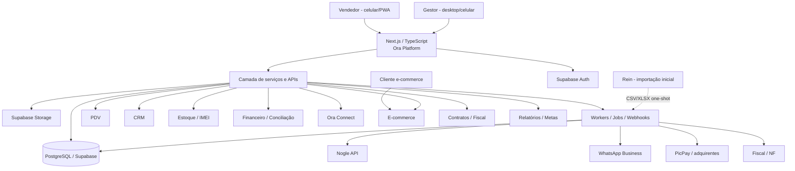
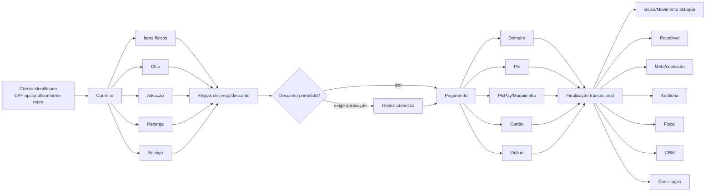

# ORA 5G — DOSSÍE MESTRE UNIFICADO PARA CLAUDE

**Versão: 05/11/2026**. Documento de transferência de contexto. Inclui decisões do usuário, propostas de engenharia, requisitos e, como apêndices, transcrições de pesquisas históricas. Leia `README.md` se estiver usando o pacote ZIP.

**NOTA IMPORTANTE:** Se uma pesquisa antiga conflitar com a decisão recente, prevalece a decisão explícita recente do usuário. Nomes de endpoints, planos, preços, leis e regras fiscais em relatórios históricos exigem checagem atual/autorizada. Não há credenciais privadas nem confirmação de software implementado.


---

# ANEXO / SEÇÃO: Instruções de importação

> Origem no pacote: `README.md`

# ORA 5G — PACOTE DE TRANSFERÊNCIA PARA CLAUDE CODE E CODEX

**Versão documental:** 2026-11-05 — baseline de planejamento, **não** evidência de software implementado.
**Propósito:** permitir que Claude Code/Claude e OpenAI Codex continuem o desenvolvimento com o mesmo contexto, prioridades, limites de segurança e critérios de qualidade discutidos com o proprietário.

## Como importar

### Claude (interface de conversa)
1. Anexe `ORA5G_DOSSIE_MESTRE_UNIFICADO.md` (arquivo único) e, se for útil, `referencias_visuais/ora5g_visao_geral_telas.png`.
2. Cole o texto de `PARA_COLAR_NO_CLAUDE.md` na primeira mensagem.
3. Peça uma leitura crítica e validação do entendimento ANTES de iniciar qualquer código.
4. Os três relatórios detalhados em `originais/research/` podem ser anexados adicionalmente caso Claude precise consultar uma pesquisa específica.

### Claude Code (terminal / projeto Git)
1. Extraia **todo o conteúdo** deste ZIP dentro da raiz do repositório privado Ora 5G ou em uma pasta temporária que será incorporada ao repositório. Se já houver um repositório, **não sobrescreva arquivos existentes sem revisão**; compare primeiro.
2. Garanta que `CLAUDE.md` esteja na raiz do repositório e que `AGENTS.md` esteja disponível ao Codex.
3. Peça ao Claude Code para ler `README.md`, `CLAUDE.md`, `docs/00_CONTEXTO_E_DECISOES.md`, `docs/01_REQUISITOS.md`, `docs/02_ARQUITETURA.md`, `docs/03_DADOS.md`, `docs/07_ROADMAP.md`, `docs/10_DECISOES_PENDENTES.md` e os demais documentos conforme a tarefa.
4. Abra uma branch para documentação/planejamento e faça revisão antes de merge. **Não executar migrations nem tocar no banco de produção na importação.**
5. Cada etapa deve virar issues pequenas, com critérios de aceitação; o backlog inicial está em `backlog.json`.

## Arquivos importantes

| Caminho | Conteúdo |
|---|---|
| `ORA5G_DOSSIE_MESTRE_UNIFICADO.md` | Contexto reunido em um único Markdown para anexar ao Claude |
| `PARA_COLAR_NO_CLAUDE.md` | Prompt pronto para iniciar a conversa |
| `CLAUDE.md` | Regras obrigatórias para Claude Code |
| `AGENTS.md` | Regras compartilhadas para Codex e agentes |
| `docs/00_CONTEXTO_E_DECISOES.md` | Negócio, objetivos, decisões, hierarquia de fontes |
| `docs/01_REQUISITOS.md` | Requisitos rastreáveis por módulo |
| `docs/02_ARQUITETURA.md` | Arquitetura, módulos, eventos, consistência e segurança |
| `docs/03_DADOS.md` | Modelo de dados conceitual e restrições |
| `docs/04_FLUXOS.md` | Jornadas transacionais e exceções |
| `docs/05_PERMISSOES.md` | Perfis, lojas e aprovações |
| `docs/06_INTEGRACOES.md` | APIs, canais e riscos de integração |
| `docs/07_ROADMAP.md` | Etapas, dependências, marcos e prazos indicativos |
| `docs/08_DESIGN_E_TELAS.md` | Mapa de telas, componentes e padrões visuais |
| `docs/09_TESTES_E_ACEITE.md` | Estratégia de qualidade e casos E2E |
| `docs/10_DECISOES_PENDENTES.md` | Perguntas de negócio/técnicas que exigem confirmação |
| `docs/11_OPERACAO_DOS_AGENTES.md` | Claude Code + Codex, branches, PRs, DoD |
| `docs/12_HISTORICO_E_PROVENIENCIA.md` | Trechos verbatim, evolução das decisões e lacunas |
| `backlog.json` | Backlog inicial legível por máquina, não tickets executados |
| `originais/research/*.md` | **Três relatórios completos** da Pesquisa Aprofundada |
| `originais/historico/*.md` | Texto inicial de conversa fornecido anteriormente |
| `referencias_visuais/` | Protótipo HTML, guia de estilo, 10 PNGs e vídeo MP4 |

## Regras de interpretação

**P0 — Decisão explícita do usuário:** deve ser preservada até mudança explícita.
**P1 — Proposta técnica recomendada:** adequada como base, mas depende de ADR e validação humana.
**P2 — Hipótese/integração não verificada:** NÃO codificar como se fosse contrato confirmado.
**P3 — Proposta antiga superada:** guardar como histórico, NÃO seguir por padrão.

**Exemplos importantes:**
- Rein = **apenas importação inicial por arquivos** de produtos/preços; não projetar API Rein em operações diárias (P0).
- 14 lojas existentes, validar uma loja piloto antes de expandir (P0).
- UX vendedor mobile-first; algumas lojas não têm notebook nem scanner (P0).
- PicPay POS é usado; **não** pressupor API específica do terminal (P0 sobre uso, P2 sobre API).
- Nogle documentação: `https://docs.nogle.tech/`; credenciais privadas NÃO estão neste pacote; endpoints exigem validação (P0 sobre intenção, P2 sobre contratos).
- WordPress/WooCommerce, GHL, Bling etc. apareceram nas **primeiras sugestões exploratórias**, posteriormente superadas como arquitetura central pela intenção de plataforma própria. Podem servir de benchmark, não dependências obrigatórias (P3).
- Evitar reescritas destrutivas, mas **não prometer zero migrations**: banco evolui com migrations versionadas (P1 corrigida).
- Dados ilustrativos do protótipo **não são dados reais**.

## Limites deste pacote

Este pacote consolida o contexto atual disponível, o texto de conversa inicial e os três relatórios de pesquisa localizados na Biblioteca. **Não há confirmação de que um repositório executável já exista, nem de que endpoints Nogle/PicPay/marketplaces tenham sido homologados, nem de que requisitos fiscais estejam validados por contador.** Falhas, dados faltantes e decisões pendentes são explicitados, em vez de inventados.

**Próxima ação:** Claude Code deve realizar a *Etapa 0: descoberta/validação dos requisitos e do ambiente existente*, produzir um relatório de divergências e abrir o backlog antes de criar schemas/migrations ou funcionalidades operacionais.


---

# ANEXO / SEÇÃO: Regras do Claude Code

> Origem no pacote: `CLAUDE.md`

# CLAUDE CODE — INSTRUÇÕES PERMANENTES DO PROJETO ORA 5G

Você é o engenheiro de software principal do projeto **Ora 5G Platform**. Trabalha junto com **OpenAI Codex**, que revisa e implementa escopos isolados. O proprietário possui 14 lojas físicas; o produto será testado em uma loja antes de expandir. O sistema deverá atender vendedores que usam **celular** e não têm notebook ou leitor de código em todas as lojas.

## Primeira tarefa antes de escrever código
1. Leia integralmente `README.md`, `docs/00_CONTEXTO_E_DECISOES.md` e `docs/10_DECISOES_PENDENTES.md`.
2. Leia os demais `docs/` relacionados ao módulo solicitado. Consulte os três `originais/research/*.md` quando precisar de detalhes e referências. `referencias_visuais/` contém **conceitos**, não código pronto ou valores de produção.
3. Verifique o estado REAL do repositório. Não afirme que um recurso existe sem localizar código/testes e executá-los.
4. Resuma entendimento, conflitos de requisito, dúvidas bloqueadoras e riscos; proponha a próxima issue pequena, com aceite.
5. Não comece alterando código, esquema ou credenciais antes de autorização ou de uma tarefa delimitada.

## Mandamentos de engenharia
- O produto é **plataforma própria integrada** de CRM + ERP + PDV + Ora Connect + omnichannel, **não só CRM**.
- Fonte central de verdade transacional: **PostgreSQL/Supabase**, com monólito modular Next.js/TypeScript proposto. Alterar somente via ADR validada.
- Mantenha domínios separados: Organização/Acesso, CRM, Catálogo, Estoque/IMEI, Vendas, Pagamentos/Caixa, Financeiro, Fiscal, Metas/Comissões, Telecom, Integrações, Canais Online, Atendimento, Marketing, BI/IA.
- **Rein somente arquivo de importação inicial de produtos e preços**. Não criar cliente de API Rein para operações de produção.
- **Nunca invente contratos de API** Nogle (`https://docs.nogle.tech/`), PicPay POS, PayJoy, WhatsApp, fiscal, Mercado Livre, Shopee, TikTok Shop ou Meta. Sem autenticação/esquema verificável, crie um `adapter` com interface, fixtures e testes e marque a integração como bloqueada.
- **Nunca** solicitar que segredos, tokens, CPF de clientes, bases reais ou certificados fiscais sejam colados no chat, committed no Git ou exibidos em logs. Usar gerenciador de segredos e ambientes autorizados.
- Garantir isolamento por loja e perfil no **servidor e banco**. A interface não substitui RBAC/RLS.
- Vendas, chips, ativações e recargas devem ser atribuídos por vendedor/loja sem dupla contagem; distinguir valor bruto, receita reconhecida, recebimento, repasse, taxas, margem e comissão.
- PDV deve suportar pagamento **misto**: dinheiro + Pix + Pix PicPay POS + cartão + financiamento/boleto conforme regras e integrações verificadas. Conciliação separada de recebimento.
- Venda de aparelho utiliza IMEI exclusivo; chip pode utilizar ICCID; linha utiliza MSISDN. Aplicar constraints, locking/reservas, auditoria e reversões apropriadas.
- Documentos fiscais podem exigir NF-e, NFC-e, NFS-e, NFCom ou outros, conforme operação, UF e responsável fiscal. **Contador e provedor fiscal devem homologar**. Aprovação interna do gestor não deve impedir dever legal de emissão.
- Mobile-first/PWA progressiva; sem dependência de scanner ou computador; **não prometer offline transacional** sem projeto específico homologado.
- Deixar o modelo extensível por migrações versionadas, testadas e compatíveis; não prometer evitar toda migration.
- IA deve auxiliar o atendimento e análises, jamais autorizar autonomamente pagamentos, descontos, documentos fiscais, crédito ou ativações sensíveis sem controles.
- Cada ação crítica deve ter logs, estados explícitos, idempotência, tratamento de erro, reprocessamento seguro, auditoria e testes.
- Documentar decisões técnicas em `docs/adr/`; manter rastreabilidade requisito→issue→PR→teste→aceite.

## Trabalho com Codex
- Não editar a mesma área/arquivo simultaneamente. Branch/worktree por issue; PR curto.
- Implementador e revisor devem ser agentes diferentes, preferencialmente alternando papéis quando apropriado.
- Cada PR deve incluir escopo, requisitos associados, testes executados/evidências, impacto de banco, riscos e plano de rollback.
- Human-in-the-loop para mudanças de acesso, banco de produção, fiscal, recebimento, segurança e release.

## Quando um requisito não estiver claro
1. Procure a decisão explícita mais recente em `docs/00_CONTEXTO_E_DECISOES.md` e `docs/12_HISTORICO_E_PROVENIENCIA.md`.
2. Verifique se é decisão pendente em `docs/10_DECISOES_PENDENTES.md`.
3. Não invente confirmação. Proponha uma opção reversível ou bloqueie apenas a parte dependente.

## Primeira resposta ao proprietário
Diga o que você entendeu, quais arquivos realmente leu, o que encontrou implementado no repositório, quais riscos impedem avançar sem validação e a primeira entrega executável pequena. Priorize a Etapa 0 e não prometa sistema pronto de uma vez.


---

# ANEXO / SEÇÃO: Regras dos agentes

> Origem no pacote: `AGENTS.md`

# AGENTS.md — Orientação para Codex e quaisquer outros agentes

Leia `CLAUDE.md`, `README.md` e as especificações de `docs/`. Essas regras são obrigatórias independentemente do agente executor.

**Meta:** desenvolver a plataforma operacional própria da Ora 5G para 14 lojas (piloto 1 loja), móvel e omnichannel, preservando a arquitetura e a integração entre CRM, PDV, estoque, IMEI, telecom, fiscal, financeiro, metas e canais digitais.

## Processo de tarefa
1. Receba uma única issue delimitada, ID de requisito e critérios de aceitação.
2. Inspecione o código existente, os testes, as decisões e as migrações ANTES de editar.
3. Crie branch/worktree individual; não concorra com outro agente no mesmo arquivo ou schema.
4. Planeje contrato de entrada/saída, autorização, estados, tratamento de falhas e testes.
5. Implemente a menor mudança completa. Proibidos endpoints falsos apresentados como reais, permissões apenas no client, mock mascarado como produção, migrations destrutivas não aprovadas e segredos em código.
6. Execute lint, typecheck, testes adequados, revisão de RLS/concorrência nas partes transacionais e E2E quando pertinente.
7. Apresente PR com checklist de aceite, diferenças de schema, riscos, evidências, plano de reversão e dúvidas restantes.
8. Peça revisão cruzada; aguarde aprovação humana para deploy crítico.

## Responsabilidades complementares
- **Claude Code**: pode liderar estrutura de domínio, contracts, regras e backend, e revisar trabalhos do Codex.
- **Codex**: pode liderar UI, testes E2E, automação, hardening ou módulos delimitados, e revisar trabalhos do Claude. Papéis não são exclusivos; alternância por issue é permitida.
- **Proprietário e especialistas**: priorizam requisitos, homologam UX, fiscal, crédito, conciliação e liberam produção.

## Fontes e limitações
A hierarquia é: decisão explícita recente do usuário > regras validadas/ADRs > requisitos propostos > pesquisas históricas > referências visuais > inferências de agentes. Se houver conflito, não faça suposições silenciosas.

## Não-negociáveis
Rein apenas importação por arquivos; Nogle sem endpoints presumidos; PicPay POS sem assumir integração automática; segurança/LGPD; vendedores mobile-first; venda mista por categoria e por pagamento; contabilidade gerencial vs formal separadas; comissão por evento idempotente; auditoria e reconciliação.


---

# ANEXO / SEÇÃO: Prompt de inicialização

> Origem no pacote: `PARA_COLAR_NO_CLAUDE.md`

# PROMPT INICIAL PARA O CLAUDE / CLAUDE CODE

Você assumirá o papel de **engenheiro/arquiteto de software líder da plataforma Ora 5G**, coordenado com OpenAI Codex. Eu sou o responsável pelo planejamento de um sistema próprio para **14 lojas físicas de celulares e acessórios**, com **Ora Connect**, e-commerce e expansão nacional. O projeto deve começar em **uma loja piloto**, atingir as 14 lojas após homologação e evoluir para vendas online nacionalmente.

Estou anexando o `ORA5G_DOSSIE_MESTRE_UNIFICADO.md` e/ou o pacote `ORA5G_PACOTE_PARA_CLAUDE.zip`. Esses documentos consolidam os requisitos e incluem relatórios de Pesquisa Aprofundada, decisões, roadmap, telas e material de agentes.

**Sua primeira obrigação:** leia o material com atenção e diga o que entendeu. Identifique decisões explícitas, propostas, integrações não verificadas, riscos, conflitos entre propostas antigas e decisões recentes, dependências e questões pendentes. Não comece construindo páginas aleatórias nem invente banco ou APIs. Na primeira resposta, entregue:

1. **Resumo de entendimento do negócio** com loja/vendedor/cliente/chips/ativações/recargas/IMEI/PicPay e as 14 lojas.
2. **Mapa dos módulos** com dependências e funcionalidades essenciais vs posteriores.
3. **Revisão crítica da arquitetura** (Next.js + TypeScript + PostgreSQL/Supabase, monólito modular, RLS, integrações por adaptadores, PWA).
4. **Plano da Etapa 0**: descoberta de processos, fluxos, requisitos, modelagem conceitual, telas e matriz de autorização; lista de entregáveis concretos.
5. **Até 10 perguntas realmente bloqueadoras**, priorizadas, sem repetir informações que já estão documentadas.
6. **Primeiras 5 issues** prontas para Claude Code e Codex trabalharem com revisão cruzada, sem impacto em produção.
7. **Critérios de pronto e testes** que impedirão fechamento artificial de funcionalidades.

**Restrições inegociáveis:**
- A Rein Sistemas é **somente origem de importação inicial por arquivos**; nenhuma dependência operacional via API Rein.
- Nogle é integração planejada para Ora Connect; documentação https://docs.nogle.tech/; não inventar endpoints nem pedir chaves em chat.
- PicPay POS existe nas lojas; não assumir API de terminal sem confirmação. Controlar dinheiro/Pix/cartão/maquininha/online, pagamentos mistos e conciliação.
- Cada operação de chip, ativação, recarga, aparelho, acessório e serviço deve gerar atribuição correta ao vendedor, à loja, a metas/bonificações sem receitas ou comissões duplicadas.
- A operação principal deve ser possível **inteiramente pelo celular**; sem notebook/scanner como pré-requisito; nota fiscal rápida, com controles legais.
- O gestor precisa de aprovações internas configuráveis (desconto, solicitações fiscais, outros), sem bloqueio indevido de obrigação fiscal.
- CRM, WhatsApp, Meta Ads, Mercado Livre, Shopee, TikTok Shop, e-commerce, IA e expansão nacional fazem parte do plano, mas não devem atrasar a fundação do piloto.
- Claude Code e Codex trabalham em branches separadas com revisão cruzada; ninguém declara 'pronto' sem teste e aceite.
- Mudanças futuras no banco são permitidas, desde que migrações sejam seguras, versionadas e testadas.

**Modo de trabalho:** preservar decisões, registrar hipóteses, fazer tarefas pequenas, explicar custos/riscos em linguagem clara e produzir arquivos de documentação prontos para versionar no GitHub. Se houver código real já existente, faça inventário dele antes de sugerir reescrita.

Comece com: **'Entendimento confirmado, pontos em aberto e proposta da Etapa 0'**.


---

# ANEXO / SEÇÃO: 00 CONTEXTO E DECISOES

> Origem no pacote: `docs/00_CONTEXTO_E_DECISOES.md`

# 00 — Contexto, objetivo, escopo e decisões

**Baseline de 05/11/2026.** Este documento consolida as decisões verbalizadas pelo proprietário e as propostas técnicas discutidas. Nenhum código ou integração está declarado como implementado.

## Contexto real do negócio
- **Marca:** Ora 5G; domínio público já existente: `ora5g.com.br`.
- **Operação:** rede de **14 lojas físicas** de celulares e acessórios. Vendedores e gestores em cada unidade; parte das lojas **não possui notebook** e **não possui leitor de código de barras**.
- **Operação telecom:** **Ora Connect** — venda de chips/SIM, potenciais eSIM (a verificar), ativações, recargas, planos, contratos, consulta de linha e serviços, com integração planejada ao **Nogle ERP**.
- **Vendas de aparelhos parcelados/financiados:** uso operacional existente de **PayJoy** em lojas físicas; vendas no boleto/financiamento também são prioridade de canal digital, mas detalhes de API/convênio/fluxo exigem homologação.
- **Pagamento presencial:** dinheiro, Pix, Pix na maquininha, cartão na maquininha; **PicPay POS é muito usado nas lojas**, além de meios online.
- **Gestão:** rastrear absolutamente cada transação por vendedor e loja; metas individuais, bonificações, fechamento diário, financeiro e painel dos gestores.
- **Rollout:** implantar e homologar **1 loja piloto**, expandir gradualmente às **14 lojas existentes** e depois expandir digitalmente pelo Brasil e abrir unidades adicionais.
- **Construção:** ferramenta e código **próprios**, GitHub privado, Claude Code + OpenAI Codex, baixo custo inicial. O proprietário valoriza planejamento prévio, telas de referência, instruções passo a passo e independência de sistemas de terceiros.

## Proposta de valor
Uma plataforma central em que a jornada `lead → cliente → venda → pagamento → estoque/telecom → fiscal → resultado financeiro → meta/comissão → pós-venda` é rastreável. Não é somente CRM, e não são vários sistemas desconectados.

### Indicadores precisam ser separados
1. **Produção comercial:** quantidades de aparelhos, acessórios, chips, ativações, recargas, planos, serviços por vendedor/loja/período.
2. **Faturamento/valor transacionado:** valor bruto da venda; receita contábil não é sempre o valor de face de recarga ou do financiamento.
3. **Pagamento/recebimento/liquidação:** valor cobrado, autorizado, pago, repassado e reconciliado, com taxas por adquirente.
4. **Margem e comissões:** custo, descontos, taxa, receita apropriável, regras de elegibilidade e estornos.
5. **Fiscal:** documentação e tributos relativos à natureza e ao responsável da operação; validação externa obrigatória.

## Decisões explícitas do proprietário — status 'definido'
| ID | Decisão | Consequência |
|---|---|---|
| DEC-U01 | Construir plataforma própria de CRM + operação completa | Planejar CRM, ERP, PDV, telecom, digital e BI juntos |
| DEC-U02 | São 14 lojas físicas | Multi-loja desde o modelo inicial |
| DEC-U03 | Piloto em uma loja, depois escalar | Impõe gates de homologação e rollout gradual |
| DEC-U04 | Rein **somente arquivos de produtos/preços** | Não projetar integração de API Rein no runtime |
| DEC-U05 | Ora Connect deve integrar Nogle, doc em `docs.nogle.tech` | Contrato de API precisa ser verificado antes de implementar |
| DEC-U06 | Dinheiro, Pix, maquininha e PicPay | Vários pagamentos por venda, diferentes liquidações, caixa e conciliação |
| DEC-U07 | Chips/ativação/recarga entram na produção individual | Ledger de eventos com categoria, atribuição e prevenção de duplicidade |
| DEC-U08 | Cada vendedor tem cadastro, metas e bonificações | Controle de performance, elegibilidade e regras versionadas |
| DEC-U09 | Gestor enxerga toda a loja/rede conforme perfil | Dashboards com RBAC e filtros auditáveis |
| DEC-U10 | Gestor precisa aprovar solicitações de nota | Workflow interno com política e legalidade fiscal preservadas |
| DEC-U11 | Interface deve ser ágil e acessível pelo celular | Mobile-first, touch, sem dependência de notebook |
| DEC-U12 | Não há leitores de código; podem existir futuramente | Busca manual + abstração de scanner/câmera |
| DEC-U13 | Integrar futuramente Mercado Livre, Shopee e TikTok Shop | Channel manager e estoque unificado com reservas |
| DEC-U14 | Meta Ads, WhatsApp e IA para leads orgânicos/pagos | Omnichannel, attribution, automação supervisionada |
| DEC-U15 | Criar esboços antes de implementar | Design system e protótipos disponíveis como referência |
| DEC-U16 | Preparar expansão nacional online e física | Multiempresa/CNPJ/UF a confirmar, logística e fiscal extensíveis |
| DEC-U17 | Claude Code e Codex desenvolverão e revisarão em conjunto | Repositório único, branches isoladas, maker-checker e QA |

## Propostas técnicas mais recentes — status 'recomendado, sujeito a ADR'
- Monólito modular, **Next.js + React + TypeScript + Tailwind**, **PostgreSQL/Supabase**, GitHub privado, auth, RLS, controle por organização/loja, CI/CD, testes e observabilidade.
- App web responsivo/PWA; subdomínio inicial sugerido `app.ora5g.com.br`; possíveis `api.ora5g.com.br`, `loja.ora5g.com.br`, `connect.ora5g.com.br` **não são aprovações de DNS/hospedagem**.
- Eventos de domínio, transactional outbox, workers e adaptadores para integrar terceiros. Monólito modular NÃO implica abrir conexão de banco diretamente ao navegador para operações críticas.
- Ledgers de estoque, financeiro, produção/comissões; entradas imutáveis e reversões em vez de apagar histórico.
- Desenvolvimento local econômico; avaliar pagamento de infraestrutura de produção somente após requisitos reais de disponibilidade, backups e volume.
- Mercado digital sob a mesma fonte de verdade de catálogo/estoque, reservas por canal, anti-overselling e logística posterior.

## Propostas antigas superadas ou apenas comparativas
No texto inicial `originais/historico/conversa_inicial_colada.md`, apareceram recomendações de **WordPress/WooCommerce, GoHighLevel, Bling, Tiny, Linx, Chatwoot, Make/n8n** como estrutura principal. Eram sugestões de uma fase exploratória de contratação de plataformas prontas. A decisão posterior do usuário é **criar sistema próprio**, logo essas opções NÃO são stack obrigatória. Podem ser avaliadas como benchmark, ferramenta periférica ou fallback com ADR. Valores, pacotes, escopos e afirmações promocionais do histórico NÃO estão validados hoje.

## Requisitos não negociáveis de qualidade
- Operações reais sem telas fake que aparentem estar funcionando; dados falsos somente em mocks/ambientes de demonstração identificados.
- Nenhum agente pode prometer ausência de bugs ou de futuras migrations. Deve perseguir compatibilidade, evolução segura, versionamento e testes.
- Fiscal, crédito, pagamentos, LGPD e produção exigem validação humana e especialistas.
- IA não deve tomar decisões financeiras/fiscais nem alterar dados sensíveis autonomamente sem autorização clara.
- Atenção: aprovação interna do gerente sobre notas NÃO substitui exigências legais de emissão.
- Sistema deve ficar funcional quando integração Nogle estiver instável para atividades que não dependam da operadora; estados de ativação devem ser corretos e nunca falsamente confirmados.

## Hierarquia para resolver conflitos
1. Decisão explícita mais recente do usuário, inclusive nas conversas de nov/2026.
2. Decisões aprovadas/documentadas em ADR e homologações reais.
3. Requisitos deste dossiê, classificados como definido/recomendado/pendente.
4. Relatórios de pesquisa completos em `originais/research/`, cuja documentação pode exigir reconfirmação.
5. Referências visuais e wireframes meramente ilustrativos.
6. Hipóteses formuladas por agentes.

## Critério empresarial de sucesso
A loja piloto deve conseguir abrir caixa, consultar produto/IMEI, cadastrar cliente, vender em dinheiro/Pix/PicPay/cartão/financiamento conforme regras validadas, registrar chip/ativação/recarga quando integração disponível, solicitar nota, encerrar venda, conciliar recebimentos, movimentar estoque, contabilizar performance individual, fechar caixa e fornecer auditabilidade — **sem notebook obrigatório**. A expansão vem depois de aceites formais, não apenas telas bonitas.


---

# ANEXO / SEÇÃO: 01 REQUISITOS

> Origem no pacote: `docs/01_REQUISITOS.md`

# 01 — Requisitos rastreáveis da Ora 5G

**Inventário inicial: 172 requisitos**. São hipóteses de implementação a validar, não funcionalidades já existentes.

Legenda: **P0** essencial à fundação/piloto conforme dependências; **P1** funcionalidades importantes para rollout/integração; **P2** expansão. Um requisito P1 pode ser antecipado se houver bloqueio operacional real.

Cada ID deve se tornar issue(s) de GitHub, ligar PR/arquivos alterados, testes executados, evidência, aceite e versão de implantação. O backlog JSON inclui esses campos vazios para preencher — **não** declarar progresso inexistente.

## Matriz de rastreabilidade inicial

### ORG — Organização, lojas e usuários (etapa-base 1)

| ID | Prio. | Requisito | Critério objetivo de aceitação |
|---|---|---|---|
| ORA-ORG-001 | P0 | Cadastrar empresa, organização, 14 lojas e loja piloto | Usuários autorizados selecionam unidade; IDs e dados fiscais coerentes. |
| ORA-ORG-002 | P0 | Associar usuários a uma ou múltiplas lojas com função e vigência | Bloqueio testado para loja sem vínculo. |
| ORA-ORG-003 | P0 | Gerir perfis diretoria, regional, gerente, vendedor, financeiro, fiscal, marketing e atendimento | Matriz de autorização versionada e auditada. |
| ORA-ORG-004 | P0 | Isolar dados por loja na API e PostgreSQL/RLS | Testes de acesso cruzado e negação por ID arbitrário. |
| ORA-ORG-005 | P0 | Histórico de alterações de papéis, políticas e configurações | Auditoria identifica ator, horário, alvo e motivo. |
| ORA-ORG-006 | P0 | Login, recuperação de conta e revogação de sessão | Acessos revogados deixam de funcionar; mensagens neutras. |
| ORA-ORG-007 | P1 | Autenticação reforçada para perfis privilegiados | MFA e política de sessão validados com segurança. |
| ORA-ORG-008 | P1 | Configurar horários, endereços, caixas e dados fiscais por loja | Mudanças versionadas com regras de vigência. |
| ORA-ORG-009 | P1 | Gerir unidades regionais, grupos e metas agregadas | Relatórios respeitam hierarquia de acesso. |
| ORA-ORG-010 | P2 | Preparar multi-CNPJ/UF para expansão física nacional | Vínculos fiscais e locais operam sem dados globais hard-coded. |

### CAT — Catálogo e precificação (etapa-base 2)

| ID | Prio. | Requisito | Critério objetivo de aceitação |
|---|---|---|---|
| ORA-CAT-001 | P0 | Cadastrar categorias, marcas, produtos, variantes e SKUs | SKU interno identificado e único no escopo definido. |
| ORA-CAT-002 | P0 | Importar produtos e preços da Rein somente por CSV/XLSX | Prévia, validação, relatório de erro, confirmação e rollback lógico. |
| ORA-CAT-003 | P0 | Não consumir API Rein em nenhuma operação diária | Nenhum módulo de runtime depende de rede/credencial Rein. |
| ORA-CAT-004 | P0 | Cadastrar preços vigentes por loja/canal conforme regra | Preço final tem origem explicável e histórico. |
| ORA-CAT-005 | P0 | Diferenciar smartphone, acessório, chip e serviço comercial | Tipos exigem campos apropriados sem tabelas isoladas de venda. |
| ORA-CAT-006 | P0 | Pesquisar por nome, SKU e, quando aplicável, IMEI/ICCID | Busca rápida funciona no celular sem leitor. |
| ORA-CAT-007 | P1 | Programar vigência de promoções e campanhas comerciais | Preço aplicado respeita período e autorização. |
| ORA-CAT-008 | P1 | Custo de produto/lote/entrada e margem gerencial | Custo histórico de venda não muda retroativamente. |
| ORA-CAT-009 | P1 | Canais externos usam mapeamento de SKU e IDs próprios | Identificadores externos não substituem PK interna. |
| ORA-CAT-010 | P2 | Permitir importação assistida em lote de fotos/atributos | Erros não criam duplicatas nem sobrescritas silenciosas. |

### INV — Estoque, serial/IMEI e suprimentos (etapa-base 3)

| ID | Prio. | Requisito | Critério objetivo de aceitação |
|---|---|---|---|
| ORA-INV-001 | P0 | Manter disponibilidade por loja e localização física | Reserva/venda nunca usa saldo de outra loja sem transferência. |
| ORA-INV-002 | P0 | Identificar aparelho por IMEI/serial e impedir venda duplicada | Concorrência e unique indexes bloqueiam duplicidade. |
| ORA-INV-003 | P0 | Registrar cada entrada/saída em livro auditável de estoque | Saldo reconciliável com movimentos e motivos. |
| ORA-INV-004 | P0 | Receber estoque inicial validado por contagem real | Divergências e aprovadores ficam registrados. |
| ORA-INV-005 | P0 | Reservar estoque durante checkout e liberar em expiração/cancelamento | Concorrência entre caixas e canais não vende duas vezes. |
| ORA-INV-006 | P0 | Bloquear venda de IMEI indisponível/transferido/reservado | Mensagem operacional clara e sem mutações parciais. |
| ORA-INV-007 | P1 | Transferência entre lojas com trânsito/recebimento | Origem e destino confirmam quantidades e divergências. |
| ORA-INV-008 | P1 | Inventário cíclico e ajuste com aprovação | Trilha permite reconstruir antes/depois e justificativa. |
| ORA-INV-009 | P1 | Compras e recebimento de fornecedores | Pedido, nota/entrega, custo e entrada identificáveis. |
| ORA-INV-010 | P1 | Histórico de reparo/devolução e condição de unidade | Produto retornado não reaparece automaticamente como novo. |
| ORA-INV-011 | P1 | Controle de ICCID de chip físico quando exigido | ICCID não é atribuído a duas ativações incompatíveis. |
| ORA-INV-012 | P2 | Transferência para CD e alocação futura a canais nacionais | Apropriação de localização e logística auditável. |

### CRM — Clientes, CRM, oportunidades e contratos (etapa-base 4)

| ID | Prio. | Requisito | Critério objetivo de aceitação |
|---|---|---|---|
| ORA-CRM-001 | P0 | Cadastro de cliente com dados mínimos e finalidade | Dados obrigatórios dependem da operação; LGPD documentada. |
| ORA-CRM-002 | P0 | Relacionar cliente às compras/IMEIs/chips/linhas e atendimentos | Perfil 360 apresenta histórico autorizado por loja/função. |
| ORA-CRM-003 | P0 | Pesquisar cliente por identificadores protegidos | Resultados evitam expor CPF desnecessariamente. |
| ORA-CRM-004 | P0 | Registrar lead, origem, atendente, vendedor responsável e etapa | Funil mostra histórico e próximo passo. |
| ORA-CRM-005 | P1 | Atividades, lembretes, follow-up e motivos de perda | Histórico com autor e vencimento. |
| ORA-CRM-006 | P1 | Detecção e mesclagem controlada de cadastros duplicados | Não perde compras/documentos; operação auditável. |
| ORA-CRM-007 | P1 | Registros de consentimento/preferência de comunicação | Retirada afeta automações e respeita obrigações. |
| ORA-CRM-008 | P1 | Contratos/anexos de venda, garantia, financiamento e telecom | Acesso, assinatura, guarda e retenção adequados. |
| ORA-CRM-009 | P1 | Histórico omnichannel de compras físicas/online | Pedido externo e venda vinculados sem sobrescrever origem. |
| ORA-CRM-010 | P2 | Segmentação comercial e valor de vida do cliente | Segmentos minimizam dados e são explicáveis. |

### POS — PDV mobile e vendas (etapa-base 5)

| ID | Prio. | Requisito | Critério objetivo de aceitação |
|---|---|---|---|
| ORA-POS-001 | P0 | Efetuar venda completa em celular sem notebook | E2E em smartphone real da loja piloto. |
| ORA-POS-002 | P0 | Busca rápida por nome/SKU/IMEI e carrinho responsivo | Usabilidade e velocidade validadas com vendedor. |
| ORA-POS-003 | P0 | Itens mistos em venda: aparelho, acessório, chip, ativação, recarga | Itens mantêm natureza e regras próprias sem dupla contabilização. |
| ORA-POS-004 | P0 | Selecionar IMEI físico disponível antes de concluir | Reserva e baixa atomizadas no banco. |
| ORA-POS-005 | P0 | Calcular preço/desconto e totais server-side | Cliente não consegue alterar preço enviado. |
| ORA-POS-006 | P0 | Solicitar aprovação do gerente para desconto acima do limite | Aprovador, limite, motivo, prazo e decisão auditáveis. |
| ORA-POS-007 | P0 | Suportar múltiplos pagamentos na mesma venda | Soma, troco, confirmação e estorno consistentes. |
| ORA-POS-008 | P0 | Vincular venda a vendedor, loja, cliente quando aplicável e canal | Atribuição preservada em todas as consultas. |
| ORA-POS-009 | P0 | Consultar status e comprovantes sem concluir pagamento pendente | Vendedor vê pendência e ação de reprocessamento segura. |
| ORA-POS-010 | P0 | Cancelar e devolver sem apagar origem | Reversão reflexa em estoque, pagamentos, fiscal e comissões. |
| ORA-POS-011 | P0 | Gerar solicitação fiscal a partir da venda em poucos toques | Vendedor não precisa escolher documento fiscal incorreto. |
| ORA-POS-012 | P1 | Troca com diferença de preço e meios de pagamento | Histórico e estoque correto na devolução/saída. |
| ORA-POS-013 | P1 | Venda parcelada/PayJoy/boleto por fluxo homologado | Etapas reais, aprovação e termos exigidos. |
| ORA-POS-014 | P1 | Aplicar campanhas, combos e regras por loja | Persistência da regra aplicada para auditoria. |
| ORA-POS-015 | P1 | Atalhos para supervisor e estados offline/sem rede | Sem venda presumida como concluída sem confirmação. |
| ORA-POS-016 | P2 | Entrada por leitor USB/Bluetooth ou câmera | Sem mudança na regra central de busca/checkout. |

### PAY — Pagamentos, PicPay e caixa (etapa-base 5)

| ID | Prio. | Requisito | Critério objetivo de aceitação |
|---|---|---|---|
| ORA-PAY-001 | P0 | Registrar dinheiro, Pix direto, Pix PicPay POS e cartões | Provider, terminal, método e comprovante quando disponível. |
| ORA-PAY-002 | P0 | Suportar financiamento, boleto, parcelamento e pagamentos online | Estados e elegibilidade definidos por integração específica. |
| ORA-PAY-003 | P0 | Diferenciar autorizado, pago, liquidado, estornado e conciliado | Relatórios não misturam venda com dinheiro recebido. |
| ORA-PAY-004 | P0 | Abrir caixa com saldo inicial e responsável | Uma sessão ativa segundo regra por gaveta/terminal. |
| ORA-PAY-005 | P0 | Registrar sangria, suprimento, reforço, devolução e saída autorizada | Cada movimento tem motivo, autor e impacto no saldo. |
| ORA-PAY-006 | P0 | Fechar caixa com valor contado e diferença | Gerente confere e aprova divergência. |
| ORA-PAY-007 | P0 | Conciliação manual PicPay POS usando referência/comprovante | Sem API não se presume liquidação automática. |
| ORA-PAY-008 | P0 | Evitar confirmação duplicada via webhook/retry | Constraints de evento externo e idempotency key. |
| ORA-PAY-009 | P1 | Importar extratos de adquirente/banco por arquivo validado | Linhas conciliadas, discrepâncias e taxas reportadas. |
| ORA-PAY-010 | P1 | Reconciliar taxas, parcelas e datas de repasse | Venda bruta vs líquido recebido visíveis. |
| ORA-PAY-011 | P1 | Gerir chargebacks, estornos, antecipação e ajustes | Efeito financeiro e comissão não duplicado. |
| ORA-PAY-012 | P1 | Permitir múltiplas maquininhas/provedores por loja | Terminal tem identificação e escopo correto. |
| ORA-PAY-013 | P2 | Integração automática com PicPay POS se API contratual confirmada | Contrato, autenticação, eventos e homologação aprovados. |
| ORA-PAY-014 | P2 | Pix/checkout web e links por provedores validados | Confirmação no backend antes de fulfill/baixa definitiva. |

### FIN — Financeiro e controladoria (etapa-base 6)

| ID | Prio. | Requisito | Critério objetivo de aceitação |
|---|---|---|---|
| ORA-FIN-001 | P0 | Resumo diário de vendas x recebimentos x produção comercial | Categorias e status reconciliáveis. |
| ORA-FIN-002 | P0 | DRE/margem gerencial com custo, taxa e desconto | Números não são apresentados como contabilidade formal auditada. |
| ORA-FIN-003 | P0 | Contas a receber ligadas a venda, vencimento e meio | Aging e status dependem de confirmação. |
| ORA-FIN-004 | P0 | Contas a pagar ligadas a fornecedor/origem | Vencimentos e responsabilidades autorizadas. |
| ORA-FIN-005 | P0 | Rastrear recebíveis e repasses por loja/adquirente | Diferenças e pendências visíveis ao financeiro. |
| ORA-FIN-006 | P1 | Conciliação bancária e contas multiempresa | Imports/matches reproduzíveis com aprovação. |
| ORA-FIN-007 | P1 | Gestão de inadimplência e cobranças autorizadas | Ações e consentimentos com auditoria. |
| ORA-FIN-008 | P1 | Relatório financeiro consolidado por loja/região/rede | RBAC respeita visão global vs local. |
| ORA-FIN-009 | P1 | Exportações CSV/XLSX/PDF de relatórios autorizados | Filtros e dados sensíveis protegidos. |
| ORA-FIN-010 | P2 | Previsão de fluxo de caixa e simulações | Premissas explicadas e separadas de fatos. |

### PERF — Vendedor, metas, comissões e bonificações (etapa-base 6)

| ID | Prio. | Requisito | Critério objetivo de aceitação |
|---|---|---|---|
| ORA-PERF-001 | P0 | Contar individualmente aparelhos, acessórios, chips, ativações e recargas | Painel por vendedor/loja/período sem duplicidade. |
| ORA-PERF-002 | P0 | Registrar performance_event único por origem/ação confirmada | Retries de API não criam duas bonificações. |
| ORA-PERF-003 | P0 | Distinguir quantidade, valor bruto, margem, receita elegível e comissão | Extrato explica cálculo de cada evento. |
| ORA-PERF-004 | P0 | Definir meta por vendedor, loja, categoria e período | Alteração não reescreve resultado histórico. |
| ORA-PERF-005 | P0 | Painel do gestor mostra metas e resultados da equipe | Filtragem loja e perfil aplicada no servidor. |
| ORA-PERF-006 | P1 | Regras de bonificação por categoria/campanha/margem/escala | Edição versionada e período de vigência. |
| ORA-PERF-007 | P1 | Ajustar comissão por cancelamento/devolução conforme regra | Comprovante de origem e reversão sem apagar histórico. |
| ORA-PERF-008 | P1 | Apurar e aprovar fechamento de bonificação | Totais detalhados, contestação e trilha de aprovação. |
| ORA-PERF-009 | P1 | Metas coletivas/regional e rankings configuráveis | Desempate transparente e autorização adequada. |
| ORA-PERF-010 | P2 | IA recomenda campanhas/metas com aprovação humana | Sem alterar remuneração automaticamente. |

### FISC — Fiscal, nota e conformidade (etapa-base 7)

| ID | Prio. | Requisito | Critério objetivo de aceitação |
|---|---|---|---|
| ORA-FISC-001 | P0 | Solicitar nota diretamente da venda no celular | Fluxo intuitivo e prefill de dados necessários. |
| ORA-FISC-002 | P0 | Fluxo interno de aprovação de solicitações pelo gestor conforme política | Auditoria sem impedir obrigação legal de emissão. |
| ORA-FISC-003 | P0 | Identificar perfil fiscal por produto/serviço/UF/CNPJ | Regras homologadas com contador/especialista. |
| ORA-FISC-004 | P0 | Integrar provedor fiscal homologado para documento correto | Estados emitido/autorizado/rejeitado/contingência claros. |
| ORA-FISC-005 | P0 | Guardar chave, protocolo, referência e evidências legais com segurança | Controle de acesso e retenção definidos. |
| ORA-FISC-006 | P0 | Tratar falha fiscal, reprocesso, contingência e cancelamento | Nenhum documento duplicado nem venda marcada indevidamente. |
| ORA-FISC-007 | P1 | Mapear cenários NF-e/NFC-e/NFS-e/NFCom conforme natureza | Matriz validada por contador com decisões por UF e operação. |
| ORA-FISC-008 | P1 | Conciliação fiscal de vendas, tributos e documentos | Pendências e divergências alertadas. |
| ORA-FISC-009 | P1 | Devolução, troca, cancelamento e correção fiscal | Fluxos e prazos homologados com fiscal. |
| ORA-FISC-010 | P2 | Multi-UF/multi-CNPJ e reforma tributária preparada | Alterações versionadas e conformes à norma vigente. |

### CONNECT — Ora Connect, chips, ativações e recargas (etapa-base 10)

| ID | Prio. | Requisito | Critério objetivo de aceitação |
|---|---|---|---|
| ORA-CONNECT-001 | P0 | Cadastrar e vender chip físico ligado ao estoque e vendedor | Unidade/ICCID e venda reconciliáveis. |
| ORA-CONNECT-002 | P0 | Separar evento de venda de chip do evento de ativação | Quantidades, status, valor e comissão independentes. |
| ORA-CONNECT-003 | P0 | Separar recarga como operação telecom com status próprio | Total pago e valor repassado/receita reconhecida não confundidos. |
| ORA-CONNECT-004 | P0 | Registrar Nogle como integração externa por adapter | Sem endpoint presumido; contrato deve vir dos docs autenticados. |
| ORA-CONNECT-005 | P0 | Refletir ativação somente após resposta verificada da Nogle | Falhas ficam pendentes/revisão sem gerar sucesso falso. |
| ORA-CONNECT-006 | P0 | Atribuir performance de ativação/recarga ao vendedor de origem | Evento idempotente e elegibilidade transparente. |
| ORA-CONNECT-007 | P1 | Consulta/atualização de linha e plano conforme API disponível | Permissão e rate limit respeitados. |
| ORA-CONNECT-008 | P1 | Portabilidade, contrato e venda de plano conforme contrato | Jornada e documentos homologados. |
| ORA-CONNECT-009 | P1 | Reconciliar repasses/bonificações Nogle e operação local | Divergências rastreáveis e reversão segura. |
| ORA-CONNECT-010 | P1 | Recuperar falha de rede com reconsulta sem reativação duplicada | Idempotência/reconciliação externa aprovadas. |
| ORA-CONNECT-011 | P2 | eSIM, contratação digital e entrega de chip nacional | Implementar somente se Nogle suportar e acordo permitir. |

### ONLINE — E-commerce e vendas online (etapa-base 11)

| ID | Prio. | Requisito | Critério objetivo de aceitação |
|---|---|---|---|
| ORA-ONLINE-001 | P1 | Site de aparelhos, acessórios e planos Ora Connect | Catálogo e estoque centralizados; não criar outro sistema de venda. |
| ORA-ONLINE-002 | P1 | Carrinho/checkout online e pedido com status | Pagamento confirmado antes de liberar fulfillment. |
| ORA-ONLINE-003 | P1 | Atribuir origem online, campanhas e vendedor quando aplicável | Sem atribuição indevida ou dupla comissão. |
| ORA-ONLINE-004 | P1 | Frete, CEP, retirada em loja e entrega com rastreio | Reserva e prazos consistentes. |
| ORA-ONLINE-005 | P1 | Devolução, arrependimento e reembolso de venda online | Prazo/regra legal homologado e efeitos auditados. |
| ORA-ONLINE-006 | P1 | Reserva de IMEI por pedido/canal anti-overselling | Pedido online concorrente com loja não vende unidade duplicada. |
| ORA-ONLINE-007 | P2 | Contratação online de planos/chips/eSIM se habilitado | Validação de identidade/contrato, antifraude e cobertura. |
| ORA-ONLINE-008 | P2 | Expansão interestadual com parâmetros fiscais e logísticos | Multi-UF testado antes da abertura nacional. |

### MKTPL — Marketplaces e channel manager (etapa-base 11)

| ID | Prio. | Requisito | Critério objetivo de aceitação |
|---|---|---|---|
| ORA-MKTPL-001 | P1 | Preparar adaptadores separados Mercado Livre/Shopee/TikTok Shop | Contratos e permissões confirmados antes do deploy. |
| ORA-MKTPL-002 | P1 | Sincronizar SKU/preço/estoque/anúncio conforme recursos | Evitam overselling e divergência detectável. |
| ORA-MKTPL-003 | P1 | Importar pedido marketplace com ID externo e dedupe | Reenvio de webhook não duplica pedido/reserva. |
| ORA-MKTPL-004 | P1 | Tratar entrega/frete/etiquetas/rastreio por canal | Estados de fulfillment corretos e não inventados. |
| ORA-MKTPL-005 | P1 | Conciliação de tarifas, comissões e repasses por marketplace | Lucratividade por pedido/canal explicável. |
| ORA-MKTPL-006 | P1 | Cancelamentos, devoluções e reembolsos por canal | Estoque/financeiro/fiscal/commission reversos. |
| ORA-MKTPL-007 | P2 | Sincronização near-real-time por webhooks/adapters | Rate limits/retries monitorados. |
| ORA-MKTPL-008 | P2 | Métricas por anúncio/canal/produto e margem | Valores reconciliados sem confundir receita bruta com líquida. |

### WHATS — WhatsApp, atendimento e automação (etapa-base 11)

| ID | Prio. | Requisito | Critério objetivo de aceitação |
|---|---|---|---|
| ORA-WHATS-001 | P1 | WhatsApp Business Platform oficial conectado ao CRM | Conta/números/escopos homologados; templates válidos. |
| ORA-WHATS-002 | P1 | Caixa de entrada multiatendente com atribuição à loja/vendedor | Mensagens e transferência auditadas. |
| ORA-WHATS-003 | P1 | Leads orgânicos e pagos identificados por origem consentida | Campanha e UTM preservados quando disponíveis. |
| ORA-WHATS-004 | P1 | Histórico 360 de conversas/negócios por cliente | Política de retenção/consentimento aplicada. |
| ORA-WHATS-005 | P1 | Respostas rápidas, etiquetas, SLA e repasse para humano | Handoff sempre acessível. |
| ORA-WHATS-006 | P1 | Templates e mensagens proativas em conformidade Meta | Sem spam nem envio sem permissão/consentimento apropriado. |
| ORA-WHATS-007 | P2 | IA supervisionada para qualificação e sugestão de respostas | Ações sensíveis exigem revisão e logs. |
| ORA-WHATS-008 | P2 | Recuperação de carrinho e pós-venda sob consentimento | Taxa de resposta/conversão mensurada. |

### META — Meta Ads e atribuição (etapa-base 11)

| ID | Prio. | Requisito | Critério objetivo de aceitação |
|---|---|---|---|
| ORA-META-001 | P1 | Importar insights autorizados de Meta Ads por conta/campanha | OAuth/scopes revisados; dados de custo e período auditáveis. |
| ORA-META-002 | P1 | Capturar UTM e origem de leads de site/WhatsApp | Jornada vincula campanha, oportunidade e venda quando possível. |
| ORA-META-003 | P1 | Mostrar gasto, CTR, CPC, CPL, CPA e ROAS quando calculáveis | Fórmulas, período e limitações explicitadas. |
| ORA-META-004 | P1 | Funil por vendedor/loja/campanha e atribuição | Dupla contagem/dedup de conversões minimizada. |
| ORA-META-005 | P2 | Conversions API/eventos com consentimento e dedupe | Sem rastrear dados sem base legal/autorização. |
| ORA-META-006 | P2 | Analisar margem e CAC por campanha | Distingue métrica estimada de valor liquidado. |

### AI — Inteligência artificial e análise (etapa-base 12)

| ID | Prio. | Requisito | Critério objetivo de aceitação |
|---|---|---|---|
| ORA-AI-001 | P1 | Painéis básicos e alertas desde o MVP | KPIs operacionais calculados de fatos transacionais. |
| ORA-AI-002 | P2 | IA auxilia atendimento e qualificação de leads | Base de conhecimento versionada, revisão e handoff. |
| ORA-AI-003 | P2 | IA sugere produtos, respostas e roteamento de cliente | Sem enviar informações sensíveis não autorizadas. |
| ORA-AI-004 | P2 | IA resume campanhas, metas e falhas operacionais | Valores e fonte verificáveis; sem inventar dados. |
| ORA-AI-005 | P2 | Autorização humana obrigatória para operações financeiras/fiscais | Auditoria de proposta/aprovador/execução. |
| ORA-AI-006 | P2 | Controle de custo por chamada de modelo e retenção | Orçamento configurável, logs redigidos e alertas. |
| ORA-AI-007 | P2 | Avaliação de qualidade e red-team de agentes | Testes de prompt injection e permissões aprovados. |

### REPORT — Gestão, BI e relatórios (etapa-base 7)

| ID | Prio. | Requisito | Critério objetivo de aceitação |
|---|---|---|---|
| ORA-REPORT-001 | P0 | Dashboard diretoria consolidado das 14 lojas | Filtro por período, loja, vendedor, natureza e status. |
| ORA-REPORT-002 | P0 | Dashboard gerente de loja: caixa, metas, aprovação de desconto/NF | Só dados autorizados; alertas com link ao fato original. |
| ORA-REPORT-003 | P0 | Dashboard vendedor mobile: produção do dia, metas e atalhos | Dados apenas do escopo autorizado. |
| ORA-REPORT-004 | P0 | Relatório de chips vendidos, ativações e recargas separadamente | Produção não implica faturamento tributável idêntico. |
| ORA-REPORT-005 | P0 | Relatório por método de pagamento e terminal PicPay | Distinção pagamento/pêndencia/liquidação/reconciliação. |
| ORA-REPORT-006 | P1 | Relatórios de margem, vendedor e ranking configurável | Comissão/estorno reconciliáveis. |
| ORA-REPORT-007 | P1 | Alertas de estoque mínimo/IMEI/caixa divergente/fiscal pendente | Notificação contextual e auditada. |
| ORA-REPORT-008 | P2 | Dashboard expansão nacional por marketplace, ads e canais | Receitas/fees/margens por canal. |

### QUAL — Segurança, qualidade, operação e compliance (etapa-base 1)

| ID | Prio. | Requisito | Critério objetivo de aceitação |
|---|---|---|---|
| ORA-QUAL-001 | P0 | CI, lint, typecheck, testes e code review obrigatórios | PR sem CI verde não libera merge. |
| ORA-QUAL-002 | P0 | RLS e autorização negada por padrão, testadas por loja | Testes positivos e negativos com dois vendedores/lojas. |
| ORA-QUAL-003 | P0 | Auditoria imutável de operações e aprovações críticas | Prova quem fez o quê e quando. |
| ORA-QUAL-004 | P0 | Segredos em ambientes seguros sem exposição no Git/cliente | Secret scanning e testes de configuração. |
| ORA-QUAL-005 | P0 | Backups e ensaio de restauração de banco e anexos | RPO/RTO definidos com responsável e evidência. |
| ORA-QUAL-006 | P0 | Observabilidade de erros, latência, filas e conciliação | Alertas e dashboards com dono e severidade. |
| ORA-QUAL-007 | P0 | Migrations versionadas, não destrutivas, testadas | Revisão humana e rollback/roll-forward preparados. |
| ORA-QUAL-008 | P0 | Plano de contingência para internet, pagamentos e fiscal | Equipe piloto sabe como operar com segurança. |
| ORA-QUAL-009 | P0 | Piloto com testes de usuário, caixa e fechamento diário | Critérios de go/no-go assinados. |
| ORA-QUAL-010 | P1 | Performance mobile e testes em dispositivos/internet reais | SLOs aprovados e comparados com resultado. |
| ORA-QUAL-011 | P1 | LGPD: bases legais, retenção, direitos do titular e minimização | Encarregado/jurídico revisa e aprova políticas. |
| ORA-QUAL-012 | P1 | Testes de carga, concorrência e disaster recovery | Sem venda/IMEI duplo, serviço retorna ao estado previsto. |
| ORA-QUAL-013 | P1 | Processo de resposta a incidentes e suporte às lojas | Playbook, contatos e rastreio de incidentes. |
| ORA-QUAL-014 | P2 | Análise de segurança periódica e monitoramento de dependências | Atualizações e vulnerabilidades triadas. |

## Checklist anti-omissão por requisito

Todo requisito entregue deverá ter, antes do fechamento:

- [ ] Referência a decisão/fluxo de negócio e responsável humano.
- [ ] ID, issue, prioridade e dependências explícitas.
- [ ] Contrato de entrada/saída, autorização de acesso e estados.
- [ ] Implementação server-side; UI e acessibilidade onde aplicável.
- [ ] Validação de erros, concorrência, reversão e idempotência onde relevante.
- [ ] Unit/integration/E2E tests adequados, cobertura de permissões e de impactos de loja.
- [ ] Logs/auditoria, segurança/LGPD, observabilidade e suporte.
- [ ] Referência de arquivos, migrations e contratos modificados.
- [ ] Evidência de homologação em staging/piloto e aceite humano para operações críticas.
- [ ] Registro de versão/release/rollback e monitoramento após implantação.

## Extensões e decisões pendentes

Consultar `docs/10_DECISOES_PENDENTES.md`; os nomes e tabelas acima são propostas e não autorizam migrations antes da definição dos processos reais.


---

# ANEXO / SEÇÃO: 02 ARQUITETURA

> Origem no pacote: `docs/02_ARQUITETURA.md`

# 02 — Arquitetura e contratos internos

## Escolha-base proposta (ADR pendente)
**Monólito modular** com web responsiva/PWA em **Next.js + React + TypeScript + Tailwind**, serviços transacionais server-side e banco **PostgreSQL/Supabase**. Repositório privado único, testes automatizados e pipelines de promoção entre ambientes. Evitar microsserviços prematuros, mas impor limites de contexto.

```text
Vendedor mobile/PWA ─┐
Gerente/diretoria ────┼──> UI Next.js / API autorizada ──> serviços de domínio ──> PostgreSQL
Site e-commerce ─────┘               │                         │                 ├─> Auth/RLS
                                     │                         │                 ├─> Audit/Outbox
                                     │                         │                 └─> arquivos/storage
                                     │                         ├─> estoque/IMEI
                                     │                         ├─> venda/caixa/financeiro
                                     │                         ├─> CRM/performance
                                     │                         └─> telecom/fiscal
                                     └──> workers/integration hub ──> Nogle | Fiscal | Adquirentes
                                                                └─> WhatsApp | Meta | Marketplaces
Rein CSV/XLSX ──> importador com validação/staging/preview ──> catálogo / preços iniciais
```

## Bounded contexts / módulos
| Contexto | Dono lógico | Responsabilidades | Não deve controlar diretamente |
|---|---|---|---|
| Identity/Organization | IAM | Auth, usuário, perfil, organizações, lojas, filiais, equipes | Preços, descontos |
| Product Catalog | Catálogo | Produto, variante, SKU, atributo, tabela de preço, regime comercial | Baixa de estoque |
| Inventory | Estoque | Ledger de movimentos, serial/IMEI, ICCID físico, reserva, transferências | Quitação de pagamento |
| CRM | Clientes | Cliente 360, contatos, leads, funil, consentimentos, histórico | Informações brutas de cartão |
| Commerce | Vendas | Carrinho, venda, itens tipados, promoções, atribuição, lifecycle | Estado real na adquirente |
| Payments/Cash | Pagamentos e caixa | Intent/attempt, registro, confirmação, caixa, POS, liquidação | Emissão fiscal |
| Finance | Financeiro | Contas, obrigações, conciliação, repasses, taxas, demonstração gerencial | Rescrever a venda original |
| Performance | Metas | Events idempotentes, regras de bonificação, cálculo, ajustes | Alterar pagamento bruto |
| Tax/Fiscal | Fiscal | Solicitação, autorização interna, provedor, documento e estado fiscal | Decidir obrigação legal só por UI |
| Telecom | Ora Connect | Chip, ICCID, linha, plano, ativação/recarga, sincronização Nogle | Inventar sucesso externo |
| Engagement | Atendimento | WhatsApp, tickets, roteamento, histórico, mensagens, IA supervisionada | Alterar caixa sem permissão |
| Digital Channels | Marketplaces/site | Pedidos, anúncios, preço/canal, reserva, entrega, devoluções | Criar IMEI duplicado |
| Marketing | Atribuição | UTMs, campanhas, leads, métricas e conversão | Presumir atribuição perfeita |
| Analytics | BI | Read models, filtros por loja, gráficos, análises | Reescrever fatos financeiros |
| Integration Hub | Integrações | Adapters, credenciais seguras, filas, retries, idempotência e replay | Expor chave no navegador |

## Limites de consistência
- **Transação PostgreSQL local** para gravar dados relacionados criticamente, como venda + reserva/baixa de estoque ou movimento de caixa quando dentro do mesmo domínio e do banco.
- **Serviços externos** (Nogle, PicPay, fiscal, marketplaces) NÃO participam da transação ACID. Usar state machine, outbox/eventos, retry com backoff, dedupe e reconciliação.
- Evitar 2 confirmações da mesma venda, do mesmo IMEI, da mesma ativação/recarga e da mesma comissão. Usar constraints, concorrência controlada, lock otimista/pessimista quando apropriado, unique indexes e idempotency keys.
- Reverter efeitos financeiros/estoque via **registros compensatórios**, sem apagar fatos históricos. Retenção e correções LGPD seguem política específica.
- Erros de integração devem resultar em status claros `pendente`, `falhou`, `precisa_revisao` ou equivalente; nunca simular confirmação.

## Estados sugeridos (confirmar com regra do negócio)
```text
sale: draft -> pending_approval -> pending_payment -> paid -> fulfillment_pending -> completed
                                   |-> payment_failed              |-> cancelled/refunded/returned
payment: created -> awaiting_confirmation -> confirmed -> settlement_pending -> settled
                                        |-> failed/refunded/chargeback
telecom_activation: requested -> queued -> processing -> confirmed
                                           |-> failed -> review/retry
fiscal_request: requested -> policy_review? -> queued -> provider_processing -> authorized
                                                 |-> rejected/corrected/cancelled/contingency
stock_reservation: active -> consumed | released | expired
cash_session: opening -> open -> closing -> closed -> reviewed
```
Esses são **exemplos de estados**, não enums finais. Estados dependem de fluxos legais/comerciais ainda não validados; evitar enum fechado sem ADR.

## Segurança por design
- Auth central, sessões seguras, MFA para perfis privilegiados quando possível, gestão de dispositivos e logout.
- RBAC servidor + RLS banco por organização/loja, atendendo usuários com acesso a mais de uma unidade sem escalar privilégio.
- Não confiar em `store_id`, `role`, desconto aprovado ou preço enviados pelo cliente; verificar servidor.
- Dados sensíveis: minimização de CPF/telefone, finalidade e consentimento apropriados, controle de retenção, segredo, acesso auditado, mascaramento em logs. Cartões: **nunca armazenar PAN/CVV**; delegar ao provedor homologado.
- Criptografia em trânsito, segredos por ambiente, políticas de acesso ao Storage; backup e restauração REALMENTE testados, inclusive anexos e evidências.
- Ações privilegiadas devem exigir permissão + auditoria `quem/quando/onde/antes/depois/motivo`, e aprovação gerencial onde necessário.

## Infraestrutura e operação
- Ambientes `local`/`test`/`staging`/`production`, isolamento de projetos, migrations revisadas e CI.
- Workers ou jobs para integrações. Nenhum segredo de terceiros no client. Cuidados com SSR/Edge e deployment.
- Monitoramento de erro, latência de PDV, fila pendente, eventos duplicados, estoque negativo, conciliação vencida, documentos fiscais e backups.
- Configurações por loja/UF/CNPJ para fiscal e canais, sem codificar CNPJ ou valores fixos em componentes.
- Offline: inicialmente **contingência operacional documentada**; sincronização offline com venda/estoque/financeiro exigiria desenho e homologação próprios.

## ADRs a abrir antes de migrations
- ADR-001 arquitetura monólito modular, ambientes e limites.
- ADR-002 organização/tenant/loja/CNPJ e perfis.
- ADR-003 livro de estoque serial e saldos deriváveis.
- ADR-004 transações, pagamento, liquidação e caixa.
- ADR-005 produção, metas, comissões e ajustes.
- ADR-006 integração externa, outbox e idempotência.
- ADR-007 fiscal e aprovação gerencial por obrigação.
- ADR-008 UX mobile-first e contingência.
- ADR-009 e-commerce e anti-overselling entre canais.
- ADR-010 LGPD, logs, retenção e backups.


---

# ANEXO / SEÇÃO: 03 DADOS

> Origem no pacote: `docs/03_DADOS.md`

# 03 — Modelo conceitual de dados (para desenho físico posterior)

**AVISO:** nomes de tabelas/campos abaixo são **propostas**, não schema migrado nem contrato externo verificado. Antes de criar banco: validar com cenários reais, políticas fiscais, regras do financeiro, multi-CNPJ e seleção do piloto. Não materializar tabelas apenas por esta lista.

## Entidades e relações principais

```text
organization 1--N company 1--N store
store N--N user (membership + role + validity)
customer 1--N lead / opportunity / interaction / sale / telecom_line
store 1--N stock_location / cash_session / stock_movement / sale
product 1--N variant 1--N serial_unit [IMEI opcional]
variant N--N price_list (effective period, channel, store)
store + variant 1--N inventory_movement -> balance (materialized/derived)
sale 1--N sale_item; sale 1--N payment; sale 1--N fiscal_document
sale 1--N attribution; sale 1--N performance_event
payment 1--N attempt/settlement/reconciliation_event
telecom_operation N--1 sale_item (quando originada de venda); 1--N external_event
commission_result N--1 performance_event; N--1 versioned_commission_rule
integration_event 1--N attempt; all -> audit records
```

## Núcleo de organização e IAM
| Entidade proposta | Atributos/constrangimentos importantes |
|---|---|
| `organizations` | id interno, nome, status |
| `companies` | id, organização, dados fiscais validados, CNPJ protegido, status |
| `stores` | id, empresa, código, UF, endereço, timezone, status, configuração fiscal |
| `users` | id auth, nome, status; não duplicar identidade no banco |
| `store_memberships` | user, store, role, vigência; unique por vínculo ativo conforme política |
| `roles`, `permissions`, `role_permissions` | conjunto versionado de permissões; escopo `own/store/region/org` |
| `approval_policies`, `approval_requests`, `approval_actions` | tipo, versão, motivo, solicitante, aprovador independente, prazos, trilha |

## Clientes e CRM
| Entidade | Dados e regras |
|---|---|
| `customers` | id próprio, nome, CPF opcional/conforme finalidade, telefone, e-mail, origem, status; dedupe com cuidado e LGPD |
| `customer_identifiers` | tipo/documento hash ou dados protegidos, proveniência, unicidade conforme regra |
| `customer_addresses` | endereço/CEP/UF, validade; logística nacional futura |
| `consents`, `contact_preferences` | canal, base/finalidade, data, fonte, retirada, política |
| `leads`, `opportunities` | fonte, campanha, responsável, loja, etapa, valor previsto, motivo de perda |
| `interactions`, `tasks`, `service_tickets` | histórico, autoria, atribuição, SLA, anexos protegidos |

## Catálogo e preço
| Entidade | Dados e regras |
|---|---|
| `products`, `product_variants` | SKU interno único por organização, marca, modelo, categoria, especificações |
| `product_kinds` | physical_phone, accessory, sim, esim, activation, recharge, plan, service, warranty etc. (tipos configurados) |
| `price_lists`, `price_entries` | produto, canal/loja, moeda, início/fim vigência, preço, prioridade, autor |
| `product_cost_entries` | custos históricos por lote/entrada conforme política; não sobrescrever custo histórico |
| `product_external_mappings` | Rein import source key, marketplace SKU/ID externo; chave interna própria |
| `import_batches`, `import_rows`, `import_errors` | origem CSV/XLSX, hash, pré-visualização, validação, confirmação, auditoria, dedupe |

## Estoque e IMEI/ICCID
| Entidade | Dados e regras |
|---|---|
| `stock_locations` | lojas, depósito/estoque reservado, trânsito, assistência |
| `serial_units` | id único, variant, IMEI/IMEI2 quando aplicável, serial, condição, localização, status; unicidade real |
| `sim_cards` | ICCID (se aplicável) único sob política, lote, loja, ativação e estado |
| `stock_movements` | id, tipo, origem, destino, variant/serial, qtd, motivo, referência, autor, timestamp, reversão |
| `stock_reservations` | id, canal/sale/order, store, serial/variant, qtd, expiração, estado, chave idempotente |
| `stock_balances` | snapshot/cache consistente por location+variant; invariantes com movimentos |
| `stock_counts`, `stock_count_lines` | inventário, conferências, divergências, aprovações e ajuste auditado |
| `stock_transfers`, `transfer_lines` | origem, trânsito, recepção, divergência, confirmação e responsabilidade |
| `purchase_orders`, `goods_receipts`, `suppliers` | compras, custos e entradas auditáveis |

## Vendas e pagamentos
| Entidade | Dados e regras |
|---|---|
| `commercial_transactions` / `sales` | org, store, channel, seller, customer, moeda, totais, desconto, status, idempotency_key |
| `sale_items` | kind, variant/service, qty, gross/net, tax profile reference, cost snapshot, commission attribution, serial/ICCID when needed |
| `sale_attributions` | vendas compartilhadas, vendedor originador/fechador, regras explícitas para evitar duplicidade |
| `discount_requests`, `discount_approvals` | valor, limite, policy version, gerente, motivo, auditoria |
| `payments` | 1:N por venda; method, amount, status, provider, terminal, receipt, fee, currency |
| `payment_attempts` | id externo, NSU/TID quando disponível, state, idempotency_key, comprovante seguro, raw redigido |
| `payment_settlements` | bruto, fee, líquido, previsão/efetivação, adquirente, data, conciliação |
| `cash_sessions`, `cash_movements`, `cash_closures` | abertura, recebimento, sangria, suprimento, estorno, fechamento, diferença, conferência |
| `receivables`, `payables`, `finance_entries` | origem, vencimento, competência, liquidação, custo, taxa, reversão, lançamentos gerenciais |
| `reconciliations`, `reconciliation_items` | comparação Ora vs extrato POS/banco/provedor, exceções e aprovação |
| `returns`, `exchanges`, `refunds` | referência ao original, motivos, direitos, estoque, fiscal, financeiro e comissão |

## Telecom / Ora Connect
| Entidade | Dados e regras |
|---|---|
| `telecom_lines` | id local, provider_line_id opcional, número/MSISDN protegido, status, cliente, plano |
| `telecom_plans` | id local, mapeamento Nogle, tarifação e vigência conforme contrato |
| `activations` | requested/processing/confirmed/failed, ICCID, linha, vendedor, loja, id externo, retries, timestamps |
| `recharges` | número/linha, montante pago, valor repassado, comissão, status Nogle, recibo, reconciliado |
| `portabilities`, `telecom_contracts` | processo, autorização, responsável, documentos e status conforme Nogle e normas |
| `telecom_operations` | comando local, payload mínimo, provider idempotency, request/response sanitizados, state |
| `telecom_partner_settlements` | comissão/repasse, extrato, divergência, período, documento fiscal aplicável |

## Performance, metas e bonificações
| Entidade | Dados e regras |
|---|---|
| `performance_events` | event_type, source_id, vendedor, loja, cliente ref opcional, qty, gross, eligible_base, data, source+type unique |
| `targets`, `target_rules` | escopo vendedor/equipe/loja, produto/categoria, período, unidade, regra/limite, versão |
| `commission_rules`, `commission_rule_versions` | vigência, elegibilidade, prioridade, fórmula/limites versionados |
| `commission_calculations`, `commission_adjustments`, `commission_payouts` | base, valor, regra, status, estorno, autorização de pagamento |

## Fiscal, canais, marketing e atendimento
| Entidade | Dados e regras |
|---|---|
| `fiscal_profiles`, `fiscal_requests`, `fiscal_documents`, `fiscal_events` | natureza, UF/CNPJ, provedor, status, chave, protocolo, xml/arquivo seguro, cancelamento, correção |
| `sales_channels`, `external_listings`, `external_orders`, `order_items`, `fulfillment_orders`, `shipments`, `marketplace_settlements` | canal e ID externo nunca são PK; estoque reservado, taxas e logística |
| `campaigns`, `ad_accounts`, `attribution_touchpoints`, `utms`, `conversion_events` | origem, gasto, conversão atribuída, limites de atribuição, consentimento |
| `conversations`, `messages`, `conversation_assignments`, `message_templates` | WhatsApp, owner/loja, status, canal, consentimento, SLA, handoff, custo |
| `ai_sessions`, `ai_suggestions`, `ai_actions`, `ai_approvals` | base usada, versão de prompt, limites, revisão humana, auditoria |
| `integration_connections`, `integration_events`, `outbox_events`, `inbox_dedupe`, `integration_attempts`, `webhook_deliveries` | provider, scope, ext ID, payload mínimo redigido, estado, retries, dedupe, correlação |
| `audit_logs`, `data_access_logs`, `attachments`, `notification_events` | rastreabilidade, retenção, autorização, integridade |

## Integridade e transações
1. Uma unidade IMEI não pode estar em duas lojas ou em duas vendas concluídas. Definir unique index e transação/lock para reservar/consumir.
2. Estoque não pode ficar abaixo do permitido, salvo regra expressa de backorder; bloqueio no servidor e banco quando viável.
3. `sales` 1:N `payments`; soma de pagamentos confirmados por espécie/caso deve reconciliar com total devido sem exceder/duplicar, considerando pagamentos pendentes, troco e estornos.
4. `performance_events` protegido contra duplicidade por `(source_type, source_id, event_type, attribution_scope)` ou chave equivalente.
5. Documentos fiscais e transações Nogle devem suportar falhas externas sem perder correlação com venda local.
6. Trilha original imutável; ajustes e cancelamentos geram eventos compensatórios.
7. Status e valores não devem ser atualizados por requisições que não provem autorização e versão/concorrência.
8. IDs internos distintos de IDs externos; usar `external_mappings` e garantir unicidade por provider/tenant.
9. Retenção de dados e expurgo/anomização compatíveis com obrigações legais; tratamento LGPD requer decisão formal.

## Índices e escala a projetar (revisar após volume real)
- `store_id` + `created_at` para vendas, estoque, eventos e auditoria.
- `seller_id` + `performed_at` + `event_type` para performance/metas.
- `sku`/variante, IMEI/serial e ICCID com regras de busca e unicidade.
- IDs externos compostos `(provider, account_id, external_id)`; keys de idempotência com unique indexes.
- Sessões de caixa por `(store_id, register_id, opening_date/status)`, vedando simultaneidade não permitida.
- Índices de filas pendentes e expiração de reservas.

## Política de migrations
- Toda mudança em migration versionada no Git e testada em staging com dados representativos anonimizados.
- Preferir expandir→migrar dados→mudar código→contrair, com rollout gradual quando necessário.
- Sem `DROP` destrutivo nem renomeações abruptas em produção sem revisão, backup verificável e procedimento de recuperação.
- Criar testes automatizados de constraints, autorização RLS, isolamento multiloja, consistência de pagamento e concorrência.


---

# ANEXO / SEÇÃO: 04 FLUXOS

> Origem no pacote: `docs/04_FLUXOS.md`

# 04 — Jornadas, estados, exceções e trilhas de auditoria

Todos os fluxos são **especificações para validação**, não indicação de operação já implementada. Medidas e aprovações fiscais devem ser homologadas por especialistas.

## F01 — Login e seleção de loja
1. Usuário se autentica com sessão segura.
2. Backend consulta memberships vigentes; se uma loja, a seleciona; se múltiplas, oferece escolha autorizada.
3. Carrega menu e permissões conforme função e escopo; backend/RLS reconfirmam toda operação.
4. Em troca de loja, limpar estado sensível de PDV/caixa e exigir sessão de caixa apropriada.
5. Registro de acesso, alteração de loja e ações sensíveis em auditoria.
**Exceções:** conta bloqueada, sessão expirada, loja inativa, acesso negado, usuário com mais de um papel.

## F02 — Abertura de caixa
1. Vendedor/caixa autorizado abre sessão para loja/gaveta/terminal.
2. Informa saldo inicial físico e registra conferência.
3. Servidor impede abertura concorrente incompatível.
4. Ao operar: registrar suprimento, sangria, pagamentos, devoluções e ajustes conforme permissão.
5. Fechamento exige conferência de dinheiro e confronto com valores calculados, justificativa da diferença e eventual aprovação do gerente.
**Prova de aceite:** relatório caixa previsto vs contado vs recebimentos PicPay/cartão por status; ausência de dupla abertura.

## F03 — Venda presencial básica de smartphone com IMEI
1. Consultar/vincular cliente quando necessário.
2. Pesquisar produto por nome/SKU, selecionar IMEI **disponível na loja**.
3. Criar carrinho e reservar IMEI com expiração/lock; validar preço server-side.
4. Solicitar desconto dentro/fora de alçada; aprovar no próprio celular do gerente sem elevar privilégio do vendedor.
5. Selecionar um ou vários meios de pagamento.
6. Confirmar dinheiro manualmente conforme política; para pagamentos eletrônicos observar confirmação real ou comprovante e status pendente.
7. Concluir transação de acordo com contrato operacional; consumir reserva/baixar estoque, emitir recibo, criar evento de performance e fluxo fiscal associado. Aplicar compensação quando etapa externa falhar.
8. Cliente e vendedor veem recibos/status. Manager confere diário.
**Exceções:** IMEI simultaneamente selecionado por outro vendedor, desconto recusado, Pix não confirmado, timeout PicPay, troco, cartão recusado, serviço fiscal indisponível, cancelamento pós-pagamento.

## F04 — Venda combinada: smartphone + acessório + chip + ativação + recarga
1. Mesmo carrinho inclui 5 itens/ações de natureza comercial distintas e possivelmente documentos fiscais distintos.
2. Controle de estoque recebe smartphone/IMEI, acessório/quantidade e chip/ICCID.
3. Pagamentos mistos (exemplo: dinheiro + Pix PicPay + cartão) serão discriminados em N registros; total e comprovantes corretos.
4. Ativação da linha é enviada à Nogle **somente quando fluxo de contrato/regra permitir**, usando idempotência e identificação do cliente/chip.
5. Recarga usa operação telecom própria e confirmação externa.
6. Eventos de performance `PHONE_SALE`, `ACCESSORY_SALE`, `SIM_SALE`, `ACTIVATION_CONFIRMED`, `RECHARGE_CONFIRMED` devem ser gerados **uma vez**, a partir do status elegível de cada origem.
7. Financeiro diferencia valor de face da recarga, repasse à operadora e receita/comissão da Ora; descontos, impostos e taxas segundo política homologada.
8. Gestor vê quantidade, bruto, líquido, margem, metas e pendências por vendedor.
**Exceções:** venda física paga e ativação falhou: não marcar ativação como concluída, oferecer status, retorno de suporte e reprocessamento seguro sem ativar duas vezes; regras de devolução do chip/recarga dependem do contrato.

## F05 — Nota fiscal desde o celular + aprovação interna
1. No detalhe da venda, botão **Solicitar / Emitir nota** (rótulo final segundo política da loja).
2. Dados necessários pré-preenchidos de produto, cliente e loja; campos faltantes solicitados com clareza.
3. Backend calcula perfis fiscais por item/serviço/UF/CNPJ segundo matriz validada.
4. Se uma **política interna legítima** pedir revisão de gerente, criar fila com prazo, razão e trilha; **não bloquear indevidamente emissão legalmente obrigatória**. A arquitetura deve ter exceção/fluxo compulsório conforme revisão fiscal.
5. Adapter do provedor fiscal cria, consulta e recebe autorização/rejeição. Exibir status real, protocolo/documento e reprocessamento/contingência.
6. Cancelamento/devolução gera eventos relacionados, nunca apaga documento anterior.
**Exceções:** CPF inválido, cliente ausente, provedor indisponível, rejeição SEFAZ/municipal/serviço competente, NFCom para telecom quando aplicável, múltiplos documentos em venda mista, timeout pós-autorização (consultar antes de reenviar).

## F06 — Conferência estoque e transferência entre lojas
1. Gerente inicia transferência: lote/IMEI da loja A para B.
2. Estoque A tem reserva e movimento de saída para trânsito; B ainda não deve vender unidade não recebida.
3. Gerente B confere IMEI/quantidade, registra divergências e aceita recebimento.
4. Reconciliar trânsito, custos e histórico; aprovação para ajustes.
**Exceções:** extravio, duplicidade de IMEI, divergência, cancelamento da transferência em trânsito.

## F07 — Contatos de Meta Ads/WhatsApp até venda
1. Lead chega de anúncio/orgânico; guardar origem/UTM e consentimento legalmente adequado.
2. WhatsApp recebe conversa autorizada (API oficial), cria/vincula contato, atribui vendedor/loja segundo regra.
3. IA pode sugerir resposta, classificar intenção e recomendar produtos **sob guardrails**, com handoff humano.
4. Vendedor gera oportunidade, consulta disponibilidade e conclui venda presencial ou online.
5. Atribuir conversão dentro das limitações do canal; não duplicar clientes/conversões; permitir análise custo→lead→venda→margem.
**Exceções:** sem consentimento/opt-out, janela e templates Meta, erro API, contato em duas lojas, atribuição incerta, respostas de IA indevidas.

## F08 — Marketplace → pedido → estoque → expedição → conciliação
1. Adapter recebe pedido com `provider + account + external_order_id` e deduplica notificação.
2. Mapeia SKU e loja/local de fulfillment, reserva quantidade/IMEI real.
3. Confirma status e pagamento somente com dados oficiais; emite documentos aplicáveis, cria separação e envio.
4. Concilia taxas, frete, subsídios, repasse e devolução.
5. Atualiza estoque físico e disponibilidade de canais; pedido externo preserva ID próprio.
**Exceções:** webhook repetido, cancelamento antes/depois de expedição, estoque esgotado em outra loja, parcial, reembolso/chargeback.

## F09 — Meta, bonificação e fechamento do vendedor
1. Evento comercial elegível entra em `performance_events` de forma idempotente.
2. O motor lê regra de metas/comissão **versionada, vigente no momento definido pela política**.
3. Calcula quantidade, pontos, margem e valor; consulta estornos/cancelamentos, inadimplência quando aplicável.
4. Vendedor vê extrato e gestor consolida por loja, região, categoria e período.
5. Financeiro confere e aprova pagamento de bônus quando previsto.
**Exceções:** troca de loja no mês, venda compartilhada, estorno posterior, ativação não confirmada, mudança de regra retroativa, disputas.

## F10 — Cadastro, contratação e recarga digital Ora Connect
1. Landing page/WhatsApp recebe interessado em plano; coleta apenas dados necessários, informa privacidade e cobertura verificável.
2. CRM cria lead; cliente seleciona plano e método de pagamento segundo oferta homologada.
3. Confirmações, documentos e autorização de contratação seguem Nogle e normas; integrações só após contrato API verificado.
4. Em caso de sucesso, registrar linha/contrato/status externo e eventos de performance; em falha, manter pedido rastreável, pendente ou reembolsável conforme regra.
5. Pós-venda e suporte via CRM/WhatsApp.
**Exceções:** cobertura não confirmada, duplicidade de linha, falha Nogle, portabilidade, consentimento, expedição de SIM, recarga para número errado.

## F11 — Recuperação e contingência
- Cai internet na loja: interromper confirmação eletrônica não verificada; aplicar SOP de contingência, nunca afirmar pagamento confirmado ou NF autorizada sem prova.
- Recebe webhook duplicado: dedup por provider/event ID; ack e registro de já processado.
- Envia requisição, timeout, provedor conclui sem resposta: consultar estado remoto antes de repetir operação sensível.
- Banco falha entre etapas locais: transação e outbox preservam invariantes; processo de recuperação repetível.
- Gerente nega desconto: venda volta a estado editável ou encerrada sem efeitos de estoque definitivos.
- Devolução após bônus pago: gerar evento de ajuste e relatório de pendências, sem apagar evento original.


---

# ANEXO / SEÇÃO: 05 PERMISSOES

> Origem no pacote: `docs/05_PERMISSOES.md`

# 05 — Perfis, permissões e aprovações

**Matriz inicial para homologar.** Os perfis podem coexistir e ter escopos loja/region/rede. Toda regra se aplica no **servidor e RLS**; menus ocultos sozinhos não bastam.

| Ação | Vendedor | Gerente loja | Gestor regional | Diretoria | Financeiro | Fiscal | Atendimento/Marketing |
|---|---|---|---|---|---|---|---|
| Abrir sessão de vendas da própria loja | Sim | Sim/supervisão | Não por padrão | Supervisão | Não | Não | Não |
| Consultar cliente da própria carteira/loja | Sim | Sim | Conforme escopo | Conforme necessidade | Parcial | Parcial | Atendimento autorizado |
| Cadastrar venda e pagamento | Sim | Sim | Não por padrão | Não por padrão | Ajuste autorizado | Não | Não |
| Aprovar desconto acima de alçada | Não | Sim até limite | Limite regional | Alçada superior | Não | Não | Não |
| Solicitar nota fiscal | Sim | Sim | Consulta | Consulta | Não por padrão | Sim | Não |
| Revisar solicitação fiscal internamente | Não | Conforme política | Escalada | Escalada | Não | Sim | Não |
| Emitir/transmitir documento fiscal (backend/provedor) | Fluxo autorizado | Acompanhamento | Acompanhamento | Auditoria | Consulta | Operação fiscal | Não |
| Ver resultado e meta pessoal | Próprio | Loja | Região | Rede | Comissão autorizada | Não | Não |
| Ver margem detalhada e lucro | Restringir | Conforme política | Sim autorizado | Sim | Sim | Necessário | Agregados |
| Fechar e conferir caixa | Próprio/solicita | Confere/aprova | Audita | Audita | Concilia | Não | Não |
| Transferir estoque | Solicita | Aprova/recebe | Pode autorizar | Audita | Não | Não | Não |
| Alterar preço, regra de comissão | Não | Exceção controlada | Conforme alçada | Aprovação | Consulta | Consulta | Marketing propõe |
| Administrar usuários e papéis | Não | Membros próprios limitados | Regional limitado | Admin autorizado | Não | Não | Não |
| Integrar canais/APIs, credenciais | Não | Não | Não | Admin técnico autorizado | Conciliação | Fiscal técnico | Marketing próprio |
| Ver dados de outras lojas | Não por padrão | Não | Apenas sua região | Conforme função | Apenas escopo financeiro | Apenas escopo fiscal | Apenas carteira autorizada |

## Aprovações
- Cada aprovação tem `requester`, `approver`, `store`, `type`, `reason`, `policy_version`, `before/after`, `created/decided_at`, `audit_id`.
- Um usuário não pode aprovar sua própria solicitação crítica quando a política exigir segregação de funções.
- **Descontos:** alçada configurável por loja, vendedor, categoria, valor/percentual, promoção e orçamento (diário/mensal se confirmado). Acima de alçada → fila e notificação gerente mobile.
- **Notas:** o desejo do usuário é aprovação de gerente, mas a obrigação fiscal e os prazos legais têm prioridade. Contador deve definir quando a revisão interna pode ocorrer sem descumprimento e quando emissão deve ser automática/obrigatória.
- **Estoque e caixa:** ajuste, perda, divergência e cancelamento devem ter aprovação conforme risco e quantia.
- **Meta/comissão:** alterações e pagamentos exigem aprovação e versionamento.
- **IA:** nunca assume perfil privilegiado ou executa operação financeira/fiscal só por texto recebido em WhatsApp ou prompt.

## Testes mínimos
- Vendedor da Loja A tenta acessar venda/cliente/IMEI/metas da Loja B: **403/ausência do resultado**.
- Gerente A tenta aprovar desconto B: negado.
- Usuário troca `store_id` na requisição: servidor ignora ou recusa com auditoria.
- Conta revogada ou role alterado: tokens antigos não podem continuar autorizando ações incompatíveis.
- Acesso diretoria global: rastreável e condicionado ao escopo.
- Executivo com acesso multiempresa: não pode ver recurso de empresa fora do vínculo.


---

# ANEXO / SEÇÃO: 06 INTEGRACOES

> Origem no pacote: `docs/06_INTEGRACOES.md`

# 06 — Integrações externas e políticas de adaptação

**REGRA UNIVERSAL:** nenhuma API externa é parte do modelo de domínio da Ora. Cada serviço tem interface/adapter, mapeamento, credencial protegida, estados, timeouts, retry controlado, idempotência, logs sem dados sensíveis, testes com mocks, testes de contrato, permissões e observabilidade. Não implementar chamadas fictícias como reais.

## Registro de fornecedores e validação
| Integração | Para quê | Status de conhecimento | Estratégia de v1 / dependências |
|---|---|---|---|
| Rein Sistemas | Produtos/preços legados | **Decisão de uso somente por arquivos**, não runtime | CSV/XLSX, staging, validação, dry-run, import auditado. NÃO criar cliente de API Rein. |
| Nogle (`https://docs.nogle.tech/`) | Ora Connect: chips, linha, plano, ativação/recarga e contratos | Documentação indicada; **endpoints exatos, auth, scopes, webhooks não estabelecidos neste pacote** | Inventário Swagger/OpenAPI/contratos com acesso autorizado; adapters tipados; mocks; homologação. |
| PicPay maquininha | Recebimentos POS no balcão | Uso frequente confirmado; **disponibilidade de API POS não estabelecida** | Registros de método/terminal/NSU/comprovantes conforme disponível, conciliação manual/arquivo primeiro; API somente após convênio/contrato. |
| Pix/checkout online | Cobrança e confirmação | Provedor/contrato a decidir | Adapter; webhook e consulta com dedupe, antifraude e segurança; sem cartão bruto no banco. |
| PayJoy | Financiamento de aparelhos | Uso presencial confirmado; API/integração digital não confirmadas | Fluxo manual assistido compatível com operação atual; validar acesso digital, elegibilidade e termos antes de automatizar. |
| Fiscal (NF-e/NFC-e/NFS-e/NFCom) | Documentos por natureza fiscal | Obrigação existe mas detalhe depende de contador, UF, CNPJ e operação | Contratar/validar provedor; matriz fiscal homologada; estados, idempotência e contingência. |
| WhatsApp Business Platform | Atendimento e vendas | Canal desejado; conta, número, templates e escopos não confirmados | API oficial autorizada, inbox multivendedor e política Meta; nada de spam. |
| Meta Marketing API / Ads | Métricas e atribuição | Requisito explícito; contas/scopes não conectados aqui | OAuth e acesso homologado; relatório e atribuição com consentimento e limites. |
| Mercado Livre | Marketplace | Canal planejado; endpoints e acesso devem ser confirmados na fase | Adapter de produtos, estoque, pedidos, logística, taxas, reembolsos. |
| Shopee | Marketplace | Canal planejado; contratos e escopos a homologar | Adapter separado; sem depender do formato Mercado Livre. |
| TikTok Shop | Marketplace | Canal planejado; elegibilidade/regra Brasil e APIs a validar | Adapter separado, produtos/pedidos/envio/cancelamento e custos. |
| E-commerce Ora | Site nacional | Planejado, plataforma não implementada | Pode compartilhar aplicação e backend; checkout, frete, estoque, fiscal e LGPD. |
| IA / LLM | Atendimento e inteligência | Desejado; modelo/API/custo a escolher | Tools com permissão, RAG, guardrails, supervisão humana e gastos monitorados. |

## Nogle — contrato a obter antes de codificar
1. Autenticação: método, scopes, ambientes, rotação e expiração de token, concessão de cliente/operadora.
2. Catálogo: planos e produtos realmente acessíveis à conta Ora.
3. Dados de cliente/contrato, limites de CPF e retenção, consentimentos e documentação.
4. Ativação SIM/ICCID/MSISDN/eSIM, retorno, consulta, rollback e idempotência quando suportados.
5. Recarga, confirmação, tarifa/comissão, cancelamento/reversão e conciliação.
6. Portabilidade/linha/planos/status, se realmente oferecidos e licenciados.
7. Webhooks vs polling, rate limits, paginação, sandbox, códigos de erro e tempos.
8. Protocolos de reprocessamento: consulta antes de reenviar comando após timeout.
9. Testes de contrato e mapeamento schema da Ora ↔ schema Nogle.
10. Referências: documentação oficial **https://docs.nogle.tech/**. As pesquisas históricas indicam limitação para extrair endpoints; **não presumir nomes de rotas**, ainda que produto Nogle divulgue recursos amplos.

**Nunca incluir segredos neste pacote ou em tickets.** Configurar secrets via ambiente seguro e autorização do proprietário; logar apenas ID de correlação, estados, hash/mascara de identificadores quando necessário.

## PicPay POS e conciliação
- Capturar no PDV: método `cash`, `pix_direct`, `pix_pos`, `debit_pos`, `credit_pos`, `financing`, `boleto`, `online` etc.; provedor PicPay (se aplicável), terminal, parcela, referência/NSU/TID quando comprovante trouxer, data, valor, status e taxa estimada/efetiva.
- Não assumir que Pix na maquininha e Pix via API e-commerce são a mesma integração.
- Primeiro: confirmação e conciliação conforme processos/extratos realmente disponíveis, sem marcar como conciliado por simples cadastro manual.
- Depois: automatizar quando uma API contratual específica e acesso à conta forem comprovados e testados.
- Tratar estornos, chargebacks, antecipações, taxas e data de liquidação.

## Marketplaces
- ID externo NUNCA substitui ID interno; idempotência `(canal, conta, pedido_externo, evento)`.
- Reservar estoque físico, unificar SKU por variante, evitar venda simultânea do mesmo IMEI em PDV e online.
- Suportar anúncios, status de pedido, separação, frete, logística, cancelamento, devolução, fee e repasse; capacidades específicas dependem do canal.
- Integração por adapter, com filas de retry, limites de API, alarmes e reconciliação diária por divergência.
- Receita líquida por canal deve considerar taxas de marketplace e despesas por pedido; não confundir com pedido bruto.

## WhatsApp e Meta Ads
- Plataforma oficial com conta/números autorizados; templates/consentimento/janela de atendimento segundo política Meta vigente.
- Atendimento multiagente por loja, filas/atribuição e histórico acessível ao CRM conforme permissão.
- Origem orgânica/paga, UTMs, campanha/conjunto/anúncio, lead e venda quando possível; dedupe e transparência das limitações de atribuição.
- Métricas: investimento, alcance, impressões, CTR, CPC, CPM, CPL, CPA, conversões e ROAS **quando dados e fórmula permitirem**. Não tratar atribuição estimada como certeza.
- IA supervisionada: respostas sugeridas, qualificação, agendamento e roteamento; nunca enviar dados de cartão, negociar crédito/fiscal ou aprovar desconto autonomamente.

## Fiscal
A documentação fiscal brasileira muda. Não fixar por suposição o modelo de documento para recarga/chip/serviço de telecom. Validar responsabilidade da Ora vs operadora/Nogle, modalidade, CNPJ, operação e UF com contador/provedor e normas atuais. Emissão obrigatória não pode ficar bloqueada por aprovação interna não conformante.

## Checklist de homologação do adapter
- [ ] Documento oficial acessível e versão registrada; escopo de conta autorizado.
- [ ] Tabela endpoint→uso→método→auth→payload→resposta→erro→limite.
- [ ] Ambiente sandbox ou homologação permitido (sem cobranças reais).
- [ ] Contratos TypeScript/schema validados e mocks com fixtures redigidas.
- [ ] Idempotência e consulta de estado após timeout.
- [ ] Webhook com assinatura/replay protection ou polling seguro segundo docs.
- [ ] Logs sem payload pessoal indevido, segredo protegido.
- [ ] Testes unitários, de contrato, integração sandbox e E2E aprovados.
- [ ] Alerta operacional, reprocesso e suporte documentados.
- [ ] Aprovação de produção e rollback definidos.


---

# ANEXO / SEÇÃO: 07 ROADMAP

> Origem no pacote: `docs/07_ROADMAP.md`

# 07 — Roadmap por ciclos, etapas, entregáveis e gates

**Atenção:** estimativas indicativas de esforço de planejamento. Não são cronograma contratado, nem somam linearmente (há dependências e sobreposição), e a disponibilidade dos agentes não elimina validações humanas. Prazos devem ser recalibrados após a Etapa 0 e inspeção do ambiente/repositório real.

## Marcos de produto
- **Marco A / MVP operacional da loja piloto:** login/perfis, cadastro de loja, clientes/produtos/preços, importação Rein por arquivos, estoque/IMEI, PDV mobile, pagamentos/caixa, aprovação interna, fiscal aplicável, auditoria, suporte e relatórios básicos. Chip/ativação/recarga com status/atribuição ficam em trilha prioritária conforme acesso Nogle; definir no gate do piloto se operação real depende da integração.
- **Marco B / Operação das 14 lojas:** Marco A estabilizado, transferências/compras/inventários, conciliações, metas/comissões, governança multiunidade, treinamentos e rollout gradual.
- **Marco C / Plataforma expandida:** Ora Connect com integrações homologadas, e-commerce nacional, marketplaces, WhatsApp, Meta Ads, BI avançado, IA e logística/fiscal interestaduais.

## Etapas completas
| Etapa | Duração estimada do estudo anterior | Dependências / entregáveis | Gate de aceite |
|---|---|---|---|
| **0. Engenharia de requisitos** | 2–4 sem | Levantamento nas lojas, mapa AS-IS/TO-BE, inventário fiscal, decisões, wireframes, matriz RBAC, métricas, contrato Nogle a obter | Assinatura de baseline do proprietário e responsáveis de operação |
| **1. Fundação tecnológica** | 3–5 sem | GitHub privado, ADRs, ambientes, Next.js/TS, DB Supabase, auth, CI, logging, testes | CI verde; isolamento de lojas comprovado |
| **2. Cadastros/importação Rein** | 3–5 sem | Empresas/lojas/usuários/cliente, catálogo/preço, CSV/XLSX staging/dry-run | Importação reproduzível; zero dependência operacional Rein |
| **3. Estoque e IMEI** | 5–8 sem | Livro estoque, serial, reserva, contagem, transferências básicas | Teste de concorrência sem IMEI duplicado; inventário piloto conferido |
| **4. CRM** | 4–6 sem | Cliente 360, leads, tarefas, vínculo vendedor/loja, histórico | Lead→cliente→venda rastreável |
| **5. PDV** | 6–10 sem | Carrinho mobile, cliente, IMEI, descontos/aprovação, pagamento misto, caixa, cancelamentos | Vendedor faz venda real no celular com caixa confiável |
| **6. Financeiro/comissões** | 5–8 sem | Contas, liquidação, conciliação, metas e comissões versionadas | Fechamento diário e bonificação sem dupla contagem |
| **7. Fiscal/segurança/conformidade** | 5–10 sem | Provedor fiscal, contingência, LGPD, auditoria, backups | Documentos/status homologados e teste de recuperação |
| **8. Piloto 1 loja** | 4–8 sem | Treinamento, paralelismo controlado, conciliação, incidentes, UAT | Go/no-go documentado com caixa/estoque/fiscal íntegros |
| **9. Rollout 14 lojas** | 6–12 sem | Ondas, treinamento, migração de estoque por contagem e suporte | Critérios por loja; 1 + 2 + 4 + 7 = 14 |
| **10. Ora Connect** | 5–9 sem | Contrato Nogle verificado, chip/ICCID, ativação, recarga, eventos e conciliação | E2E com sandbox autorizado, falhas recuperáveis |
| **11. E-commerce e omnichannel** | 8–16 sem | Site, pedidos, estoque, Mercado Livre/Shopee/TikTok, WhatsApp e Meta conforme fases | Fluxo pedido→estoque→entrega→reembolso válido |
| **12. BI, automações e IA** | 6–12 sem | KPIs avançados, análise de campanhas, IA supervisionada | Métricas reproduzíveis, custo IA controlado, guardrails |
| **13. Consolidação/evolução** | 4–8 sem iniciais, contínua | Testes de carga, DR, observabilidade, governança, escala nacional | SLOs, restauração, suporte e monitoramento aprovados |

**Observação importante:** 10–12 podem ocorrer parcialmente antes do rollout se o piloto comercial precisar de telecom/WhatsApp; planejar por dependências reais. Financeiro, fiscal, segurança e indicadores básicos têm trabalho transversal desde o início — não deixar tudo para etapas finais.

## Primeiros 7 dias
1. Confrontar documentos com operações reais: escolher loja piloto, entrevistar gerente/vendedor/caixa, financeiro, fiscal e responsável Ora Connect.
2. Inventariar equipamentos, conexão, fechamento de caixa, maquininha PicPay, etiquetas/códigos, regras de desconto, termos PayJoy, nota fiscal e jornadas de chip/recarga.
3. Inventariar exports de produtos/preços da Rein (sem credenciais/APIs); testar amostras **fictícias ou anonimizadas**.
4. Verificar acesso autorizado à documentação Nogle e contrato da empresa; nunca pedir chaves em mensagem.
5. Capturar telas de referência e aprovar a navegação básica (login, vendedor, gerente, PDV, estoque, fiscal).
6. Definir critérios de aceite e decisões pendentes críticos; registrar responsáveis e riscos.
7. Criar GitHub privado e primeiras ADRs / issues documentais, com Claude Code implementando documentação e Codex revisando.

## Primeiros 30 dias (plano granular)
- **Semana 1:** fluxo AS-IS, perfis, equipamento, operação piloto.
- **Semana 2:** PRD e arquitetura TO-BE, protótipos e contratos conceituais, matriz de permissão, decisões de saldo/estoque/fiscal.
- **Semana 3:** repositório, ambiente dev/staging, CI, auth inicial, regras AGENTS/CLAUDE.
- **Semana 4:** cadastro org/loja/usuário, catálogo inicial, importador Rein com modo dry-run e testes, revisão de arquitetura antes de avançar.

## Primeiros 90 dias
- **Dias 1–30:** base documental aprovada, backlog e setup real da engenharia.
- **Dias 31–60:** IAM, lojas, catálogo e importador, testes de RLS, estoque/IMEI prototipado e schema auditado.
- **Dias 61–90:** movimentos, reserva e concorrência de estoque; primeira jornada end-to-end PDV com meios de pagamento simulados em staging, sem assumir implantação real; plano de homologação fiscal e Nogle validado.

## Estimativas de calendário discutidas anteriormente
| Capacidade | Piloto real | Plataforma expandida |
|---|---|---|
| Um desenvolvedor experiente com IA e especialistas pontuais | ~9–15 meses | ~18–30 meses |
| Proprietário desenvolvendo sobretudo com Claude Code/Codex enquanto aprende | ~12–24 meses | ~24–36 meses ou mais |
| Equipe experiente de 3–5 profissionais, paralelismo coordenado | ~6–10 meses | ~12–20 meses |

Outros relatórios históricos mencionam horizonte de **10 meses** como programa de engenharia. Isso é **cenário de equipe/capacidade**, não prazo garantido nem compromisso já assumido. Reavaliar após definir requisitos e alocação reais.

## Rollout e aceite por onda
**Piloto 1 loja → +2 lojas (3 no total) → +4 (7) → +7 (14).**
Antes de cada onda: inventário físico assinado, configuração fiscal/local, cadastro de funcionários, sessão de caixa e POS, treinamento, backup/rollback, suporte, contingência e reconciliação das primeiras operações. A loja recém-ativada não deve consumir estoque da loja ainda não migrada sem reconciliação.

## Critérios go/no-go (mínimo)
- Zero duplicidade conhecida de IMEI/venda/pagamento após testes concorrentes.
- Fechamento de caixa, conciliação POS e relatórios comerciais batem com amostras auditadas.
- Documentos fiscais legalmente requeridos são emitidos de forma homologada e pendências visíveis.
- Permissões multi-loja testadas; segredos e dados de cliente protegidos.
- Contingência, help desk e procedimento de retorno ao sistema anterior durante piloto definidos.
- Usuários reais completam PDV no celular, e gerente consegue revisar aprovações.
- Backup e restauração demonstrados em staging; monitoração e responsáveis ativos.

## Gestão de custos
A filosofia é começar econômico e só aumentar custos após uso comprovado. Gastos potenciais: GitHub/IA, Supabase, deploy/servidor, backup independente, provedor fiscal, WhatsApp, Meta, adquirentes, serviços de email/SMS, integrações marketplace e monitoramento. Valores de mensalidades contidos em pesquisas antigas exigem cotação atualizada e **não devem ser adotados como orçamento fechado**. Separar sempre licenças dos agentes de custos de API de IA e das tarifas transacionais de pagamento/mensageria.


---

# ANEXO / SEÇÃO: 08 DESIGN E TELAS

> Origem no pacote: `docs/08_DESIGN_E_TELAS.md`

# 08 — Referência de front-end, experiência e telas

## Materiais já produzidos (todos no pacote)
- `referencias_visuais/prototipo.html` — protótipo HTML navegável por telas (conceito, não produto funcional).
- `referencias_visuais/tela_01.png` até `tela_10.png` — dez telas ilustrativas.
- `referencias_visuais/ora5g_visao_geral_telas.png` — mosaico.
- `referencias_visuais/ora5g_previa_telas.mp4` — vídeo animado curto de apresentação.
- `referencias_visuais/guia_design.md` — estilos e UX originais gerados.

**Atenção:** conteúdo mock e indicadores exibidos nas imagens são fictícios; a marca, cores e nomenclatura final exigem aprovação do proprietário. O vídeo é montagem de slides, não demonstração do sistema rodando. Runway não habilitou vídeo no plano gratuito na ocasião; a prévia foi gerada por outro método.

## Mapa das 10 telas/protótipos
| Nº | Tela | Componentes e ações sugeridas |
|---|---|---|
| 01 | **Login e acesso** | Logo Ora 5G, email/login, senha, recuperar senha, MFA/perfil/loja após login. |
| 02 | **Diretoria / rede** | KPIs de vendas, caixa, lojas, categorias, vendedores, estoque crítico; filtro loja/período. |
| 03 | **Gestor de loja** | Metas/vendedores, caixa, aprovações de desconto, solicitações fiscais, cancelamentos, alertas. |
| 04 | **Vendedor mobile** | Iniciar venda, estoque, chips, ativação, recarga, nota, metas pessoais, caixa, próximos clientes. |
| 05 | **PDV mobile** | Busca nome/SKU/IMEI, carrinho, botões grandes, pagamento misto, dinheiro/Pix/PicPay/cartão, status. |
| 06 | **Estoque/IMEI** | Busca produto e serial, saldo por loja, reservas, entradas, transferências, inventário. |
| 07 | **CRM / WhatsApp** | Inbox, contato 360, funil, etiqueta, loja/atendente, IA sugere/resposta humana. |
| 08 | **Ora Connect** | Chip/ICCID, ativação, recarga, linha, status Nogle e histórico. |
| 09 | **Canais online / Marketing** | Mercado Livre, Shopee, TikTok Shop, e-commerce e Meta Ads/atribuição. |
| 10 | **Financeiro / Fiscal** | Caixa, meios de pagamento, conciliação, nota fiscal, fila de aprovação e status. |

## Navegação proposta por perfil
**Diretoria:** Visão da Rede | Lojas | Vendas/PDV | Estoque | Clientes/CRM | Ora Connect | Canais Online | Marketing | Atendimento | Financeiro | Fiscal | Configurações.

**Gestor:** Painel da Loja | Equipe/Metas | Aprovações | Vendas | Caixa | Estoque | Clientes | Fiscal | Relatórios.

**Vendedor (barra inferior mobile):** Início | Nova venda | Estoque | Chips/Recargas | Clientes / Mais. Atalhos persistentes: *Solicitar nota*, *Minhas metas*, *Pendências*.

**Financeiro/Fiscal:** interfaces reduzidas a suas funções; sem necessidade de acesso integral ao CRM de outras lojas.

## Design system proposto (aguarda aprovação da marca)
| Token | Cor/valor provisório |
|---|---|
| Background | `#F5F8FB` |
| Navegação escura | `#0E192B` |
| Texto principal | `#122237` |
| Ação primária | `#0EAE9F` |
| Destaque | `#13D9C7` |
| Informação | `#348BF4` |
| Borda | `#E4EAF0` |
| Sucesso | `#16AB79` |
| Aviso | `#ED9B37` |
| Botões | raio ~10–12 px; área tocável >=44×44 CSS px |
| Cards | raio ~14–15 px |
| Fonte | Inter (sugestão) com sans-serif fallback |

## Componentes sugeridos
`AppShell`, `Sidebar`, `Topbar`, `StoreSwitcher`, `MobileBottomNav`, `AuthForm`, `RoleGuard` (apenas UX, não substitui servidor), `KpiCard`, `SalesBreakdown`, `ProductSearch`, `SerialPicker`, `Cart`, `POSPaymentSelector`, `CashSessionPanel`, `ApprovalQueue`, `InvoiceRequestButton`, `Customer360`, `ConversationInbox`, `LeadKanban`, `TelecomActionStatus`, `InventoryTable`, `ChannelOrderTable`, `ReconciliationTable`, `AuditTimeline`, `RetryNotice`, `LoadingState`, `EmptyState`, `NoPermissionState`, `ErrorNotice`, `ConfirmationDialog`.

## Requisitos de interação
- **Mobile-first com adaptação desktop**: vendedor deve vender e solicitar nota usando celular; sem scanner/barcode no MVP.
- Entrada por teclado/toque/nome/SKU/IMEI; scanner/câmera apenas extensão futura.
- Performance percebida rápida: pesquisa, carrinho, escolha de pagamento, aprovação no telefone do gerente. **Metas de latência devem ser definidas e medidas no piloto**, não inventadas.
- Estados explícitos: carregando, vazio, sem autorização, erro de rede, conflito de estoque, pagamento pendente, sucesso real, estorno e reversão.
- Botões críticos têm confirmação e retorno confiável; não mostrar 'sucesso' baseado apenas no clique.
- Acessibilidade: labels, teclado, contraste, foco visível, leitores de tela, valores BRL e formatação brasileira de data/número.
- Não copiar literalmente interfaces, logos ou recursos protegidos de Condor, Shopify, Linx etc. Referências são funcionais e ergonômicas.

## Wireframes rápidos (sem detalhar componentes visuais finais)

### Login
```text
┌────────────────────────────────────┐
│             ORA 5G                 │
│       Gestão comercial integrada   │
│                                    │
│  E-mail / Usuário [____________]   │
│  Senha           [____________] 👁 │
│           [ ENTRAR NA PLATAFORMA ] │
│  Esqueci minha senha               │
└────────────────────────────────────┘
```

### Vendedor mobile
```text
┌────────────────────────────────────┐
│ ORA 5G    Minha loja    Perfil      │
│ Olá, vendedor                       │
│ Meta de hoje: ███░░  (por categoria)│
│ [ + NOVA VENDA                 ]   │
│ [ Chips ] [ Ativações ] [ Recargas ]│
│ [ Estoque ] [ Clientes ] [ Nota ]   │
│ Meus resultados: aparelho/acessório │
│ + chips + ativações + recargas      │
│ Pendências: pagamento, fiscal       │
│ ⌂ Início   🛒 Vender   📦 Estoque   │
└────────────────────────────────────┘
```

### PDV mobile
```text
┌────────────────────────────────────┐
│ ← NOVA VENDA      Loja A   Caixa 01 │
│ Cliente  [Buscar CPF/telefone]      │
│ Produto  [Nome / SKU / IMEI ...]    │
│ [+ Aparelho] [+ Chip] [+ Recarga]   │
│------------------------------------│
│ Celular IMEI ****1234       R$ ... │
│ Acessório x1                 R$ ... │
│ Ativação (pendente)          R$ ... │
│------------------------------------│
│ Desconto   [Solicitar aprovação]    │
│ Total                         R$ ...│
│ [ DINHEIRO ] [ PIX / PICPAY ]       │
│ [ CARTÃO ]   [ FINANCIAMENTO ]      │
│ [ + ADICIONAR OUTRO PAGAMENTO ]     │
│ [ CONFERIR E CONCLUIR ]            │
│ [ SOLICITAR NOTA ]                  │
└────────────────────────────────────┘
```

### Gerente
```text
┌────────────────────────────────────┐
│ Painel loja • Hoje                  │
│ Vendas │ Caixa │ Ativações │ Metas  │
│ [ Aprovações pendentes (N) ]        │
│  - Desconto  (Aprovar / Negar)      │
│  - Revisão de nota (conforme regra) │
│ Vendedores / produção por categoria │
│ Pendências: fiscal | POS | Estoque  │
└────────────────────────────────────┘
```

## Ordem recomendada de UI
1. Definir design tokens/componentes e auth/loja/perfil.
2. Implementar UI com **mocks tipados explicitamente identificados**, testando estados e acessibilidade.
3. Conectar somente contratos reais do backend aprovados; impedir mocks em produção.
4. Fazer teste prático em celulares das lojas e sessão com vendedor/gerente.
5. Atualizar protótipos por revisão e registrar divergências UX antes de ampliar módulos.


---

# ANEXO / SEÇÃO: 09 TESTES E ACEITE

> Origem no pacote: `docs/09_TESTES_E_ACEITE.md`

# 09 — Estratégia de testes, rastreabilidade e definição de pronto

## Pirâmide de qualidade
- **Unit:** regras de preços, descontos, taxas, elegibilidade comissão, estados, arredondamento BRL, cálculos fiscais APENAS após homologação, helpers de SKU/IMEI/ICCID.
- **Integration:** PostgreSQL real de teste com transações, constraints, RLS, concorrência, ledgers, idempotência, APIs internas e outbox.
- **Contract:** fornecedores externos com esquemas oficiais versionados; mocks e fixtures redigidas; sandbox autorizada quando disponível.
- **E2E:** navegação móvel e desktop, múltiplas lojas/usuários, caixa, venda, nota, estoque, CRM e telecom sem dependência de prod real.
- **Security:** autorização negativa, IDOR, injection, CSRF/XSS conforme arquitetura, vazamento de segredos, controles de arquivos, prompt injection de IA.
- **Perf/confiabilidade:** carga realista, checkout em rede limitada, tempo de busca, integração timeout, concorrência em IMEI, backup/DR e estabilidade de filas.
- **UAT:** vendedor e gestor da loja piloto, financeiro/contador e responsáveis pelas integrações e suporte.

## Casos ponta a ponta (registrar evidência por ID)
| ID | Cenário | Esperado |
|---|---|---|
| E2E-001 | Usuário vendedor login via celular, seleciona loja autorizada | Só enxerga dados/ações da própria loja |
| E2E-002 | Vendedor de A chama endpoint com store_id B | Negado em API e RLS |
| E2E-003 | Gerente da loja A tenta aprovar desconto da B | Negado e auditado |
| E2E-004 | Cliente, smartphone IMEI X, caixa abre, venda em dinheiro | IMEI reservado/baixado uma vez, caixa correto, performance/venda associadas |
| E2E-005 | Dois caixas vendem IMEI X simultaneamente | No máximo uma venda/consumo válido |
| E2E-006 | Venda de acessório + smartphone + chip + ativação + recarga | Todos os fatos por natureza sem duplicar receita/comissão |
| E2E-007 | Pagamento R$ dividido dinheiro + Pix POS + cartão | N registros, soma correta e estado de cada pagamento |
| E2E-008 | PicPay POS informado mas liquidação não conferida | Relatório indica pendente/não reconciliado |
| E2E-009 | Pix/maquininha não confirmou e app fecha | Venda não é falsamente marcada quitada; recuperação segura |
| E2E-010 | Duplo webhook de pagamento | Único efeito financeiro, estoque e performance |
| E2E-011 | Abertura/sangria/suprimento/fechamento caixa | Fechamento reproduzível, diferença e gerente auditados |
| E2E-012 | Desconto excede alçada e gerente aprova no celular | Aprovador e policy version guardados; preço final correto |
| E2E-013 | Desconto excede alçada e gerente rejeita | Venda não conclui com preço rejeitado |
| E2E-014 | Nota solicitada na venda via celular | Pré-preenchimento e status fiscal real; política de aprovação conforme legalidade |
| E2E-015 | Fiscal timeout após autorização externa | Consulta idempotente, sem duplicação de nota |
| E2E-016 | Venda mista exige diferentes documentos fiscais | Matriz de documentos homologada, associação íntegra à operação |
| E2E-017 | Nogle confirma ativação de chip depois da venda | Evento de produção apenas após confirmação real |
| E2E-018 | Nogle falha/timeout em ativação ou recarga | Estado pendente/revisão; retry não duplica ativação/comissão |
| E2E-019 | Recarga de valor R$X com repasse e comissão distintos | Gerencial mostra valor de face vs receita apropriável e recebimento |
| E2E-020 | Cancelar aparelho e devolver ao estoque | Reversão auditada, IMEI elegível só conforme condição e inspeção |
| E2E-021 | Estornar venda após bonificação calculada | Ajuste conforme regra, sem apagar evento original |
| E2E-022 | Transferir IMEI A→B, venda tenta em trânsito | Bloqueada até recebimento e conferência |
| E2E-023 | CSV Rein com duplicados/campos inválidos | Preview, erros, sem inclusão indevida; runtime não chama API Rein |
| E2E-024 | Lead Meta Ads→WhatsApp→vendedor→venda | Atribuição possível, consentimento e histórico sem duplicar conversões |
| E2E-025 | Cliente desautoriza marketing WhatsApp | Automação respeita opt-out/templates e mantém registros legais mínimos |
| E2E-026 | Pedido Mercado Livre/Shopee/TikTok (fixture) usa mesmo estoque do PDV | Reserva atômica anti-overselling e dedupe por ID externo |
| E2E-027 | Pedido marketplace cancelado após envio | Fluxo de devolução, estoque/financeiro/fiscal e comissão coerentes |
| E2E-028 | Usuário de perfil Atendimento solicita aprovação via chatbot IA | IA não eleva privilégio nem executa operação crítica |
| E2E-029 | Falta internet no PDV mobile | Estados seguros, contingência, nenhuma confirmação falsa |
| E2E-030 | Restaurar banco + anexos e reprocessar fila | Recovery com evidência, dados e idempotência preservados |
| E2E-031 | Fechamento diário vendedor/loja por todas categorias | Quantidade, bruto, recebimento, lucro gerencial e bônus reconciliados |
| E2E-032 | Duas lojas e três vendedores com meta e cashback/reversal simulado | Resultados por escopo sem vazamento e sem bonificação duplicada |

## Critérios de pronto (Definition of Done)
- ID de requisito, issue e responsável definidos; regra de negócio/UX aprovada.
- Contratos tipados, casos de erro e autorização server-side concluídos.
- Testes unitários de regra, integração de banco/RLS e E2E para fluxo crítico passam no CI.
- Segurança revisada; logs sem segredos; auditoria e métricas funcionam.
- Migrações versionadas/rollback e dados sensíveis revisados quando aplicável.
- UI acessível responsiva, com estados carregando/vazio/erro/sem permissão/conflito.
- Documentação de APIs e operações, suporte, incidentes e contingência revisada.
- Revisão cruzada Claude Code/Codex no PR; aprovação humana nos assuntos críticos.
- Evidência anexada ao ticket com ambiente/data/revisão/casos; deploy e monitoramento rastreados.

## Medidas e SLOs (pendentes de validação)
Coletar baseline de hardware, rede, jornada de vendas e volume das lojas. Definir metas específicas para busca/carrinho, disponibilidade, filas, RPO/RTO e conclusão fiscal **antes de declarar valores numéricos**. Não inventar latências ou percentuais de uptime.

## Evidência mínima por requisito
`requirement_id`, `issue_id`, `PR`, `module`, `files`, `migration`, `test_case_id`, `CI_run`, `staging_version`, `reviewer`, `human_approver` e `date_of_acceptance`, com anexos sanitizados. `backlog.json` contém campos para vincular essas informações no futuro.


---

# ANEXO / SEÇÃO: 10 DECISOES PENDENTES

> Origem no pacote: `docs/10_DECISOES_PENDENTES.md`

# 10 — Decisões em aberto: não inferir silenciosamente

**Objetivo:** o agente deve tratar estes tópicos como pendências a resolver na Etapa 0 com responsáveis humanos. Não é necessário interromper todo o planejamento: criar abstrações e mocks sem executar alterações irreversíveis.

| ID | Decisão crítica | Por que bloqueia/impacta | Proposta provisória / quem valida |
|---|---|---|---|
| D-001 | A Ora será a fonte de verdade do **estoque operacional** desde quando? | Evitar divergência com Rein/sistemas legados e online | Tratar como objetivo, definir data de corte e inventário; proprietário/estoque |
| D-002 | Existe 1 CNPJ ou vários? Qual estrutura de filiais/UF? | Fiscal, bancos, relatórios, tenant | Modelar empresa→loja extensível; contador/proprietário |
| D-003 | Quais lojas têm PC/tablet/celular, caixa, Pix, maquininha, leitor, internet? | UI, contingência e POS | Inventário da loja piloto e amostra das demais; gerente/infra |
| D-004 | Jornada real de venda: cliente/CPF obrigatório quando e por quê? | LGPD, fiscal, PayJoy, telecom | CPF conforme necessidade legal/comercial, não obrigatório global; jurídico/contador |
| D-005 | Regras atuais de desconto, teto por gerente, orçamento diário/mensal | Aprovação/limites | Policy versionada; comercial/diretoria |
| D-006 | O gerente deve aprovar **toda nota** ou só exceções? | Emissão legal obrigatória e prazo fiscal | Fluxo condicionado ao parecer fiscal; contador/diretoria |
| D-007 | Como é emitida a nota hoje? Qual provedor, certificado, UF e modelos? | Fiscal real | Inventariar antes de implementar; fiscal/contador |
| D-008 | Nogle: OpenAPI/Swagger, auth, scopes, sandbox, webhook, produto contratado | Conectar Ora Connect corretamente | Consultar docs.nogle.tech com credencial guardada; dono da conta/técnico |
| D-009 | Nogle: qual papel jurídico da Ora nos chips/recargas/ativação? | Receita líquida vs repasse e documento fiscal | Validar com Nogle/contador |
| D-010 | PicPay: como obter NSU/comprovante/extratos, API POS realmente existe? | Conciliação automatizada | Começar com manual/arquivo auditado; financeiro/PicPay |
| D-011 | Recebimento Pix direto por qual banco, conta e CNPJ? | Regras de conciliação | Adapter genérico e confirmação comprovada; financeiro |
| D-012 | PayJoy: fluxo real, repasse, quem financia, integração web autorizada? | Financeiro, crédito, LGPD | Registrar manualmente assistido até homologação; comercial/PayJoy |
| D-013 | Vendas no boleto próprio vs parceiro de crédito, regras de inadimplência | Responsabilidade financeira | Não assumir análise de crédito por IA; jurídico/financeiro |
| D-014 | Quais metas e bonificações vigentes por função/categoria/período? | Performance e pagamento | Motor versionado; diretoria/RH/financeiro |
| D-015 | Quem recebe a comissão em venda compartilhada e reatribuição de lead? | Evitar duplicidade | Configurar regra; comercial |
| D-016 | Ativação/recarga pode ocorrer antes/depois de venda quitada? | Estado, reembolso, risco | Mapear casos reais com Nogle e gestores |
| D-017 | Qual saldo de caixa e quem pode suprir/sangrar/fechar? | Permissões e auditoria | Documentar SOP real; financeiro/gerentes |
| D-018 | Quais formatos de export de produtos/preços Rein? | Importador | Receber amostras sintéticas/anonimizadas, não credenciais; operações |
| D-019 | Quais dados antigos além de produtos/preços devem migrar? | Escopo da migração; Rein explicitamente limitada a esses dados | Outros dados somente se nova decisão explícita do usuário |
| D-020 | Identidade visual oficial, logo, cores, tipografia e telas favoritas | Design system final | Validar screenshots e dez mocks existentes; proprietário/marketing |
| D-021 | Quais WhatsApps/números estão habilitados à API oficial e quais consentimentos? | Integração e LGPD | Revisar com fornecedor Meta e jurídico |
| D-022 | Quais contas Meta Ads e política de atribuição? | Relatórios e ROAS | Tokens/escopos secretos em ambiente; marketing |
| D-023 | Quais marketplaces abertos e quais permissões API? | Priorização digital | Verificar marketplace e ordem de entrada; comercial |
| D-024 | Canal online: loja própria sob ora5g.com.br ou subdomínio dedicado? | Infra, SEO, CMS, checkout | Não instalar WordPress sem ADR; proprietário/marketing |
| D-025 | Como distribuir estoque para online e nacional (CD, loja de origem, retirada)? | Reserva, frete, impostos | Definir OMS e prioridade de fulfillment; operações |
| D-026 | Política de troca, devolução, garantia, aparelhos usados e assistência | Estoque e obrigações legais | Jurídico/comercial/estoque |
| D-027 | Infra produção (Supabase, VPS, hospedar app, backups, domínio) e orçamento | Disponibilidade, custos e LGPD | Dimensionar após carga e RPO/RTO, sem pagamento antecipado |
| D-028 | Quantos caixas/vendedores simultâneos por loja, SKUs, volume de IMEIs/dia? | Performance e concorrência | Medir nas lojas; operações |
| D-029 | Precisamos de operação offline transacional ou apenas procedimento de contingência? | Complexidade de estoque/POS/fiscal | V1 sem offline financeiro transacional por padrão; pilotar contingência |
| D-030 | Limites de autonomia IA, ferramentas, base de conhecimento e orçamento | Privacidade e segurança | IA supervisionada por padrão; proprietário/jurídico |
| D-031 | Quem aprova migrations/deploy e responde a incidentes? | Governança | Criar matriz RACI e rota de escalonamento; proprietário/engenharia |
| D-032 | Condições objetivas para retirar legado e expandir ondas | Risco operacional | Definir go/no-go assinado; gerente/financeiro/fiscal |
| D-033 | Relatório de Pesquisa Aprofundada representa fonte atual para preços/leis? | Dados publicados podem mudar | Verificar documentos oficiais antes de implementar; especialista |
| D-034 | Quando implantar telecom, WhatsApp e e-commerce diante do piloto? | Dependências e escopo | Ajustar roadmap com receita/risco, sem adiar fundação |

## Primeiras 8 decisões a buscar na Etapa 0
D-001, D-002, D-003, D-005, D-006, D-007, D-008, D-010 são as mais estruturantes. A confirmação de cada uma deverá ser registrada em ADR/decisão de negócio com responsável/data. As demais seguem abertas até suas fases, mas o schema deve evitar acoplamentos que as tornem difíceis.


---

# ANEXO / SEÇÃO: 11 OPERACAO DOS AGENTES

> Origem no pacote: `docs/11_OPERACAO_DOS_AGENTES.md`

# 11 — Coordenação Claude Code × OpenAI Codex

## Princípio
**Dois agentes no mesmo projeto, nunca dois agentes mudando o mesmo domínio/arquivo/schema sem coordenação.** Os dois não constituem substituto para auditor fiscal, contador, especialista em meios de pagamento, segurança ou validação de colaboradores da loja.

## Papéis padrão (podem alternar por issue)
| Atividade | Executor inicial | Revisor independente | Aceite |
|---|---|---|---|
| ADRs, contratos de domínio, modelagem | Claude Code | Codex | Proprietário/área especialista |
| Interfaces e componentes | Codex | Claude Code | Vendedor/gerente piloto |
| Fluxos críticos PDV/estoque/financeiro | Claude Code | Codex + testes adversariais | Gestor, financeiro |
| Integrações via adapter | Claude Code | Codex | Responsável técnico do fornecedor |
| Testes E2E, perf, CI | Codex | Claude Code | Engenharia + área piloto |
| Segurança e RLS | Claude Code + Codex | Revisor humano quando crítico | Responsável de segurança |
| Fiscal/nota/Crédito | Agente responsável por issue | Outro agente | Contador/jurídico/financeiro |
| Infra/deploy produção | Engenheiro/agent | Outro agente | Aprovação humana obrigatória |

## Sequência de trabalho por issue
1. O Product Owner valida escopo e critério de aceitação; associar ID `ORA-...` e fase.
2. Claude Code ou Codex faz `git fetch`, lê `AGENTS.md`, `CLAUDE.md`, ADRs, requirements e inspeciona código existente.
3. Criar branch `feature/ORA-...-slug` e/ou worktree isolada.
4. Escrever plan de impacto: arquivos e dados, API/contrato, RBAC, teste, rollback.
5. Implementar e executar `lint`, `typecheck`, unit/integration/E2E necessários; sem simular CI.
6. Fazer PR com matriz requisito→arquivo→teste→evidência→aceite.
7. Outro agente realiza code review real, tenta casos negativos, pede correções.
8. Humanos aprovam mudanças de produto/custo/segurança/fiscal/banco/deploy.
9. Deploy staging; validar logs, métricas e invariantes; registrar go/no-go.

## Template de issue
```markdown
### ORA-XXX-000 — Nome da funcionalidade
**Contexto e objetivo:**
**Decisão/ADR:**
**Prioridade e etapa:**
**Perfis e loja envolvidos:**
**Pré-condições:**
**Fluxo feliz:**
**Falhas, concorrência, idempotência e reversões:**
**Integrações externas e documentação oficial:**
**Critérios de aceitação observáveis:**
**Testes (unit/integration/e2e/security):**
**Não escopo:**
**Responsável Claude Code/Codex; Revisor outro agente:**
**Aprovação humana necessária:**
```

## Template de PR
```markdown
### Resumo e Issue
- Requisitos atendidos:
- Decisões/ADRs relacionadas:
### Arquivos e contratos alterados
- UI/backend/db/worker/API:
- Migrations: sim/não — compatibilidade e plano de restauração:
### Testes executados e resultados verificáveis
- lint / typecheck / unit / integration / E2E / segurança:
- Cenários negativos e de falha:
### Segurança, LGPD e riscos
- RBAC/RLS:
- Secrets/PII:
- Efeitos em estoque/caixa/fiscal/telecom:
### Release
- Staging evidência:
- Rollback / feature flag:
- Revisão cruzada por:
- Aceite humano por:
```

## Tarefas iniciais sem riscos de produção
1. Fazer **inventário real do repositório** e listar tecnologia/código/testes implementados. Não presumir repositório vazio.
2. Validar requisitos `ORA-ORG-*`, `ORA-CAT-*`, `ORA-INV-*`, `ORA-POS-*` com usuário piloto.
3. Criar ADRs 001–010 (sem rodar migrations), contratos conceituais e estados.
4. Criar estrutura de design system a partir de PNG/HTML, em branch isolada, usando mocks tipados e sem alegar produção.
5. Criar pipeline CI e testes RLS de exemplo, depois implementar organização/lojas/autorização com migrações revisadas.

## Regras de comunicação com o proprietário
- Usar português claro; relatar o que realmente existe vs planejado.
- Explicar impacto financeiro/operacional antes de pedir assinatura ou comprar serviço.
- Não pedir secrets no chat nem oferecer automação de emissão fiscal/crédito sem homologação.
- Toda entrega deve terminar com evidência, limitações, pontos abertos e próximo passo objetivo.


---

# ANEXO / SEÇÃO: 12 HISTORICO E PROVENIENCIA

> Origem no pacote: `docs/12_HISTORICO_E_PROVENIENCIA.md`

# 12 — Origem, citações do proprietário e mudanças de rumo

Este documento registra **a evolução das instruções**. Trechos entre aspas são transcrições visíveis do histórico/contexto; pequenos recortes são identificados como tal. Datas quando disponíveis: mensagens entre **01 e 05 de novembro de 2026**. Parte das mensagens anteriores veio de `originais/historico/conversa_inicial_colada.md`; os três relatórios em `originais/research/` foram localizados na Biblioteca.

## Frases e decisões importantes, preservadas na linguagem original

**Visão inicial de domínio, CRM, operadora e financiamento** (transcrição do texto histórico):
> "tenho esse dominio que ja está no ar: ora5g.com.br"
>
> "quero usar ia para criar um CRM completo para a minha loja, e usar tambem para vender e divulgar a operadora Ora connect e vender celulares no boleto, preciso criar um planejamento completo e minucioso, como cada ia vou usar, qual precso assinar, se vou precisar instalar o wordpress, estava pensando no claude e chatgpt"

**Operação existente:**
> "tenho as lojas fisicas, e preciso do sistema para ter controle de estoque e todas as funcionalidades de um CRM completo, e ja uso a payjoy para vender os celulares nas lojas fisicas, são 14 lojas, alem disso preciso usar para divulgar a nossa operadora e os celulares, para ter uma escala tambem no digital"

**Exigência de implementação integral pelos dois agentes** (transcrição do histórico recuperado):
> "o claude code e o codex devem desenvolver o sistema por completo, sem faltar nada, por isso é tão importante esse planejamento de acordo com toda essa conversa"

**Contagem individual e pagamentos (03/11/2026; trechos):**
> "Hoje em dia a gente usa muito o PicPay, a maquininha do PicPay nas lojas. Então é muito importante que os chips vendidos entrem como contabilidade de vendas diárias, as ativações, as recargas, também tem que ter uma contabilidade geral, né? Conte para venda do dia para aquele vendedor."
>
> "Além disso, é muito importante ter esse controle no painel do gestor. E tudo tem que estar conectado: a venda do chip, a venda dos itens da loja também, né, individualmente."
>
> "Para que tenha um controle de meta, de bonificação, tudo certinho."

**Celular, nota, equipamentos e evolução (03/11/2026; trechos):**
> "Seja fácil pro vendedor, mais rápido pro vendedor solicitar uma NF, uma nota fiscal, que seja rápido e intuitivo, como o sistema do Condor, por exemplo."
>
> "Mas em alguns casos o vendedor vai ter que acessar pelo celular, porque não é toda loja que tem um notebook. Não temos o leitor de código, mas futuramente podemos implementar isso nas lojas."
>
> "Então é muito importante que tudo isso já esteja num planejamento prévio, como base, pra que a gente consiga desenvolver o aplicativo por completo e futuramente não tenha que reescrever nada ou criar novas migrações, nem banco de dados, nem nada."

**Nogle (03/11/2026, transcrição):**
> "acesse tambem as chaves de api e adicione no planejamento: Para acessar documentação da api, disponível neste link: https://docs.nogle.tech/"

A documentação foi indicada; **não** foram fornecidas chaves, e não se devem pedir ou expor. Endpoints devem ser validados em acesso autorizado e descritos no contrato versionado.

**Marketplace, marketing, WhatsApp e IA (04/11/2026; trechos):**
> "Uma outra coisa que seria interessante de colocar seria espaços ali para integração com o Mercado Livre, com a Shopee, com o TikTok Shop, métricas também para Facebook, para o Meta Ads, na verdade, né?"
>
> "E a integração com o WhatsApp, tanto para conversar diretamente com o cliente quanto para um atendimento mais automatizado para o cliente que vem de forma orgânica ou pelo tráfego pago, né?"
>
> "Eu tô separando aqui as telas principais do sistema e eu gostaria de alguns esboços de como que esse sistema ficaria"
>
> "O gestor tem que aprovar as notas fiscais."
>
> "A pretensão é que inicialmente comece com uma loja só para testes. Depois a gente expanda para as outras 14 lojas e também pra que a gente não dependa somente das lojas, né? Mas pra que a gente consiga expandir pro restante do Brasil, inicialmente online e depois com lojas físicas."

**Análise por etapas (05/11/2026):**
> "a partir de agora você é um engenheiro de sistemas, analise minuciosamente o projeto como um todo, divida em etapas de desenvolvimento"

**Pedido de protótipo visual (05/11/2026):**
> "gere as telas principais de login acesso e as demais em um video curto, para termos uma ideia de design e botões que serão utilizados no projeto no front end, ai teremos uma base para o desenvolvimento do design"

**Pedido atual (05/11/2026):**
> "preciso importar todo o contexto e planejamento dessa conversa minuciosamente, para que o claude entenda e esteja em sintonia com o planejamento"

## Linha de evolução que evita contradições
1. **Fase exploratória:** considerar WordPress, WooCommerce, GHL, Bling, Tiny, Make/n8n, outros ERPs/CRMs, custos de ferramentas e soluções prontas. Essas eram recomendações de uma resposta anterior e **não representam decisão final de stack**.
2. **Escopo real confirmado:** 14 lojas físicas, PayJoy presencial, controle completo de estoque, CRM e divulgação de Ora Connect.
3. **Decisão de propriedade:** construir software próprio, modular e integrado, com Claude Code + Codex; Supabase/Next.js como base técnica proposta.
4. **Dependência Rein explicitamente eliminada:** somente produtos/preços em arquivos de importação; nenhum endpoint operacional Rein.
5. **Operação total conectada:** chip vendido, ativação e recarga contam na produção de vendedor, sem confundir receita e caixa; PicPay POS, dinheiro, Pix, cartão, financiamento e pagamentos online.
6. **Mobile-first:** loja sem notebook/leitor; UX rápido e emissão/solicitação fiscal em poucos toques; aprovação de gerente condicionada a dever fiscal.
7. **Integrações digitais previstas:** Nogle docs, Mercado Livre, Shopee, TikTok Shop, WhatsApp, Meta Ads, IA supervisionada e e-commerce nacional.
8. **Estratégia de implantação:** uma loja piloto, depois 14, e expansão brasileira de canal online e mais lojas.
9. **Telas conceituais geradas:** dez telas PNG, protótipo HTML e vídeo MP4 não funcional; cores provisórias.
10. **Correção de expectativa técnica:** reduzir retrabalho estrutural não significa proibir futuras migrations; migrations versionadas e seguras são necessárias.

## Material preservado no ZIP
- `originais/historico/conversa_inicial_colada.md`: texto inicial (inclui respostas antigas, que devem ser tratadas como histórico, não decisões vigentes).
- `originais/research/pesquisa_1_plano_mestre.md`: pesquisa focada núcleo comercial, PicPay/telecom/fiscal e agentes.
- `originais/research/pesquisa_2_plano_mestre.md`: pesquisa de arquitetura, cronograma de engenharia e custos; alguns fatos/valores exigem atualização.
- `originais/research/pesquisa_3_plano_mestre.md`: pesquisa de omnichannel, benchmarks de varejo, wireframes e expansão nacional.
- `referencias_visuais/*`: PNGs, HTML, guia design e MP4 gerados anteriormente.

**Limitações honestas:** este dossiê não é uma exportação literal de cada token de todas as mensagens, incluindo pensamentos ou conversas fora dos materiais acessíveis. Ele preserva todos os requisitos conhecidos, transcrições localizadas e relatórios disponíveis, distinguindo fala do usuário de proposta técnica. As pesquisas podem incluir fontes web/afirmações que não foram revalidadas nesta consolidação. Nenhum endpoint secreto, credencial ou arquivo de banco real foi adicionado.


---

# ANEXO / SEÇÃO: 13 PROMPTS POR FASE

> Origem no pacote: `docs/13_PROMPTS_POR_FASE.md`

# 13 — Prompts operacionais prontos para dividir o trabalho

## Etapa 0 — Engenharia de requisitos (Claude Code)
> Leia `README.md`, `CLAUDE.md`, `docs/00_CONTEXTO_E_DECISOES.md`, `docs/01_REQUISITOS.md`, `docs/10_DECISOES_PENDENTES.md`, `docs/12_HISTORICO_E_PROVENIENCIA.md` e os relatórios de pesquisa. Não edite o banco e não implemente telas. Produza uma revisão de consistência, um mapa das jornadas AS-IS/TO-BE, riscos, 10 ADRs propostas, critérios de aceite do piloto e as primeiras issues. Classifique definido, recomendado, pendente e superado. Não repita perguntas que o proprietário já respondeu.

## Etapa 0 — Revisão independente (Codex)
> Audite a proposta do Claude Code usando os 172 requisitos de `docs/01_REQUISITOS.md` e `backlog.json`: identifique omissões, acoplamentos, hipóteses travestidas de fatos, falhas potenciais em estoque/caixa/fiscal, inconsistências de UX mobile e critérios de aceite insuficientes. Faça uma lista de blockers sem implementar código. Proponha testes negativos e de concorrência.

## Etapa 1 — Fundação (Claude Code)
> Após aprovação dos ADRs, verifique o repositório real e implemente de forma incremental a estrutura modular, autenticação, organização/lojas, RBAC/RLS, auditoria e CI. Não use segredos reais; migrations só em ambiente dev e após revisão. Produza testes positivos/negativos de isolamento entre duas lojas. Entregue um PR por tarefa.

## Etapa 1 — Contraprova (Codex)
> Revise IAM, RLS, migrations e pipeline de CI. Teste `store_id` adulterado, IDOR e acesso entre usuários de lojas diferentes, e verifique se nenhuma autorização depende apenas da UI. Documente achados e bloqueie merge em falhas de acesso.

## Etapas 2–3 — Catálogo/importação e estoque (Claude Code)
> Construa importação de produtos e preços Rein SOMENTE por CSV/XLSX (staging/dry-run/validação/dedupe), depois modelo de estoque/IMEI, ledger de movimentos e reserva concorrente. Prove que IMEI não pode ser vendido duas vezes e que estoque da Loja A não é consumido por Loja B. Não implemente API Rein.

## Etapas 4–5 — CRM e PDV móvel (Claude Code/Codex)
> Implemente CRM com cliente 360 e PDV mobile-first usando os PNGs/HTML como referência não vinculante, sem copiar dados fictícios. Faça quatro passos cliente→itens→pagamentos→conclusão, suporte a aparelho/IMEI/acessório/chip/ativação/recarga e pagamento misto. Adicione aprovação de desconto no celular do gerente. Ligue backend só a contratos reais. Construa E2E completos com estados de erro, operação pendente e concorrência.

## Etapas 6–7 — Financeiro, comissões e fiscal (Claude Code/Codex)
> Separe venda/pagamento/liquidação/conciliação; registre PicPay POS manual/arquivo conforme disponível sem supor API. Faça metas, bonificações e performance ledger idempotentes por vendedor/loja/categoria. Para fiscal, faça arquitetura de adapter e fila; emissão real depende de matriz validada por contador/provedor. O gerente controla aprovações internas sem atrasar obrigação legal.

## Etapa 8 — Homologação do piloto (ambos)
> Crie roteiro de UAT e test report verificável para uma loja: login mobile, venda IMEI, dinheiro/Pix PicPay/cartão, fechamento caixa, estoque, nota e comissão. Documente incidentes, processo contingência, suporte, reversão e go/no-go. Nenhuma expansão até aceite do proprietário e especialistas.

## Etapa 9 — Rollout 14 lojas (ambos)
> Transforme a validação do piloto em runbook por unidade: inventário inicial físico, usuários/caixas/maquininhas, fiscal, treinamentos, migração, suporte, monitoramento, go/no-go. Ondas 1+2+4+7 lojas; não duplicar vendas reais em sistemas paralelos nem depender da Rein diariamente.

## Etapa 10 — Integração Nogle (Claude Code implementa, Codex testa)
> Consulte documentação **oficial autorizada** em https://docs.nogle.tech/ e/ou contrato OpenAPI obtido legalmente; inventarie endpoints reais, autenticação e rate limits. Não invente rotas. Implemente adapter tipado com testes de contrato, retries/idempotência, estados de ativação/recarga, logs redigidos, performance por vendedor, repasse e conciliação. Documente bloqueios de acesso sem pedir chaves em chat.

## Etapa 11 — Omnichannel (ambos por adapters separados)
> Implemente gradualmente site/e-commerce, Mercado Livre, Shopee, TikTok Shop, WhatsApp Business e Meta Ads usando contratos oficiais verificados, conta/escopos autorizados, LGPD e stock reservation central. Desenhe testes de webhook duplicado, venda física concorrendo com pedido externo, reembolso, fees e margem por canal. Separar implementação por PR/adapter, sem arquivos compartilhados simultâneos.

## Etapa 12 — IA (ambos)
> Implemente recursos assistivos supervisionados para lead, WhatsApp e BI. Use base de conhecimento versionada, autorização por perfil, logs redigidos, orçamento, avaliação e handoff humano. Não executar ações de crédito/pagamento/nota/ativação/desconto sem fluxo autorizado e revisão humana. Testar prompt injection, PII e uso fora da função.

## Etapa 13 — Segurança e evolução (ambos)
> Rode testes de carga realista, backup e restore, auditoria RLS, análise de incidentes, revisão de migrations e observabilidade. Meça latência/erros antes de prometer números. Documente DR, contratos de suporte, custos reais e roadmap de melhoria contínua.


---

# ANEXO / SEÇÃO: Guia original do protótipo

> Origem no pacote: `referencias_visuais/guia_design.md`

# Ora 5G — Guia inicial de design para desenvolvimento

## Objetivo
Este material é um **conceito visual demonstrativo** da futura plataforma Ora 5G. Não é um sistema funcional, não está conectado a APIs e os nomes, valores e indicadores exibidos nas telas são **fictícios**. A identidade visual (cores e tipografia 'ora5G') é provisória, aguardando marca/logotipo oficiais.

## Referências
- Vídeo: ora5g_previa_telas.mp4
- Protótipo navegável: prototipo.html (abra no navegador; use botões Anterior/Próxima ou setas do teclado).
- Telas estáticas: tela_01.png até tela_10.png.

## Mapa de telas
1. **Login e acesso** — e-mail, senha, recuperação, permissão por perfil, autenticação forte.
2. **Diretoria** — indicadores agregados da rede e resultados por loja.
3. **Gestor de loja** — caixa, metas, solicitações de desconto, notas fiscais e cancelamentos.
4. **Vendedor mobile** — atalhos de operação e produção individual.
5. **PDV mobile** — carrinho, busca, IMEI, valores e pagamento Pix PicPay/cartão/dinheiro.
6. **Estoque e IMEI** — saldo por loja, serial, reserva, transferências e inventários.
7. **CRM / WhatsApp** — fila compartilhada, origem do lead e sugestões de IA supervisionada.
8. **Ora Connect** — chips, ativações, recargas, vínculo ao vendedor, status da Nogle.
9. **Canais online e campanhas** — Mercado Livre, Shopee, TikTok Shop, e-commerce e Meta Ads.
10. **Financeiro e fiscal** — pagamentos, conciliação, caixa e solicitação/status de notas.

## Design tokens propostos (para validar)
- Background principal: #F5F8FB
- Azul-escuro da navegação: #0E192B
- Texto principal: #122237
- Cor de ação: #0EAE9F
- Destaque cyan: #13D9C7
- Azul informativo: #348BF4
- Bordas: #E4EAF0
- Sucesso: #16AB79
- Aviso: #ED9B37
- Cartões: border-radius 14–15px
- Botões: border-radius 10–12px
- Alvos touch no mobile: pelo menos 44×44 CSS px.
- Tipografia de produção sugerida: Inter, com fallback sans-serif.

## Padrões de interação
- Menu da diretoria: Visão geral, Lojas, PDV e vendas, Estoque/IMEI, CRM e clientes, Ora Connect, Canais online, Financeiro, Fiscal e notas, Configurações.
- Mobile do vendedor: atalhos 'Nova venda', 'Estoque', 'Chips', 'Recarga' e 'Nota fiscal'.
- Confirmar status real de pagamento antes de concluir como quitado.
- Não liberar IMEI vendido duas vezes; manter movimentações auditáveis.
- Solicitação fiscal pelo vendedor e aprovação gerencial **quando a política interna exigir**, sem confundir aprovação interna com autorização fiscal oficial.
- Perfis: diretoria, gestor regional, gerente de loja, vendedor, financeiro, fiscal, atendimento e marketing.
- Acesso mobile-first; o mesmo front-end deve funcionar em desktops e celulares. Não exigir scanner de código de barras.
- Estados obrigatórios em cada tela: carregando, vazio, sem permissão, erro de rede, conflito, sucesso, confirmação e reversão.

## Implementação sugerida para Claude Code e Codex
- Next.js App Router, React, TypeScript, Tailwind CSS e biblioteca de componentes acessível.
- Converter cada tela em componentes reutilizáveis, com design tokens em arquivo único.
- Extrair AppShell, Sidebar, Header, KPI Card, DataTable, Badge, ApprovalQueue, Search, MobileBottomNav, POSCart, PaymentMethodPicker e ConversationView.
- Criar primeiro componentes e mock data tipados; conectar APIs **apenas após** validar contratos e permissões.
- Nunca copiar dados fictícios do protótipo para o banco real.
- Toda ação privilegiada deve ser validada no servidor e auditada.
- Validar UX presencialmente com um vendedor e um gestor da primeira loja piloto.
- Não presumir endpoints de Nogle, PicPay, marketplaces ou Meta Ads: confirmar documentação, escopos e autorização antes de integrar.

## Critérios de aceitação de UI
- Vendedor conclui fluxo principal no celular sem desktop.
- Todas as telas têm hierarquia clara e botões com rótulos compreensíveis.
- Ações críticas exibem estado de carregamento e feedback confiável.
- Layout suporta dispositivos móveis usuais e desktops.
- Navegação por teclado, labels e contrastes acessíveis.
- Toda tela que mostra dinheiro usa valores formatados em BRL.
- Tela de gerente sinaliza aprovação pendente sem bloquear emissão legalmente obrigatória.


---

# ANEXO / SEÇÃO: pesquisa_1_plano_mestre

> Origem no pacote: `originais/research/pesquisa_1_plano_mestre.md`

> Relatório extraído integralmente de documento de Pesquisa Aprofundada da Biblioteca. Conteúdo histórico; verificar fatos, preços, normas, integrações e referências antes de implementação.

# Plano mestre de desenvolvimento da plataforma Ora 5G

## Visão do produto e decisões que devem entrar na fundação

O sistema da Ora 5G deve nascer como uma **plataforma comercial única**, e não como um conjunto de módulos isolados. A venda de um smartphone, de um acessório, de um chip, a ativação de uma linha, uma recarga, um plano da Ora Connect ou uma venda online precisam alimentar a mesma estrutura de cliente, vendedor, loja, pagamento, meta, comissão, financeiro, estoque, fiscal e relatórios. Essa decisão é o que evita, no futuro, ter um “sistema da loja” e outro “sistema da operadora” que não conseguem produzir um fechamento diário confiável.

A arquitetura recomendada continua sendo um **monólito modular em Next.js/TypeScript + PostgreSQL/Supabase**, com módulos bem separados internamente, mas compartilhando autenticação, dados e regras centrais. O Next.js documenta suporte a aplicações web completas, self-hosting, testes e Progressive Web Apps, o que é particularmente útil para a Ora porque parte dos vendedores precisará trabalhar pelo celular. citeturn941715search6 O PostgreSQL fornece constraints, chaves estrangeiras, unicidade e outras garantias no próprio banco, importantes para impedir, por exemplo, duplicidade de IMEI ou registros financeiros inválidos. citeturn355290search5

Há uma correção importante no objetivo de “não precisar criar novas migrações nunca”. **Nenhum sistema empresarial que evolui pode garantir zero migrações futuras.** O objetivo correto é evitar **reescritas estruturais e migrações destrutivas**. O próprio Supabase recomenda que mudanças de schema sejam feitas por migrações versionadas e mantidas no controle de versão; isso é um mecanismo de segurança e rastreabilidade, não um problema. citeturn941715search4turn941715search5 Portanto, o projeto deve nascer com um modelo suficientemente geral para acomodar novos produtos, meios de pagamento, serviços e integrações sem alterar as estruturas centrais, mas ainda devemos aceitar migrações incrementais e controladas quando o sistema evoluir.

A Rein permanece fora da arquitetura operacional: ela servirá apenas como fonte para importação inicial de produtos e preços. Já a Nogle deve ser tratada como **adaptador externo da vertical de telecom**, porque a própria Nogle descreve sua plataforma como responsável por clientes, linhas, planos, recargas, billing e integrações, e informa oferecer API para conectar esses dados ao ecossistema do cliente. citeturn355290search0turn355290search2 A base da Ora deverá continuar funcionando mesmo quando a Nogle estiver indisponível; operações que dependam diretamente da operadora ficam em estado pendente e são retomadas posteriormente.

O desenho geral deve ser este:

```text
                        ORA 5G PLATFORM
                              │
       ┌──────────────────────┼───────────────────────┐
       │                      │                       │
   PDV / MOBILE            E-COMMERCE            ADMIN / CRM
       │                      │                       │
       └─────────────── CAMADA COMERCIAL ────────────┘
                              │
             Venda / item / vendedor / cliente
                              │
       ┌──────────────┬───────┼────────┬─────────────┐
       │              │       │        │             │
   ESTOQUE        PAGAMENTOS FISCAL   METAS       FINANCEIRO
       │              │       │        │             │
   IMEI/SKU       PicPay/Pix NF-e/   Comissão    Recebíveis
                              NFC-e/
                              NFCom
                              │
                     INTEGRAÇÕES EXTERNAS
                     Nogle / fiscal / pagamentos
```

A consequência prática é que **não haverá uma tabela de “vendas de celular”, outra de “chips”, outra de “recargas” e outra de “vendas online” desconectadas**. Todos esses eventos entram em um núcleo comercial comum e recebem classificações diferentes. Essa é provavelmente a decisão de arquitetura mais importante de todo o projeto.

## Núcleo comercial, pagamentos, chips, recargas e metas

O sistema deve possuir um conceito central de **transação comercial**. Uma transação terá origem (`loja`, `mobile`, `ecommerce`, `connect`), loja, vendedor responsável, cliente, horário, status, itens, pagamentos, documentos fiscais e eventos relacionados. Assim, a venda física de um aparelho e a ativação de uma linha podem fazer parte da mesma jornada comercial, embora cada item mantenha sua natureza própria.

O cadastro de item comercial deve suportar, desde o começo, categorias como `produto_fisico`, `chip`, `esim`, `ativacao`, `recarga`, `plano`, `servico`, `acessorio`, `garantia`, `financiamento` e futuras categorias sem mudança estrutural do banco. Um celular pode exigir controle de IMEI; um chip pode exigir ICCID; uma linha pode exigir MSISDN; uma recarga não movimenta estoque físico; um serviço pode depender da Nogle. Essa diferenciação deve ser determinada por metadados e regras de categoria, e não por tabelas completamente independentes.

Isso permite que o fechamento diário do vendedor seja realmente completo. Se Maria vender dois aparelhos, três acessórios, oito chips, realizar seis ativações e quinze recargas, o painel dela deve enxergar tudo como produção comercial daquele dia, mas também permitir decompor o resultado por categoria. O mesmo princípio vale para o gestor, que deve conseguir analisar vendedor, loja, região, período, categoria, margem, pagamento, quantidade, meta e bonificação.

Para isso, eu acrescentaria ao modelo inicial um **ledger de performance**. Em vez de calcular bonificações diretamente contando registros de várias tabelas, cada evento comercial confirmado gera um `performance_event`. Por exemplo: `SALE_PRODUCT`, `SALE_CHIP`, `ACTIVATION`, `RECHARGE`, `PLAN_SALE`, `ACCESSORY_SALE`. Cada evento guarda vendedor, loja, cliente, transação de origem, valor, quantidade, categoria, data e regra de meta aplicável. A mesma origem nunca pode gerar o mesmo evento duas vezes, protegido por chave de idempotência e constraint de unicidade; isso reduz drasticamente o risco de comissão duplicada. O PostgreSQL oferece constraints de unicidade, checks e integridade referencial adequadas para esse tipo de garantia. citeturn355290search5

As metas devem ser configuráveis e versionadas. Uma meta pode ser “R$ 80 mil em vendas”, “40 chips”, “30 ativações”, “R$ 5 mil em acessórios” ou uma combinação ponderada. A plataforma deve conseguir configurar metas por vendedor, função, loja, período e categoria sem alterar código. A bonificação também deve ser modelada como regra, e nunca como um número fixo dentro da tela. Assim é possível mudar a política comercial mensalmente mantendo o histórico da política que valeu para cada venda.

O núcleo mínimo de dados dessa área deve conter aproximadamente:

| Domínio | Entidades principais |
|---|---|
| Comercial | `sales`, `sale_items`, `sale_status_history`, `sales_channels` |
| Atribuição | `sale_attributions`, `performance_events`, `targets`, `target_rules`, `commission_rules`, `commission_results` |
| Telecom | `sim_cards`, `telecom_lines`, `activations`, `recharges`, `portabilities`, `telecom_operations` |
| Estoque | `products`, `variants`, `serial_units`, `stock_balances`, `stock_movements`, `reservations`, `inventories` |
| Pagamentos | `payments`, `payment_attempts`, `payment_methods`, `payment_providers`, `cash_sessions`, `cash_movements`, `reconciliations` |
| Fiscal | `fiscal_documents`, `fiscal_document_items`, `fiscal_events`, `fiscal_profiles` |
| CRM | `customers`, `addresses`, `consents`, `interactions`, `opportunities`, `tasks` |
| Auditoria | `audit_logs`, `access_events`, `approval_events`, `integration_events` |

A venda deve permitir **múltiplos meios de pagamento na mesma operação**. Por exemplo, R$ 500 em dinheiro + R$ 1.000 em Pix + saldo em cartão. Isso significa que `sale.total` não pode conter simplesmente um campo `forma_pagamento`; ele deve estar ligado a N registros em `payments`.

Os meios iniciais devem incluir dinheiro, Pix, Pix na maquininha, cartão de débito, cartão de crédito, financiamento, boleto e outros meios futuros. PicPay já distingue soluções presenciais e digitais, incluindo POS, TEF, PicPay Tap, links, checkout e API; por isso, o modelo da Ora não deve ser amarrado a “PicPay = cartão”. citeturn720996search0 A documentação oficial também confirma que a maquininha pode receber Pix diretamente e que o fluxo aguarda confirmação do pagamento. citeturn720996search2

Para a Ora, eu faria a integração PicPay em duas camadas. Na primeira versão, a venda registra `Pix — PicPay POS`, `débito — PicPay POS`, `crédito — PicPay POS` etc., e o fechamento concilia esses pagamentos com os dados do estabelecimento. Depois, quando tivermos acesso comercial e técnico adequado, implementamos integrações automáticas. A API Pix publicada pelo PicPay oferece criação de cobrança, consulta, estorno e webhook, mas sua documentação atual é apresentada para e-commerce; portanto, não devemos presumir que ela controla diretamente a maquininha física. citeturn720996search1turn720996search4

Para dinheiro, o sistema precisa ir além de “forma de pagamento”. Cada loja deve possuir sessões de caixa com abertura, saldo inicial, recebimentos, sangrias, suprimentos, estornos, fechamento, saldo calculado, saldo informado e diferença. Assim o gestor enxerga não apenas “R$ 3.000 vendidos em dinheiro”, mas se havia R$ 3.000 efetivamente no caixa no fechamento.

## Experiência do vendedor, celular, nota fiscal e painel do gestor

A interface do vendedor deve ser construída **mobile-first**, mesmo para os PDVs que depois utilizarão notebook. Next.js possui guia oficial para construção de PWA, permitindo que a mesma aplicação web seja preparada para experiência semelhante a aplicativo sem exigir, na primeira fase, dois projetos separados para Android e iOS. citeturn941715search6 Isso encaixa diretamente na realidade das lojas que hoje não possuem notebook.

Eu desenharia a tela de venda como um fluxo contínuo de quatro áreas: cliente → itens/serviços → pagamento → concluir. Em um celular, isso funciona como etapas de uma mesma venda; em notebook/tablet, as mesmas informações aparecem lado a lado. O vendedor não deve navegar por vários módulos para vender um aparelho, ativar o chip e receber. Todas essas ações precisam acontecer dentro da **sessão da venda**.

A busca inicial deve aceitar CPF ou telefone. Depois disso, o vendedor consegue adicionar produto digitando nome, SKU ou futuramente lendo código de barras. Como vocês ainda não possuem leitores, a leitura não deve ser requisito para a primeira versão. Contudo, o projeto já deve abstrair a entrada de código para que um scanner USB, câmera do celular ou leitor dedicado possam ser incorporados depois sem modificar a lógica comercial.

Para celulares, selecionar o produto deve levar à escolha de um IMEI disponível naquela loja. Para chips, poderá existir seleção de ICCID. Para ativações ou recargas, a tela abre a operação de telecom correspondente. Se a Nogle confirmar a ativação, a transação recebe o evento de performance correspondente. A Nogle afirma que seu ERP contempla ativação de chips, recargas, clientes, planos, faturamento e integração via API, portanto esse desenho é coerente com a função pública descrita pelo fornecedor, embora os endpoints exatos devam ser implementados somente com a documentação privada da conta da Ora. citeturn355290search0turn355290search1

O vendedor também precisa possuir um botão simples de **“Emitir documento fiscal”**, mas a simplicidade da interface não pode esconder a complexidade fiscal. Para mercadorias de varejo, a NFC-e é um documento fiscal próprio do comércio varejista; o Portal Nacional mantém MOC, regras de validação, DANFE/QR Code e procedimentos de contingência. citeturn720996search5turn720996search7 Já serviços de comunicação utilizam NFCom, modelo 62, cuja finalidade é substituir os modelos anteriores de comunicação/telecomunicações. citeturn614998search0

Isso é especialmente relevante para a Ora Connect. A documentação fiscal vigente inclui classificação específica para “Carga/Recarga de Créditos — Telefonia Móvel”, e material do SPED indica emissão de NFCom em determinados cenários de venda/ativação de pré-pago. citeturn614998search3turn614998search10 Como a responsabilidade fiscal depende de quem presta o serviço, do papel da Ora/Nogle e da operação específica, o sistema deverá ter um `fiscal_profile` por tipo de item e um **adaptador fiscal**, com a classificação final validada por contador/especialista tributário. Essa separação é ainda mais importante em 2026, porque documentos fiscais eletrônicos estão passando por alterações decorrentes da reforma tributária, e o Portal NFCom publicou novas notas técnicas inclusive em 30 de outubro de 2026. citeturn614998search1turn720996search9

O vendedor não deveria escolher manualmente “NFC-e ou NFCom”. Ele deve clicar em emitir; o backend identifica os itens e seus perfis fiscais e determina quais solicitações precisam ser enviadas. Se uma venda possuir aparelho + acessório + serviço de telecomunicação, o sistema poderá gerar mais de um documento fiscal conforme a obrigação aplicável, mantendo todos ligados à mesma venda comercial.

No painel do gestor, a mesma base permite exibir:

| Indicador | Exemplo |
|---|---|
| Vendas do dia | R$ 82.430 |
| Aparelhos vendidos | 42 |
| Chips vendidos | 67 |
| Ativações | 55 |
| Recargas | 128 / R$ 4.280 |
| Acessórios | 96 / R$ 12.500 |
| Pix | R$ 28.400 |
| Dinheiro | R$ 9.200 |
| Cartões | R$ 31.000 |
| Financiamentos | R$ 13.830 |
| Ticket médio | calculado |
| Margem | calculada |
| Descontos | valor e percentual |
| Metas | realizado x planejado |
| Bonificação | projetada x fechada |
| Caixa | esperado x informado |
| Fiscal | autorizado / pendente / rejeitado |
| Nogle | confirmado / aguardando / erro |

Esses números devem ser filtráveis por data, vendedor, loja, região, meio de pagamento, produto, categoria e canal. O gestor também precisa navegar do indicador até a transação que gerou o número; um dashboard que mostra “55 ativações” mas não permite descobrir quais foram é inadequado para auditoria.

A atribuição individual deve ser obrigatória na finalização de qualquer venda. Isso significa que nenhuma venda deve ser criada simplesmente “pela loja”. Ela sempre possui ao menos um responsável comercial. Se no futuro houver venda compartilhada, `sale_attributions` permite dividir crédito entre vendedores sem alterar `sales`.

## Banco de dados, integrações e prevenção de reescrita

O modelo de dados deve ser elaborado antes da implementação massiva das telas. Entretanto, ele não deve tentar prever todos os campos possíveis: o objetivo é acertar **as fronteiras dos domínios e as identidades**.

A estrutura de organização deve começar com `companies → stores → users → user_store_access`. Clientes são globais à empresa, enquanto estoque, caixa e metas possuem dimensão de loja. Produtos também são globais, mas estoque e condições comerciais podem variar por loja. Essa distinção evita duplicar o mesmo cliente ou produto em cada unidade.

Para estoque serializado, o ideal é separar `product_variant` de `serial_unit`. O produto “iPhone X / 256GB / preto” pode ter 30 unidades; cada unidade possui IMEI próprio e localização atual. Um chip físico também pode ser tratado como unidade serializada com ICCID. O movimento de uma unidade precisa produzir evento em `stock_movements`, evitando simplesmente sobrescrever `store_id` e perder histórico.

Vendas, pagamentos, estoque e ativações precisam usar **idempotência**. Se a conexão do celular cair depois de o vendedor apertar “concluir”, pressionar novamente não pode vender duas vezes, ativar duas linhas ou baixar dois aparelhos. Esse requisito deve existir desde a primeira sprint, não como melhoria futura.

Para segurança, todas as tabelas acessíveis por APIs Supabase precisam ter políticas de Row Level Security apropriadas. A documentação atual do Supabase afirma explicitamente que RLS deve ser habilitada nas tabelas de schemas expostos e que políticas são executadas na própria consulta. citeturn941715search3 Na Ora isso significa, por exemplo, um vendedor não conseguir simplesmente alterar a requisição do navegador e consultar vendas de outra loja.

A estrutura deve considerar três ambientes independentes: desenvolvimento, homologação e produção. Mudanças no schema entram em arquivos de migração versionados, passam por testes locais/homologação e só depois vão para produção. O Supabase recomenda justamente um fluxo local com schema versionado e orienta equipes a não alterarem diretamente o banco remoto quando já trabalham com migrações. citeturn941715search4turn941715search5

Eu usaria adaptadores explícitos para sistemas externos:

```text
integrations/
├── nogle/
│   ├── client.ts
│   ├── activation-adapter.ts
│   ├── recharge-adapter.ts
│   └── webhook-handler.ts
├── payments/
│   ├── picpay/
│   ├── generic-pos/
│   └── pix/
├── fiscal/
│   ├── provider.ts
│   ├── nfce.ts
│   └── nfcom.ts
└── rein-import/
    ├── csv-parser.ts
    ├── xlsx-parser.ts
    └── mapping.ts
```

A Nogle, PicPay ou qualquer futuro fornecedor nunca deve aparecer diretamente dentro de `sales.service.ts`. O núcleo faz algo como `telecomProvider.activate(...)` ou `paymentProvider.createPix(...)`; o adaptador é que sabe conversar com o terceiro. Essa pequena disciplina é o que permitirá trocar ou adicionar fornecedores sem reescrever o PDV.

Também recomendo o padrão **outbox/event log** para integrações críticas: a transação da Ora é salva primeiro com o evento a enviar, e um worker processa a integração externa. Isso é especialmente útil para relatórios, Nogle, mensagens e conciliações. Para ações que precisam de resposta imediata, como uma aprovação de pagamento, o processo permanece síncrono até o resultado, mas ainda registra eventos para auditoria.

A camada fiscal precisa ser particularmente isolada porque os padrões estão evoluindo. A Receita e os portais fiscais mantêm cronogramas e notas técnicas atualizados, e a NFCom teve mudanças publicadas poucos dias antes da data deste relatório. citeturn614998search1turn614998search4 Dessa forma, atualização de layout fiscal não deve exigir mudança no modelo comercial de vendas.

## Claude Code e Codex trabalhando como uma equipe

Para este projeto, não recomendo colocar Claude Code e Codex editando simultaneamente os mesmos arquivos na mesma branch. Isso cria conflitos e, pior, decisões arquiteturais divergentes. O ideal é tratá-los como **dois engenheiros com papéis complementares e revisão cruzada**.

O Claude Code possui CLI, execução não interativa, controle de ferramentas, modo de planejamento e integração MCP. citeturn941715search0turn941715search2 A documentação da Anthropic também prevê `CLAUDE.md` no repositório para manter regras, padrões e contexto permanentes do projeto, além de integração com GitHub Actions. citeturn673899search5

Codex, por sua vez, suporta trabalho por terminal, agentes, worktrees e revisão de código; as orientações oficiais também utilizam `AGENTS.md` como fonte de regras de repositório. citeturn941715search9turn673899search1 A OpenAI recomenda manter regras de revisão específicas e duráveis em `AGENTS.md`, enquanto checks mecânicos devem permanecer no CI. citeturn673899search0

Portanto, eu estabeleceria o seguinte modelo de engenharia:

| Papel | Responsabilidade principal |
|---|---|
| Você | Product Owner; valida regras comerciais e operação |
| Claude Code | Implementador primário de uma issue/sprint |
| Codex | Revisor independente, testes, análise de segurança e arquitetura |
| Claude Code | Corrige achados da revisão |
| Codex | Segunda validação e aprovação técnica |
| GitHub Actions | Gate automático: lint, tipos, testes, build |
| Humano especializado | Fiscal, contábil, segurança/infra antes de produção |

Em algumas issues, os papéis podem ser invertidos: Codex implementa e Claude revisa. O importante é **quem implementa não ser o único que valida**.

O repositório deveria conter estes documentos desde o primeiro dia:

```text
/README.md
/CLAUDE.md
/AGENTS.md

/docs/
  PRODUCT.md
  ARCHITECTURE.md
  DATA_MODEL.md
  BUSINESS_RULES.md
  SECURITY.md
  FISCAL.md
  INTEGRATIONS.md
  UI_GUIDELINES.md
  TESTING.md
  DEPLOYMENT.md
  ADR/
    001-modular-monolith.md
    002-commercial-ledger.md
    003-stock-imei.md
    004-payment-model.md
    005-telecom-adapter.md
```

`CLAUDE.md` e `AGENTS.md` devem apontar para a mesma documentação canônica. Não devemos manter duas versões das regras da empresa, porque cedo ou tarde elas divergiriam.

Cada funcionalidade deve nascer como **Issue GitHub com contrato de entrega**. Por exemplo, “Registrar recarga”. A issue informa usuário, regra de negócio, tabelas afetadas, endpoint, interface, eventos gerados, integração Nogle, tratamento de erro, auditoria, testes e critérios de aceitação. Claude ou Codex trabalha em uma branch/worktree separada. O outro agente revisa o pull request. Codex possui suporte explícito a worktrees em seu fluxo atual, o que é adequado para isolar tarefas concorrentes. citeturn941715search9

Os agentes nunca devem receber acesso irrestrito à produção. Claude Code dispõe de controle explícito de ferramentas e permissões, e o uso de modos restritivos deve fazer parte da configuração. citeturn673899search3 Segredos de Nogle, PicPay, fiscal e Supabase ficam fora de prompts, commits e arquivos versionados.

A regra de trabalho dos dois agentes deve ser simples: **nenhuma funcionalidade é “pronta” porque a tela apareceu**. Só está pronta quando o banco, regras, permissões, auditoria, testes, estados de erro, experiência mobile, documentação e build estiverem aprovados.

## Sequência completa de construção

O projeto deve começar pela documentação e pelo modelo de domínio, não pelo dashboard. Minha proposta é um programa de aproximadamente **40 a 52 semanas**, tratado como estimativa de engenharia e não como promessa de prazo. Dois agentes podem acelerar bastante a produção de código, mas não eliminam tempo de definição de regras, testes reais nas lojas, integração com fornecedores, validação fiscal e homologação.

| Fase | Semanas | Entrega |
|---|---:|---|
| Descoberta e arquitetura | 1–3 | Regras, ADRs, ERD, jornadas, backlog |
| Fundação | 4–7 | Next.js, Supabase, auth, RBAC, lojas, CI/CD |
| Cliente e CRM | 8–10 | CPF, clientes, histórico, consentimentos, tarefas |
| Catálogo e preços | 11–13 | Produtos, variantes, fornecedores, importação Rein |
| Estoque | 14–18 | Loja, IMEI, ICCID, entrada, transferência, inventário |
| Núcleo comercial | 19–23 | Venda, itens, vendedor, canais, status, auditoria |
| PDV mobile | 24–27 | Checkout rápido celular/tablet/desktop |
| Pagamentos e caixa | 28–31 | Dinheiro, Pix, POS, cartão, sessões e fechamento |
| Desconto e aprovação | 32–33 | Motor de regras, gerente, orçamento |
| Ora Connect | 34–37 | Chips, ativações, recargas, Nogle, eventos |
| Metas e comissão | 38–40 | Targets, performance, bônus, dashboards |
| Fiscal | 41–43 | NFC-e/NFCom por adaptador e homologação |
| Financeiro | 44–46 | Recebíveis, conciliação, inadimplência |
| E-commerce | 47–49 | Catálogo público, carrinho, checkout, reserva |
| Piloto e hardening | 50–52 | Segurança, carga, backup, piloto e expansão |

Algumas trilhas podem ocorrer paralelamente em worktrees diferentes quando não alterarem o mesmo domínio. Claude poderia, por exemplo, implementar componentes visuais do CRM enquanto Codex cria testes do módulo de estoque. Já dois agentes não deveriam alterar simultaneamente o schema de `sales`.

O piloto deve acontecer em uma única loja. Durante esse período precisamos comparar diariamente os números do novo sistema com a realidade física: estoque, dinheiro, Pix, vendas, chips, ativações, recargas, descontos e fiscal. Somente depois de vários fechamentos consistentes eu expandiria para as outras 13 unidades.

## Critério para considerar a Ora realmente completa

A definição de “completa” não deve significar “tem todas as telas”. Para a Ora, o sistema só estará pronto para substituir a operação atual quando uma jornada integral funcionar sem planilhas paralelas: um vendedor entra pelo celular, é identificado com sua loja e perfil, localiza/cadastra o cliente, vende um aparelho por IMEI, adiciona acessório e chip, realiza ativação ou recarga quando aplicável, recebe por dinheiro/Pix/cartão/financiamento, solicita ou gera o documento fiscal apropriado, atualiza estoque, caixa e financeiro, credita sua produção individual, atualiza meta/bonificação e faz tudo aparecer imediatamente no painel do gestor.

Cada etapa precisa manter histórico de quem fez, quando fez e de qual loja. Alterações críticas precisam de auditoria. O gestor deve conseguir sair de qualquer indicador agregado e chegar ao documento que originou aquele valor. A segurança por loja deve existir no banco, não apenas na tela; essa é justamente uma aplicação natural das políticas RLS do PostgreSQL/Supabase. citeturn941715search3

A conclusão também exige cenários de falha: Pix não confirmado, maquininha recusada, Nogle fora do ar, documento fiscal rejeitado, vendedor pressionando duas vezes, transferência concorrente de IMEI, perda de conexão do celular, tentativa de vender chip já utilizado, cancelamento após fechamento de caixa, devolução, estorno e aprovação de desconto. Esses cenários devem fazer parte dos testes desde o início e não de uma “fase de correção” no final.

O resultado esperado não é somente um CRM. É um **ERP/CRM/PDV/telecom/e-commerce próprio da Ora**, construído em torno de um único registro comercial e uma única identidade de vendedor, cliente e loja. Esse desenho resolve precisamente o requisito acrescentado agora: chip, ativação, recarga, aparelho, acessório, Pix, dinheiro e vendas online deixam de ser números independentes e passam a integrar a mesma produção diária, as mesmas metas, a mesma bonificação e o mesmo painel de gestão.

A arquitetura também deixa espaço para futuros leitores de código de barras, novas adquirentes, eSIM, novos meios de pagamento, outras operadoras ou novos canais sem reconstruir o núcleo. O que poderá evoluir por migrações versionadas são detalhes e novos campos; **a estrutura fundamental — organização → cliente → transação → item/serviço → pagamento → atribuição → estoque/telecom → fiscal → performance — permanece a mesma**. Essa é a meta tecnicamente correta para evitar reescritas e tornar o projeto sustentável por muitos anos.


---

# ANEXO / SEÇÃO: pesquisa_2_plano_mestre

> Origem no pacote: `originais/research/pesquisa_2_plano_mestre.md`

> Relatório extraído integralmente de documento de Pesquisa Aprofundada da Biblioteca. Conteúdo histórico; verificar fatos, preços, normas, integrações e referências antes de implementação.

# Plano mestre de desenvolvimento da plataforma Ora 5G

## Resumo executivo

A plataforma Ora 5G deve ser construída como **um único sistema empresarial modular**, com PostgreSQL/Supabase como fonte central de verdade, uma aplicação web responsiva **mobile-first**, um backend transacional, integrações isoladas por adaptadores e uma trilha de auditoria comum. O objetivo não deve ser criar um “CRM com módulos acoplados depois”, mas um **núcleo operacional único** no qual cliente, vendedor, loja, produto, IMEI, chip, ativação, recarga, serviço, pagamento, desconto, comissão, estoque, financeiro, documento e evento de integração compartilhem os mesmos identificadores e regras.

A decisão mais importante é tratar **cada operação comercial como uma venda ou evento comercial individualmente atribuível**. Isso permitirá que a Ora saiba, para cada vendedor e loja, quantos aparelhos, acessórios, chips, ativações, recargas e serviços foram realizados; quanto foi vendido; quanto foi recebido; por qual meio; quanto houve de desconto; quanto virou comissão; quanto ainda está a receber; quais taxas foram cobradas; e se a operação foi conciliada. Essa estrutura resolve simultaneamente PDV, metas, bonificações, fechamento diário, CRM e gestão financeira.

O Supabase é adequado para o núcleo porque fornece PostgreSQL gerenciado, Auth, Storage e mecanismos de autorização apoiados em Row Level Security. A documentação atual recomenda habilitar RLS e revisar explicitamente grants/policies em todas as tabelas expostas, inclusive testando tanto cenários permitidos quanto negados. citeturn349271search0turn248451search7 Para produção, a recomendação é iniciar no **Supabase Pro**, atualmente a partir de **US$ 25/mês**, com 8 GB de banco incluídos, 100 GB de Storage, 250 GB de egress e backups diários com sete dias de retenção. citeturn248451search2turn248451search4

O sistema deve ser desenvolvido por **Claude Code e Codex como dois engenheiros independentes trabalhando sobre o mesmo repositório**, e não como dois agentes alterando os mesmos arquivos simultaneamente. Claude Code ficará prioritariamente responsável por arquitetura funcional, domínio, banco, segurança e módulos transacionais; Codex por frontend, testes de integração/E2E, automação, observabilidade, revisão independente e implementação de partes delimitadas. Todo PR criado por um deverá, sempre que possível, ser revisado pelo outro. Claude Code suporta execução via CLI e automação em GitHub Actions, enquanto Codex também opera em terminal/IDE/CI e possui integração própria com fluxos de engenharia. citeturn681845search0turn681845search2turn681845search5turn681845search6

A estratégia deve evitar uma promessa tecnicamente irrealista de “nunca mais precisar de migration”. Sistemas em produção evoluem e migrations fazem parte do mecanismo seguro para alterar esquema. O requisito correto é: **modelar o domínio amplamente agora, minimizar alterações destrutivas depois e executar toda mudança futura por migrations versionadas, reversíveis e testadas**. O próprio fluxo recomendado pelo Supabase mantém migrations em código e desaconselha alterações diretas no banco remoto fora do histórico versionado. citeturn349271search1turn349271search5

O resultado do programa de dez meses deve ser uma plataforma que possa substituir gradualmente sistemas isolados e operar as 14 lojas da Ora 5G sem dependência operacional da Rein. A Rein continuará somente como fonte de **importação inicial**, preferencialmente CSV/Excel. A API oficial da Rein existe e expõe produtos, tabelas de preço, pessoas, condições de pagamento, canais, categorias, marcas, unidades e pedidos; sua autenticação utiliza SecretKey, ClientId, Database e token HMAC-SHA256 com validade limitada. Entretanto, esses endpoints não devem entrar no caminho crítico diário da Ora. citeturn248451search0turn248451search1

A documentação pública da Nogle é acessível em `docs.nogle.tech`, mas, nesta pesquisa, o conteúdo de endpoints não foi exposto de forma textual/indexável suficiente para confirmar nomes, métodos, scopes e esquema de autenticação. Portanto, **nenhum endpoint Nogle deve ser inventado**. O primeiro sprint de integração deve transformar a documentação/credenciais disponíveis para a Ora em um contrato técnico versionado antes de qualquer código de produção. citeturn677272view0

## Arquitetura, fluxos e modelo de dados

A recomendação é um **monólito modular** em Next.js/TypeScript, com módulos de domínio explicitamente separados. Isso reduz complexidade operacional no estágio atual, mas mantém fronteiras suficientes para que integrações, jobs ou serviços específicos sejam separados futuramente. PostgreSQL permanece a fonte de verdade e Supabase Auth identifica usuários; Edge Functions ou workers server-side executam integrações que exigem segredo. Segredos de produção não devem ser incluídos no código ou no cliente: o Supabase permite armazenar secrets de Edge Functions separadamente e recomenda arquivos locais fora do Git. citeturn349271search2



O fluxo financeiro deve ser separado conceitualmente em **venda, pagamento, recebimento e conciliação**. Uma venda de R$ 1.000 no cartão não significa necessariamente R$ 1.000 recebidos naquele instante, e uma venda de chip ou recarga pode ter valor, custo, comissão e liquidação distintos. Isso exige um ledger operacional em vez de simplesmente guardar `payment_method` na tabela `sales`.



O esquema deve usar UUIDs, timestamps com timezone, chaves estrangeiras, índices adequados e estados explícitos. Campos financeiros devem usar `numeric`, não ponto flutuante. Dados imutáveis de auditoria, preços de venda e movimentos de estoque não devem ser sobrescritos retroativamente.

| Domínio | Tabelas principais | Campos-chave e relações |
|---|---|---|
| Organização | `companies`, `stores`, `departments` | `store.id`, CNPJ, código, endereço, status |
| Identidade | `profiles`, `roles`, `permissions`, `role_permissions`, `user_store_access` | `profile.auth_user_id → auth.users`, loja, papel, status |
| Cliente | `customers`, `customer_addresses`, `customer_contacts`, `customer_consents` | CPF normalizado/único quando aplicável, nome, telefone, e-mail, consentimentos |
| CRM | `leads`, `opportunities`, `crm_tasks`, `customer_interactions`, `campaigns` | cliente, responsável, etapa, origem, próximo contato |
| Catálogo | `products`, `product_variants`, `categories`, `brands`, `price_lists`, `product_prices`, `price_history` | SKU, EAN, categoria, custo, preço, validade |
| Estoque | `stock_locations`, `stock_balances`, `stock_items`, `serial_numbers`, `stock_movements`, `stock_reservations`, `inventory_counts`, `stock_transfers` | loja, SKU, qty, IMEI/serial, origem/destino, motivo |
| Comercial | `sales`, `sale_items`, `sale_status_history` | loja, vendedor, cliente, total bruto/líquido, canal, status |
| Telecom | `telecom_products`, `sim_cards`, `activations`, `recharges`, `connect_lines`, `connect_operations` | ICCID/MSISDN quando aplicável, operador, vendedor, cliente, status Nogle |
| Desconto | `discount_rules`, `discount_budgets`, `discount_requests`, `discount_approvals` | nível vendedor/produto/loja, piso, limite diário/mensal, aprovador |
| Pagamentos | `payments`, `payment_attempts`, `payment_methods`, `payment_providers` | valor, método, adquirente, NSU/ID externo, status |
| Financeiro | `receivables`, `settlements`, `fees`, `reconciliation_batches`, `reconciliation_items`, `cash_sessions`, `cash_movements` | vencimento, bruto, taxa, líquido, liquidação, divergência |
| Meta | `goals`, `goal_metrics`, `commission_rules`, `commission_events`, `bonus_calculations` | vendedor/loja/período, métrica, alvo, atingimento |
| Documentos | `contracts`, `document_templates`, `documents`, `document_signatures`, `fiscal_documents` | cliente/venda, versão, hash, storage path, status fiscal |
| E-commerce | `carts`, `orders`, `order_items`, `shipping`, `web_sessions` | cliente, canal, estoque reservado, pagamento |
| Integrações | `integration_accounts`, `integration_events`, `sync_jobs`, `webhook_events`, `external_references` | provider, idempotency key, payload hash, retry/status |
| Governança | `audit_logs`, `access_events`, `privacy_requests`, `data_retention_jobs` | usuário, ação, entidade, before/after, IP/contexto |

O ponto especialmente importante para a Ora é `sale_items.type`: ele deve representar, por exemplo, `DEVICE`, `ACCESSORY`, `SIM`, `ACTIVATION`, `RECHARGE`, `CONNECT_PLAN`, `SERVICE` e futuros tipos. Assim, uma mesma venda pode conter smartphone + capa + chip + ativação, mas cada item continua mensurável individualmente para estoque, comissão e relatório.

IMEI não deve ser tratado apenas como texto no item da venda. Ele deve existir como entidade de estoque/serial, com ciclo `received → available → reserved → sold → returned/blocked/transferred`, permitindo saber em que loja está, de qual entrada veio, quando saiu e em qual venda foi utilizado.

O caixa precisa de `cash_sessions`: abertura por operador/loja, valor inicial, entradas, retiradas/sangrias, pagamentos em dinheiro, diferenças e fechamento. Pix e cartões devem guardar provedor, referência/NSU, valor bruto, taxas esperadas e valor líquido. O sistema deve aceitar pagamento dividido entre meios diferentes.

## Funcionalidades e integrações externas

O **PDV é o centro operacional**, não uma tela isolada. No celular, o fluxo alvo é: identificar cliente ou continuar conforme política permitida → localizar produto/serviço → confirmar preço → pagamento → concluir. A venda deve ser criada inicialmente como rascunho e só adquirir estado `COMPLETED` após validações de estoque, regras de desconto e confirmação exigida pelo meio de pagamento. Todas as operações críticas devem ser idempotentes para que um duplo toque, refresh ou webhook repetido não gere duas vendas ou duas baixas.

O vendedor deve visualizar suas próprias metas, vendas, chips, ativações, recargas e comissão projetada. Gestores enxergam loja; regional/diretoria enxergam escopos maiores. O fechamento diário precisa diferenciar **quantidade de operações, faturamento bruto, descontos, cancelamentos, recebimentos, taxas e valor líquido**.

O motor de desconto deve utilizar regras versionadas: desconto máximo por produto, categoria, vendedor e função; preço mínimo; orçamento diário/mensal; limites por transação; campanhas; exceções. Acima do limite, a transação fica aguardando aprovação. A autorização deve exigir uma identidade própria do gestor e produzir `discount_request` + `discount_approval` auditáveis; não deve funcionar digitando a senha do gestor no dispositivo do vendedor sem registro independente.

Para PicPay, é importante separar **maquininha física** e API de e-commerce. A documentação pública encontrada do PicPay confirma uma API pública de e-commerce com credenciais próprias e operações de criação/consulta/cancelamento, mas isso não comprova uma API pública equivalente para a maquininha usada atualmente nas lojas. Portanto, no MVP, “PicPay maquininha” deve ser um método de pagamento registrado e conciliável, com NSU/identificador digitado ou importado; integração automática só entra após obtenção de documentação comercial/SmartPOS/TEF específica. citeturn850553search0turn850553search1turn850553search2

| Integração | Uso na Ora | Endpoint/API confirmado | Autenticação / escopo | Decisão |
|---|---|---|---|---|
| Rein | bootstrap de catálogo/preços | `GET /api/v1/produto`, `GET /api/v1/produto/{id}`, `GET /api/v1/tabela-preco`; API também lista categorias, marcas, variações etc. | Headers Token, Database, Timestamp, ClientId; token HMAC-SHA256 assinado com SecretKey | **Não usar no runtime.** Preferir CSV/XLSX; API apenas como referência/fallback de migração autorizado |
| Nogle | linhas, ativações, recargas/serviços Ora Connect | **não confirmado nesta pesquisa** | **não confirmado nesta pesquisa** | Sprint de discovery obrigatório; documentar OpenAPI/Postman, scopes, rate limit, webhooks e sandbox antes de implementar |
| PicPay e-commerce | pagamento online se contratado | criação, consulta e cancelamento documentados | credenciais do lojista; documentação pública cita tokens específicos | Integrar via adapter somente para produto contratado |
| PicPay maquininha | loja física | **não confirmado** | **não confirmado** | MVP registra transação; automação futura após documentação TEF/SmartPOS |
| WhatsApp | CRM, notificações, atendimento | configurar pela API oficial contratada | token/conta empresarial | Isolar em `WhatsAppProvider`; consentimento e templates conforme política aplicável |
| Fiscal | NFC-e/NF-e/NFS-e conforme operação | depende do provedor contratado | depende do provedor | `FiscalProvider` abstrato; definição com contador/provedor antes de produção |

A Rein documenta token com validade máxima de 15 minutos e exige SecretKey, ClientId, Database e HTTPS; a documentação OpenAPI lista também operações de pessoa, condição de pagamento, canal de venda, variação, categoria, marca, unidade, figura fiscal e pedido. citeturn677272view1turn248451search1 Isso é útil para entender os dados legados, mas não justifica acoplar a nova plataforma à Rein.

A importação Rein deve usar staging tables: `import_batches`, `import_rows`, `import_errors` e `import_mappings`. O arquivo é carregado, lido sem alterar produção, normalizado, validado e exibido em preview. Só então um comando de commit cria/atualiza registros. Cada linha deve guardar origem, hash, resultado e ID criado. O importador deve ser repetível sem duplicar dados.

O e-commerce deve consumir o **mesmo catálogo, preço e estoque** do PDV. Um pedido web cria reserva de estoque e só converte em saída após confirmação do pagamento. Nunca deve existir um segundo estoque “do site”.

Contratos e documentos devem ser versões associadas ao cliente/venda/serviço, com hash, timestamp e origem. Arquivos ficam em buckets privados do Storage e são acessados por autorização, não por URL pública permanente.

Para LGPD, a empresa precisará mapear finalidade, hipótese legal, retenção e acesso aos dados; a ANPD destaca papéis de controlador, operador e encarregado e recomenda que avaliações de impacto descrevam dados tratados, metodologia, riscos e medidas mitigadoras. citeturn850553search3turn850553search5turn850553search6 Portanto, o projeto deve incluir inventário de dados, processo para solicitações do titular, política de retenção e registro de acessos desde o primeiro release.

## Divisão de trabalho entre Claude Code e Codex

A colaboração não deve ser “Claude faz metade e Codex faz metade” de maneira fixa. Ela deve ser organizada por **ownership temporário de uma issue/branch**, com revisão cruzada. Isso evita alterações concorrentes e reduz a chance de ambos introduzirem padrões diferentes.

| Área | Claude Code — responsável primário | Codex — responsável primário | Evidência de conclusão |
|---|---|---|---|
| Arquitetura | ADRs, módulos, entidades, contratos | revisão adversarial da arquitetura | ADR aprovado + testes |
| Banco/Supabase | migrations, constraints, triggers, RLS | testes RLS, revisão SQL, performance | `supabase db reset` + testes |
| Auth/RBAC | políticas e backend | UI e testes negativos | matriz de permissão testada |
| CRM | domínio, services, API | telas e E2E | fluxo lead→cliente |
| Produtos/preços | domínio e importador | UI/admin, testes CSV/XLSX | import replayable |
| Estoque/IMEI | transações, serial tracking | UI inventário/transferências | zero estoque negativo indevido |
| PDV | state machine e checkout backend | interface mobile-first | E2E venda completa |
| Descontos | rule engine/aprovação | telas de solicitação/aprovação | cenários limite |
| Pagamentos | ledger, adapters, idempotência | UX + mocks + reconciliação E2E | retries sem duplicidade |
| Financeiro | receivíveis, liquidação, fees | dashboards e reconciliação | fechamento reproduzível |
| Nogle | contrato/adapters | simuladores, contract tests | sandbox homologado |
| E-commerce | serviços, reserva/estoque | storefront e checkout | pedido ponta a ponta |
| WhatsApp | adapter/webhook | UI CRM e testes | mensagens auditáveis |
| Metas/comissões | motor de cálculo | dashboards | cálculo determinístico |
| Auditoria/LGPD | modelo e políticas | testes de vazamento/permissão | security suite |
| CI/CD | revisão da estratégia | implementação pipelines | pipeline verde |
| Observabilidade | eventos críticos | dashboards/alertas | drill de incidente |

Claude Code pode ser executado interativamente ou programaticamente e suporta controle explícito de ferramentas e modo de permissão; sua documentação também descreve integração com GitHub Actions. citeturn681845search0turn681845search2 Codex está disponível como agente em IDE, CLI e CI/CD e a OpenAI documenta seu uso para escrever, revisar e depurar software. citeturn681845search5turn681845search6

O repositório deverá conter arquivos de governança que ambos os agentes leiam antes de qualquer alteração: `ARCHITECTURE.md`, `DOMAIN.md`, `SECURITY.md`, `DATABASE.md`, `INTEGRATIONS.md`, `TESTING.md`, `AGENTS.md`, `CLAUDE.md`, `DECISIONS/ADR-*`, e a definição de pronto. Nenhum agente pode alterar uma regra estrutural silenciosamente; deve criar ADR.

O fluxo por tarefa será: issue bem definida → branch → implementação → testes locais → PR → revisão pelo segundo agente → correções → CI → aprovação humana para migrations, pagamentos, fiscal, segurança e produção. O objetivo é usar os agentes para aumentar capacidade, não eliminar checkpoints empresariais críticos.

A qualidade mínima deve incluir TypeScript strict, lint, unit tests, integration tests, database tests, contract tests para integrações e Playwright para jornadas essenciais. Cada bug crítico precisa gerar um teste de regressão antes do fechamento.

## Infraestrutura, segurança, CI/CD e continuidade

A estrutura inicial recomendada é `app.ora5g.com.br` para ERP/CRM/PDV, `loja.ora5g.com.br` para e-commerce, `api.ora5g.com.br` somente se houver necessidade de endpoint público separado e `connect.ora5g.com.br` se a experiência Ora Connect justificar um frontend independente. O banco nunca deve receber acesso público irrestrito apenas porque o frontend é web.

Para a fase de desenvolvimento, Supabase Free é suficiente; antes do primeiro piloto real, migrar para Pro. Atualmente o Pro parte de US$ 25/mês, inclui 8 GB de banco e backups diários por sete dias. PITR é um adicional separado; a página de preços mostra US$ 100/mês por sete dias de retenção e a documentação exige pelo menos compute Small quando PITR está ativo. citeturn248451search4turn248451search5 Para uma operação financeira com 14 lojas, minha recomendação é ativar PITR quando o PDV se tornar produção crítica, além de backup lógico periódico externo.

Para hospedar Next.js e workers em VPS, um ponto de partida prudente é **2 vCPU/4 GB RAM** para piloto e **2–4 vCPU/8 GB RAM** quando as 14 lojas estiverem ativas, medindo CPU, RAM, latência e filas antes de escalar. Como referência atual, o Lightsail publica instâncias Linux de 4 GB/2 vCPU por US$ 24/mês e 8 GB/2 vCPU por US$ 44/mês, e desde junho de 2026 o serviço está disponível na região São Paulo. citeturn469120search2turn469120search6 Esses valores são referência de mercado, não obrigação de usar AWS.

O pipeline deverá ser:


Supabase permite ambientes de branch isolados e preview branches; por padrão eles não recebem dados de produção, reduzindo a exposição de dados sensíveis durante testes. citeturn349271search3 Para mudanças de banco, todas as migrations devem executar primeiro em ambiente local descartável, depois staging e somente depois produção. A documentação oficial recomenda manter schema e migrations no repositório e aplicar mudanças remotas através desse histórico. citeturn349271search1turn349271search4

A matriz de segurança deve implementar MFA para gestores/administradores, RLS por loja/função, least privilege, `service_role` somente server-side, rotação de credenciais, CSP/headers seguros, rate limiting em endpoints sensíveis, validação de payload, anti-CSRF quando aplicável, proteção de webhooks por assinatura, idempotency keys, log de mudanças críticas, criptografia em trânsito, buckets privados e sessões curtas para funções privilegiadas. O Supabase destaca que `service_role` ignora RLS e deve permanecer no servidor. citeturn349271search0

Segredos como Nogle, PicPay, WhatsApp, SMTP ou fiscal nunca entram em `NEXT_PUBLIC_*`, Git, prompts ou screenshots. O Supabase fornece gerenciamento específico de secrets para Edge Functions e orienta que arquivos `.env` locais fiquem fora do versionamento. citeturn349271search2

O plano de contingência exige deploy versionado, feature flags para integrações arriscadas, backup pré-migration para mudanças de alto impacto, migrations forward-compatible e rollback de aplicação independente do banco. Mudanças destrutivas devem seguir expand/contract: criar campo/tabela nova → aplicação passa a preencher ambos → backfill → leitura muda → somente release posterior remove legado.

Para incidentes de loja, o sistema mobile pode preservar carrinhos/rascunhos localmente, mas **não deve marcar pagamento, baixar estoque ou emitir documento fiscal offline sem uma estratégia fiscal e financeira formalmente homologada**. Em falha de internet, o objetivo é manter dados não financeiros temporários e retomar a operação quando reconectado.

## Roadmap de dez meses e entregáveis

O cronograma abaixo assume sprints de duas semanas, aproximadamente vinte sprints. O MVP operacional não deve esperar dez meses: a meta é ter um piloto interno entre o quarto e quinto mês e transformar isso progressivamente em produção robusta.

| Período | Sprints | Entregáveis principais | Marco |
|---|---:|---|---|
| Mês 1 | 1–2 | monorepo/app, Supabase local, CI, Auth, RBAC, lojas, ADRs, schema base, catálogo de integrações Nogle/Rein | fundação congelada v1 |
| Mês 2 | 3–4 | clientes/CRM, produtos, categorias, preços, import CSV/XLSX, staging/import audit | dados mestres funcionais |
| Mês 3 | 5–6 | estoque por loja, IMEI/serial, entrada, transferência, inventário, reservas | estoque confiável |
| Mês 4 | 7–8 | PDV mobile/desktop, carrinho, venda, dinheiro/Pix/maquininha/cartão registrados, caixa | MVP PDV |
| Mês 5 | 9–10 | desconto/aprovação, receivíveis, taxas, reconciliação, metas/comissões básicas, fiscal adapter | piloto em uma loja |
| Mês 6 | 11–12 | Nogle homologada, chips, linhas, ativações, recargas, Ora Connect, contract tests | telecom integrado |
| Mês 7 | 13–14 | e-commerce, reservas, pagamentos online, contratos/docs, fiscal completo conforme provedor | omnichannel |
| Mês 8 | 15–16 | WhatsApp/CRM automações, dashboards, comissão avançada, relatórios financeiros | gestão consolidada |
| Mês 9 | 17–18 | hardening, LGPD, performance, backups/PITR, disaster drill, observabilidade, pentest/review | release candidate |
| Mês 10 | 19–20 | rollout 3→7→14 lojas, treinamento, suporte, tuning, documentação, handover | produção integral |

O **MVP obrigatório** termina somente quando cadastro de cliente, catálogo, preço, estoque, IMEI, venda, vendedor, loja, métodos de pagamento, desconto, caixa, auditoria e relatório diário estiverem ligados ao mesmo modelo transacional. Não faz sentido chamar uma tela de checkout de MVP se ela ainda depender de planilhas para fechamento diário.

Cada sprint deve sair com software utilizável. Nenhum sprint termina apenas com “código escrito”; exige migration, testes, documentação, observabilidade relevante e critérios de aceitação.

| Marco | Critério de aceite |
|---|---|
| Fundação | usuário de loja A não consegue ler/escrever dados restritos da loja B |
| Catálogo/import | mesmo arquivo importado duas vezes não duplica produtos |
| Estoque | todo movimento possui origem, destino/motivo e ator; IMEI único |
| PDV | venda completa no celular sem necessidade de desktop |
| Pagamento | retry/webhook duplicado não duplica recebimento |
| Desconto | vendedor não consegue ultrapassar limite sem aprovação registrada |
| Financeiro | valor bruto = descontos + recebíveis/recebimentos conforme regra contábil operacional |
| Telecom | ativação/recarga vinculada a venda, loja, vendedor e resposta externa |
| Comissão | reprocessamento do mesmo período gera o mesmo resultado |
| E-commerce | pedido pago reserva/baixa o mesmo estoque usado pelo PDV |
| Auditoria | alterações críticas mostram ator, data e mudança |
| Backup | restore é executado em ambiente de teste e comprovado |
| Rollout | piloto fecha caixa e estoque por período acordado sem divergência crítica |

## Custos, KPIs, riscos e definição de “projeto completo”

Os preços de ferramentas de IA mudam, portanto precisam ser tratados como custo operacional revisável. Atualmente Anthropic publica Claude Pro a US$ 20/mês e Max a partir de US$ 100/mês; a OpenAI publica Codex incluído em planos compatíveis, com Plus a US$ 20/mês e Pro a US$ 100/mês na página atual do produto. citeturn469120search0turn469120search1turn681845search3 Para desenvolvimento intensivo, os planos básicos podem atingir limites rapidamente; portanto, deve haver orçamento para tiers maiores ou uso medido.

A tabela abaixo é uma **estimativa de planejamento**, não uma cotação. Para facilitar orçamento interno, valores em reais usam um câmbio de planejamento arredondado de **R$ 5,50/US$**, e não uma taxa cambial atual.

| Item | Desenvolvimento/piloto | Produção 14 lojas |
|---|---:|---:|
| Supabase | Free → Pro US$ 25 | US$ 25+ |
| PITR | dispensável antes de produção | + US$ 100/mês + compute compatível, se adotado |
| VPS 4 GB referência | ~US$ 24/mês | — |
| VPS 8 GB referência | — | ~US$ 44/mês |
| Claude Code | US$ 20–200/mês conforme uso | uso de engenharia |
| Codex | US$ 20–100+ conforme plano | uso de engenharia |
| Domínio | já existente | já existente |
| Monitoramento | free/baixo custo inicialmente | R$ 0–500+ |
| E-mail/SMS/WhatsApp | variável | conforme volume/provider |
| Fiscal | variável | conforme provedor/documentos |
| PicPay/adquirência | taxas comerciais | taxas comerciais |
| Auditoria especializada | R$ 3 mil–10 mil por etapa | conforme necessidade |
| Revisão fiscal/LGPD/security | R$ 5 mil–25 mil ao longo do projeto | manutenção periódica |

Com AI realizando grande parte da implementação e o proprietário coordenando o produto, uma reserva realista para **serviços especializados externos** ao longo dos dez meses seria R$ 20 mil–60 mil para revisão de segurança, fiscal, UX crítica, infraestrutura e validação. Um modelo híbrido com engenheiros/consultores assumindo partes do desenvolvimento tende a ficar na faixa de R$ 80 mil–200 mil. Esses valores são estimativas de projeto, não preços de mercado garantidos.

Os KPIs de engenharia e operação devem ser definidos antes do piloto. Sugestão de metas internas: disponibilidade do PDV ≥99,9% durante horário comercial após estabilização; zero venda duplicada por retry; zero IMEI vendido duas vezes; 100% dos descontos fora de regra com aprovação registrada; 100% dos pagamentos conciliáveis por lote; divergência de estoque mensurada diariamente; p95 das interações comuns do PDV abaixo de dois segundos em condições normais; fechamento diário reproduzível; 100% dos acessos privilegiados auditáveis; restore de backup testado mensalmente; e taxa de testes E2E de sucesso acima de 99% no pipeline de release.

Os KPIs comerciais devem incluir faturamento e quantidade por vendedor/loja/categoria; ticket médio; aparelhos; acessórios; chips; ativações; recargas; serviços; margem; desconto médio; conversão; comissão; atingimento de meta; recebíveis; taxa de conciliação; divergências; estoque parado; giro; cancelamentos; chargebacks e retorno de clientes. Como tudo deriva dos mesmos eventos comerciais, o painel do gestor não precisará reconciliar manualmente números vindos de sistemas diferentes.

O maior risco técnico é tratar integrações externas como se fossem estáveis e conhecidas antes da homologação. A Nogle deve ser protegida por adapter, fila, idempotência, retry com backoff e registro de request/response sanitizado. Rein não deve ter papel operacional. PicPay maquininha não deve ser confundida com a API pública de e-commerce. Fiscal deve ser desacoplado do checkout por uma interface, embora a venda só avance para estados definidos pela política fiscal da Ora.

O maior risco de gestão é permitir que Claude Code e Codex “desenvolvam livremente” sem backlog, arquitetura e revisão. Agentes conseguem escrever e revisar código, mas o controle de domínio, acesso a produção, migrations, segredos e critérios de aceite precisa permanecer disciplinado. As capacidades atuais de ambos suportam workflows reais de engenharia, inclusive terminal, IDE e CI, mas isso não elimina a necessidade de testes e governança. citeturn681845search0turn681845search5turn681845search6

**“Projeto completo” deverá significar:** todas as jornadas de negócio definidas possuem implementação, teste, autorização, auditoria, documentação, monitoramento, backup e procedimento de recuperação; nenhuma operação principal depende de planilha ou da Rein; todos os módulos usam o mesmo cadastro de cliente, produto, loja e vendedor; todo dinheiro vendido pode ser rastreado até pagamento/recebível/conciliação; todo item físico pode ser rastreado até estoque e venda; toda ativação, chip ou recarga pode ser atribuída a vendedor e loja; e cada release pode ser reconstruído a partir do Git e das migrations.

Esse critério é mais importante do que tentar congelar o banco hoje. A arquitetura deve ser desenhada agora para evitar reescritas, mas **migrations futuras serão parte normal e controlada da vida da plataforma**. Supabase oferece exatamente esse fluxo de migrations versionadas e ambientes isolados para testar mudanças antes de produção. citeturn349271search1turn349271search3

A decisão recomendada ao término deste planejamento é começar pelo **Sprint de Fundação**, mas com uma regra: antes de Claude Code ou Codex criarem dezenas de telas, eles devem produzir e versionar o modelo de domínio, ADRs, migrations-base, matriz RBAC, estados das entidades, contratos das integrações e suíte inicial de testes. Isso reduz drasticamente o risco de chegar ao sexto mês com um CRM bonito, porém incapaz de sustentar estoque, financeiro, telecom e PDV de forma coerente.


---

# ANEXO / SEÇÃO: pesquisa_3_plano_mestre

> Origem no pacote: `originais/research/pesquisa_3_plano_mestre.md`

> Relatório extraído integralmente de documento de Pesquisa Aprofundada da Biblioteca. Conteúdo histórico; verificar fatos, preços, normas, integrações e referências antes de implementação.

# Plano mestre de desenvolvimento da plataforma Ora 5G

A plataforma da Ora 5G deve ser tratada como um **sistema operacional de varejo omnichannel**, e não apenas como um CRM. O projeto precisa reunir CRM, PDV, estoque/IMEI, chips e telecom, financeiro, metas e comissões, emissão fiscal, e-commerce, marketplaces, atendimento WhatsApp, marketing, integrações e inteligência artificial em um único núcleo de dados. A arquitetura deve nascer pronta para começar em uma loja, ser validada em operação real e depois escalar para as 14 lojas, vendas online em todo o Brasil e futuras unidades físicas, sem transformar cada expansão em um projeto separado.

iturn358071image0

A referência visual acima, do Shopify POS, ilustra um princípio importante para a Ora: em uma operação de loja, o vendedor precisa enxergar poucas ações, grandes, rápidas e contextuais, enquanto o sistema mantém toda a complexidade de estoque, cliente, pagamento e omnichannel por trás. O Shopify sincroniza clientes, estoque e pedidos entre operações físicas e digitais; Odoo, Lightspeed e Salesforce seguem a mesma tendência de centralizar operações e dados em vez de manter sistemas isolados. citeturn419867search2turn419867search3turn419867search6turn419867search1

## Modelo do produto e referência aos melhores sistemas de varejo

O estudo de plataformas maduras mostra quatro padrões que vale adotar. Odoo combina PDV, pesquisa de produtos e clientes, múltiplas formas de pagamento, fechamento diário, estoque, fidelidade e funcionamento em navegador, tablet e dispositivos móveis; ele também oferece operação offline no PDV. citeturn419867search2 Shopify conecta perfis de clientes, histórico completo de compras, estoque em múltiplas localidades, vendas físicas e online, retirada em loja e relatórios por funcionário e localização. citeturn419867search3turn419867search4 Lightspeed acrescenta transferências entre lojas, preços por local, pagamentos divididos, estoque em tempo real, inventário, pedidos de compra, leitura móvel e relatórios de desempenho de funcionários e unidades. citeturn419867search5turn419867search6 Salesforce leva esse conceito a uma camada mais ampla de CRM, commerce, atendimento, marketing, dados e IA, com visão unificada do consumidor. citeturn419867search0turn419867search1

A Ora deve combinar esses conceitos, mas adaptados à sua realidade específica. A entidade central não deve ser simplesmente a “venda”; deve existir uma **operação comercial** que possa conter aparelhos, acessórios, chips, ativação de linha, recarga, plano, serviço, seguro, financiamento e outros itens. Cada operação deve conhecer quem vendeu, em qual loja, para qual cliente, por qual canal, de que campanha o cliente veio, como pagou, quanto de desconto recebeu, qual custo gerou, qual comissão produziu e qual documento fiscal está associado.

Isso permite que o vendedor tenha uma única meta diária, mas que o gestor possa decompor essa meta em dimensões diferentes: faturamento de aparelhos, acessórios, quantidade de chips, número de ativações, recargas, planos, margem, ticket médio, conversão, descontos e lucro. O vendedor poderá receber R\$ 2.000 em vendas no dia e, ao mesmo tempo, ter realizado três ativações, cinco recargas e sete vendas de acessórios; o sistema deve preservar todas essas dimensões em vez de convertê-las prematuramente em um único número.

A mesma estrutura permite implementar comissões e bonificações muito mais sofisticadas: valor fixo por ativação, percentual por categoria, bônus progressivo por meta, campanha por determinado modelo, incentivo por margem, bonificação da loja e campanhas temporárias. Essas regras devem ser versionadas e possuir data de vigência, evitando alterar retroativamente a remuneração de vendas anteriores.

Para o cliente, deve existir um **perfil 360°** com compras em loja, compras online, Mercado Livre, Shopee, TikTok Shop, contatos do WhatsApp, origem de campanhas, aparelhos, IMEIs associados, linhas Ora Connect, recargas, planos, notas fiscais, pagamentos, atendimentos e consentimentos. Esse modelo se aproxima da estratégia de “single customer view” adotada por plataformas de varejo maduras. Shopify, por exemplo, mantém perfis sincronizados entre venda física e online; Lightspeed também trabalha com base compartilhada de clientes entre lojas. citeturn419867search3turn419867search6

## Arquitetura que evita retrabalho quando a Ora crescer

A base recomendada continua sendo **Next.js + React + TypeScript + Tailwind CSS**, com PostgreSQL/Supabase, começando como um **monólito modular**. Essa escolha reduz complexidade operacional agora e permite separar serviços mais tarde somente quando houver uma razão real de escala. O Supabase fornece PostgreSQL, autenticação e integração direta com Row Level Security; sua documentação atual recomenda habilitar RLS, aplicar permissões específicas por operação e testar explicitamente os cenários permitidos e negados. citeturn530300search5turn530300search6

O sistema deve ser dividido internamente em domínios independentes, embora inicialmente executados na mesma aplicação:

```text
Ora Platform
│
├── Identity & Access
├── Organization
│   ├── Empresa
│   ├── Lojas
│   ├── Equipes
│   └── Vendedores
│
├── CRM
├── Catálogo e Preços
├── Estoque e IMEI
├── PDV / Checkout
├── Pagamentos e Caixa
├── Fiscal
├── Financeiro
├── Metas, Comissões e Bonificações
├── Ora Connect
├── E-commerce
├── Marketplaces
├── Marketing & Attribution
├── WhatsApp & Atendimento
├── Documentos e Contratos
├── Analytics / BI
├── IA
└── Integration Hub
```

O **Integration Hub** é especialmente importante. Mercado Livre, Shopee, TikTok, Meta, WhatsApp, PicPay, Nogle e serviços fiscais nunca devem ser chamados diretamente a partir das telas. Cada integração deve ter um adaptador próprio, filas de sincronização, registro de eventos, retries, idempotência e logs. Assim, se uma API mudar, somente o adaptador correspondente precisa ser modificado.

O Mercado Livre já oferece APIs para pedidos, anúncios, pagamentos e sincronização da operação do seller; em 2026 a própria documentação introduziu alterações e descontinuações de endpoints, o que demonstra por que a Ora não deve acoplar seu modelo interno ao formato de uma API externa. citeturn571697search2turn571697search3turn571697search4 TikTok Shop possui APIs separadas para produtos, promoções, pedidos, fulfillment, logística, devoluções, finanças, analytics, atendimento e afiliados, além de webhooks; sua documentação alerta que versões de API mudam regularmente e recomenda acompanhar o changelog. citeturn571697search5turn571697search6

Por isso, o banco deve possuir IDs próprios. Uma venda da Ora poderá guardar `external_order_id`, mas o ID do Mercado Livre ou da Shopee nunca deve ser a chave principal da venda interna.

Também é importante corrigir uma expectativa: **não existe arquitetura séria que possa garantir “nunca mais criar migrações”**. Evoluções fiscais, integrações e novos produtos inevitavelmente podem exigir mudanças de banco. O objetivo correto é projetar um modelo robusto agora e tornar qualquer migração futura versionada, testada, reversível quando possível e executável sem perda de dados. O próprio Supabase recomenda manter políticas e alterações de banco em migrations reproduzíveis. citeturn530300search5

Para produção, backups também precisam estar no projeto desde o início. Atualmente o Supabase faz backups diários automáticos em projetos Pro e mantém sete dias no plano Pro; o próprio serviço destaca que objetos do Storage não são restaurados pelo backup do PostgreSQL, portanto documentos e arquivos exigem estratégia adicional de backup. citeturn530300search7

## Integrações comerciais, marketing, WhatsApp e Ora Connect

A arquitetura omnichannel deve possuir um **Channel Manager**. Nele serão cadastrados:

```text
Loja física
E-commerce Ora
Mercado Livre
Shopee
TikTok Shop
WhatsApp
Venda assistida / link de pagamento
Ora Connect
```

Cada canal envia pedidos para o mesmo mecanismo de pedidos e reserva de estoque. Dessa forma, um aparelho disponível em uma loja pode futuramente ser anunciado online sem permitir duas vendas simultâneas da mesma unidade ou IMEI.

No Mercado Livre, o sistema deve inicialmente sincronizar anúncios, SKU, preço, estoque, pedidos, pagamentos, envio, cancelamentos e devoluções. A API oficial permite consultar pedidos por vendedor e disponibiliza recursos próprios de gerenciamento de orders; o modelo deve utilizar notificações/webhooks quando disponíveis em vez de consultas repetitivas desnecessárias. citeturn571697search2turn571697search3

A Shopee deve ser implementada como outro adapter do mesmo Channel Manager. A plataforma possui uma Open Platform oficial; como a documentação pública retornada nesta pesquisa expõe poucos detalhes sem sessão apropriada, Claude Code e Codex devem fazer o inventário de endpoints, permissões, webhooks, limites e homologação diretamente na documentação oficial quando a integração entrar em execução, em vez de codificar endpoints presumidos. citeturn379960search23

Para TikTok Shop, a integração pode ser mais ampla: produtos, pedidos, logística, devoluções, finanças, analytics e, futuramente, afiliados/creators. Esses domínios são explicitamente contemplados pela API oficial atual do TikTok Shop. citeturn571697search5

O Meta Ads deve entrar como módulo de **Marketing Analytics e Attribution**, não apenas como uma tela mostrando gasto. A API oficial permite obter insights por conta, campanha, conjunto e anúncio, incluindo métricas como impressões, cliques, conversões, CPC, CPM, CTR, alcance, frequência e gasto. citeturn118637search2turn118637search7turn118637search8 O sistema deve então relacionar `campaign → lead → atendimento → oportunidade → pedido → pagamento → margem`, permitindo que a Ora enxergue não só ROAS publicitário, mas receita e margem reais geradas por campanha.

Isso produz indicadores que normalmente ficam separados:

```text
Campanha Meta
        ↓
R$ 1.500 de investimento
        ↓
1.800 leads
        ↓
460 conversas WhatsApp
        ↓
120 oportunidades
        ↓
42 vendas
        ↓
R$ 31.400 faturados
        ↓
R$ 8.700 margem
```

O WhatsApp deve ser tratado como **canal nativo do CRM**. A API oficial WhatsApp Cloud permite integração programática com sistemas de CRM e atendimento, incluindo comunicação automatizada e atendimento humano em escala. citeturn118637search3turn118637search4 Cada conversa deve gerar ou localizar um cliente, registrar mensagens, atribuir atendimento, identificar origem e acompanhar o funil. A IA poderá classificar intenção, sugerir respostas, responder perguntas permitidas, recuperar produtos disponíveis, acompanhar pedidos, encaminhar casos sensíveis e reagendar follow-ups. O histórico humano precisa permanecer visível e auditável.

A IA não deve poder conceder descontos, alterar estoque, efetivar pagamento, emitir documento fiscal ou executar operações financeiras diretamente sem passar pelas mesmas regras de autorização do restante do sistema. Ela deverá chamar ferramentas internas autorizadas, por exemplo:

```text
buscar_produto()
verificar_estoque()
consultar_pedido()
criar_lead()
registrar_interacao()
gerar_link_checkout()
solicitar_desconto()
solicitar_emissao_fiscal()
```

Para a Ora Connect, a Nogle passa a ser uma integração de primeira classe. A própria Nogle descreve seu ERP como plataforma para clientes, linhas, planos, ativações, recargas, billing, cobranças e integrações, e afirma disponibilizar uma API para conexão com sistemas externos. citeturn719673search1turn719673search3 A documentação informada está acessível no endereço oficial `docs.nogle.tech`, mas a versão recuperável nesta pesquisa não expôs o catálogo de endpoints em texto indexável; portanto, o planejamento deve reservar uma etapa formal de **API discovery** antes de codificar a integração. citeturn502067view0

Essa etapa deverá levantar autenticação, ambientes, endpoints, webhooks, limites, erros e operações disponíveis. Nenhuma chave deve ser colocada no GitHub ou enviada em prompts. Claude Code e Codex devem consumir as chaves somente por variáveis de ambiente ou secret manager.

No sistema da Ora, o fluxo ideal será:

```text
Vendedor
   ↓
Seleciona "Chip / Ora Connect"
   ↓
Cliente ou CPF
   ↓
Escolhe plano
   ↓
Seleciona ICCID/chip
   ↓
Ora cria operação comercial
   ↓
Integração Nogle solicita ativação
   ↓
Nogle responde
   ↓
Ora registra status
   ↓
Venda + ativação + comissão + financeiro
```

A venda física do chip, a ativação e uma eventual recarga serão **eventos diferentes ligados à mesma operação**, porque podem possuir valores, datas, tributação e regras de remuneração diferentes.

Quanto ao PicPay, existe API pública documentada para pagamentos de e-commerce, consulta, cancelamento e callback. citeturn828974search0turn828974search1 Isso não significa automaticamente que a maquininha física utilizada hoje pela Ora ofereça a mesma integração. Portanto o PDV deve suportar dois níveis: inicialmente registrar “Cartão/Pix — PicPay POS” e os dados de conciliação disponíveis; posteriormente, se o contrato PicPay da Ora disponibilizar integração de terminal/TEF adequada, o adapter poderá automatizar autorização e conciliação sem alterar o núcleo do PDV.

## Caixa, fiscal, metas e visão gerencial

O caixa precisa distinguir **forma de pagamento**, **adquirente** e **liquidação**. Portanto “cartão” não deve ser um simples campo de texto.

Um pagamento pode ser:

```text
Forma: PIX
Canal: terminal
Adquirente: PicPay
Valor bruto: R$ 1.299,00
Taxa: R$ 0,00
Valor líquido: R$ 1.299,00
Status: conciliado
```

ou:

```text
Forma: cartão de crédito
Canal: terminal
Adquirente: PicPay
Parcelas: 10
Valor bruto: R$ 2.499,00
Taxa prevista: R$ 182,40
Valor líquido previsto: R$ 2.316,60
Status: aguardando conciliação
```

Isso permitirá relatórios de faturamento, recebimento e margem sem misturar conceitos.

O fechamento diário deve consolidar, por loja e vendedor, aparelhos, acessórios, chips, ativações, recargas, serviços e vendas online atribuídas à unidade, além de dinheiro, PIX, cartão, financiamento e demais meios. O gestor deve ter drill-down até a transação original. Sistemas maduros como Odoo e Lightspeed também tratam vendas diárias, formas de pagamento, caixa e reconciliação como dimensões distintas. citeturn419867search2turn419867search6

O fluxo fiscal deve ser extremamente simples para o vendedor:

```text
VENDA CONCLUÍDA

✓ Pagamento aprovado
✓ Estoque reservado
✓ Cliente identificado

[ Emitir nota ]
[ Enviar recibo WhatsApp ]
[ Nova venda ]
```

Se a política da Ora exigir aprovação:

```text
VENDEDOR
Solicitar emissão
      ↓
GESTOR
Aprovar / rejeitar
      ↓
SERVIÇO FISCAL
Transmitir NF-e/NFC-e
      ↓
SEFAZ
Autorizar / rejeitar
```

É importante distinguir essas duas aprovações: o gestor faz uma **aprovação interna da Ora**; a autorização fiscal efetiva é feita pela infraestrutura fiscal competente. O Portal Nacional da NF-e mantém os layouts e regras técnicas de integração NF-e/NFC-e no Manual de Orientação do Contribuinte. citeturn828974search3turn828974search4 Portanto, o módulo fiscal deve ser desacoplado e validado com contador/especialista fiscal antes de entrar em produção.

O dashboard executivo deverá possuir filtros por período, loja, vendedor, canal e categoria e apresentar pelo menos:

```text
Faturamento bruto
Margem
Ticket médio
Vendas
Unidades vendidas
Chips vendidos
Ativações
Recargas
Planos
Descontos concedidos
Descontos por vendedor
Vendas por forma de pagamento
PIX
Dinheiro
Cartão
Financiamento
Estoque
Giro
Transferências
IMEIs
Pedidos online
Pedidos marketplace
Meta Ads
Leads
Conversão
CAC
ROAS
Conversas WhatsApp
Tempo de atendimento
Comissões
Metas
Ranking de vendedores
```

O vendedor deve enxergar apenas os próprios indicadores e os indicadores que a empresa decidir compartilhar. Gerentes podem enxergar a loja. Gestores regionais podem enxergar suas unidades. Administração pode visualizar a rede completa. Supabase Auth combinado com RLS é adequado para implementar esse tipo de controle por usuário e linha, desde que as políticas sejam testadas explicitamente. citeturn530300search5turn530300search6

Como o sistema tratará CPF, telefone, histórico de compras, conversas, linhas, endereços e comportamento comercial, LGPD precisa fazer parte do desenho desde o banco de dados. A ANPD caracteriza tratamento como operações que incluem coleta, uso, armazenamento, acesso, comunicação e eliminação de dados pessoais e orienta agentes a adotar governança e controles de segurança. citeturn828974search5turn828974search6turn828974search7 O projeto deve portanto registrar base legal/consentimentos quando aplicável, limitar acesso, manter auditoria, estabelecer retenção e permitir atendimento a solicitações de titulares.

## Esboços das principais telas

O **vendedor no celular** deve entrar diretamente em uma tela operacional, e não em um ERP cheio de menus:

```text
┌───────────────────────────┐
│ ORA 5G • Loja Centro      │
│ Olá, João                 │
├───────────────────────────┤
│ META HOJE                 │
│ R$ 3.420 / R$ 5.000       │
│ █████████████░░ 68%       │
├───────────────────────────┤
│ + NOVA VENDA              │
│ + CHIP / ATIVAÇÃO         │
│ + RECARGA                 │
│ + CLIENTE                 │
├───────────────────────────┤
│ Hoje                      │
│ 12 vendas    R$ 3.420     │
│ 4 chips      3 ativações  │
│ 5 recargas                │
│ Comissão estimada R$ 186  │
├───────────────────────────┤
│ Início  CRM  Vendas  Mais │
└───────────────────────────┘
```

O checkout deve permitir vender aparelho, acessório, serviço e telecom na mesma jornada:

```text
┌───────────────────────────┐
│ NOVA VENDA                │
├───────────────────────────┤
│ Cliente                   │
│ CPF 000.000.000-00        │
├───────────────────────────┤
│ Buscar produto...         │
│                           │
│ iPhone 16 128GB     1x    │
│ Capinha Premium      1x   │
│ Chip Ora Connect     1x   │
│ Ativação             1x   │
│                           │
├───────────────────────────┤
│ TOTAL         R$ 5.499,00 │
├───────────────────────────┤
│ [ PAGAMENTO ]             │
└───────────────────────────┘
```

Na escolha de pagamento:

```text
COMO O CLIENTE VAI PAGAR?

[ DINHEIRO ]
[ PIX ]
[ PIX • MAQUININHA ]
[ CARTÃO • MAQUININHA ]
[ FINANCIAMENTO ]
[ PAGAMENTO ONLINE ]
[ DIVIDIR PAGAMENTO ]
```

A tela do gerente deve destacar exceções e decisões, em vez de exigir inspeção manual de centenas de operações:

```text
┌─────────────────────────────────┐
│ GESTÃO • LOJA CENTRO            │
├─────────────────────────────────┤
│ Hoje R$ 41.850  ▲ 12%           │
│ Meta 83%                        │
│ Margem R$ 10.430                │
├─────────────────────────────────┤
│ PENDÊNCIAS                       │
│ 3 descontos para aprovar        │
│ 4 notas para aprovar            │
│ 2 divergências de caixa         │
│ 1 falha de ativação             │
├─────────────────────────────────┤
│ Vendedores                      │
│ Ana    112% ████████████        │
│ Lucas   91% ██████████          │
│ João    68% ███████             │
└─────────────────────────────────┘
```

A tela administrativa da rede deve comparar lojas:

```text
ORA 5G • VISÃO DA REDE

Hoje: R$ 382.410
Margem: R$ 96.218
14 lojas

Loja       Venda      Meta    Margem
Centro     41.850     112%    26%
Norte      38.420      94%    24%
Sul        35.912      88%    25%
...

Canais
Loja física      71%
Site             12%
Mercado Livre     8%
Shopee             5%
TikTok Shop        4%
```

O CRM deve assumir a forma de funil:

```text
NOVO
 │ 142
 ▼
CONTATO
 │ 87
 ▼
NEGOCIAÇÃO
 │ 54
 ▼
AGUARDANDO PAGAMENTO
 │ 21
 ▼
GANHO
   38

Cliente: Maria
Origem: Meta Ads
Campanha: iPhone novembro
WhatsApp: ativo
Última conversa: 14:32
Interesse: iPhone 16
Loja sugerida: Centro
Responsável: João

[ WhatsApp ] [ Criar venda ] [ Agendar ]
```

Esses esboços seguem a lógica encontrada em sistemas como Shopify e Odoo: ação principal evidente, busca rápida, checkout curto e informações contextuais, enquanto relatórios e configuração ficam separados da operação diária. citeturn419867search2turn419867search3turn419867search4

## Banco de dados planejado para a operação completa

O banco não deve ser criado de uma vez com centenas de tabelas vazias. O ideal é definir o **modelo conceitual completo agora**, mas implementar migrations conforme os módulos efetivamente entram no software. Isso reduz schema morto sem perder planejamento estrutural.

O modelo principal deve compreender aproximadamente estes agregados:

```text
ORGANIZAÇÃO
companies
stores
departments
teams
users
roles
permissions
user_store_access

CLIENTES
customers
customer_addresses
customer_consents
customer_tags
customer_channels

CRM
leads
opportunities
pipeline_stages
activities
interactions
lead_sources
campaign_attributions

CATÁLOGO
products
product_variants
product_categories
prices
price_lists
suppliers

ESTOQUE
stock_locations
stock_balances
stock_movements
stock_reservations
serial_numbers
inventory_counts
stock_transfers

VENDAS
orders
order_items
order_status_history
sales_channels
sellers

PAGAMENTOS
payments
payment_methods
payment_acquirers
payment_installments
settlements
cash_sessions
cash_movements
reconciliations

DESCONTOS
discount_rules
discount_requests
discount_approvals
discount_budgets

FISCAL
fiscal_documents
fiscal_requests
fiscal_events

COMISSÕES
goals
goal_periods
commission_rules
commission_entries
bonus_campaigns

TELECOM
telecom_customers
sim_cards
telecom_lines
telecom_plans
activations
recharges
portability_requests
nogle_operations

MARKETPLACES
channel_accounts
channel_products
channel_orders
channel_events
channel_sync_jobs

MARKETING
marketing_accounts
campaigns
ad_sets
ads
marketing_metrics
attributions

ATENDIMENTO
conversations
messages
conversation_assignments
automation_runs

INTEGRAÇÕES
integration_accounts
integration_credentials_metadata
integration_events
webhook_events
sync_jobs
dead_letter_events

AUDITORIA
audit_logs
access_events
security_events
```

O IMEI deve ser uma unidade serial individual, e nunca apenas uma quantidade de estoque. O mesmo princípio vale para ICCID/chips quando identificados individualmente. A movimentação precisa preservar uma cadeia como `recebimento → loja → transferência → reserva → venda → devolução`, permitindo rastreamento completo.

Também é recomendável um **event log** interno. Por exemplo:

```text
OrderCreated
PaymentAuthorized
InventoryReserved
DiscountRequested
DiscountApproved
FiscalRequested
FiscalAuthorized
SimActivationRequested
SimActivated
CommissionEarned
```

Isso não obriga adoção de uma arquitetura complexa de event sourcing; serve para auditoria, integração e automação. Marketplaces e APIs externas podem retransmitir eventos, portanto os handlers precisam ser idempotentes.

## Como Claude Code e Codex devem construir o sistema juntos

A melhor organização não é “Claude faz metade e Codex faz a outra metade”. Isso criaria dois estilos de arquitetura e áreas sem revisão independente. A estratégia recomendada é **maker-checker**: em cada entrega um agente implementa e o outro revisa, e os papéis alternam. Essa é uma recomendação arquitetural baseada nas capacidades atuais das duas ferramentas, não uma exigência dos fornecedores.

Claude Code oferece operação em terminal, modo de planejamento, controle de ferramentas e suporte a fluxos automatizados/GitHub Actions. citeturn530300search0turn530300search2 Codex CLI atualmente suporta agentes, tarefas paralelas e Git worktrees, facilitando isolamento de alterações enquanto outras tarefas são desenvolvidas. citeturn530300search3

O repositório deve possuir uma documentação que os dois agentes sejam obrigados a ler antes de qualquer tarefa:

```text
/docs
  /architecture
    architecture.md
    domains.md
    database.md
    security.md
    integrations.md

  /business
    sales-rules.md
    discount-rules.md
    commissions.md
    stores.md
    fiscal.md
    ora-connect.md

  /ux
    navigation.md
    seller-mobile.md
    manager-dashboard.md
    checkout.md

  /integrations
    nogle.md
    mercado-livre.md
    shopee.md
    tiktok-shop.md
    meta.md
    whatsapp.md
    picpay.md

  /adr
    ADR-001-modular-monolith.md
    ADR-002-supabase.md
    ADR-003-order-model.md
    ...
```

O fluxo de cada tarefa deve ser:

```text
Issue
  ↓
Especificação + critérios de aceite
  ↓
Agente A: plano
  ↓
Agente B: revisão do plano
  ↓
Agente A: implementação
  ↓
Testes automáticos
  ↓
Agente B: code review
  ↓
Correções
  ↓
CI
  ↓
Merge
```

Nenhum dos agentes deve poder marcar uma função como concluída apenas porque uma tela aparece visualmente. Cada feature precisa ter **Definition of Done** incluindo regra de negócio, permissões, validação, testes unitários, teste de integração, teste E2E quando necessário, auditoria, tratamento de erro, mobile e documentação.

A sequência recomendada é:

| Fase | Entrega principal | Claude Code | Codex |
|---|---|---|---|
| Fundação | repo, arquitetura, auth, lojas, RBAC | arquiteta/implementa | revisa/testa |
| Catálogo | produtos, preços, importação Rein | revisa | implementa |
| Estoque | estoque, IMEI, transferências | implementa | revisa |
| CRM | clientes, leads, funil, tarefas | revisa UX/regra | implementa |
| PDV | checkout mobile, pagamento, caixa | implementa | adversarial review |
| Telecom | Nogle, chips, ativações, recargas | revisa integração | implementa |
| Fiscal | solicitação, aprovação, emissão | implementa | testa cenários |
| Financeiro | recebíveis, conciliação | revisa | implementa |
| Comissões | metas, ranking, bônus | implementa | valida cálculos |
| WhatsApp | inbox + automação | revisa | implementa |
| Meta | métricas + attribution | implementa | revisa |
| Marketplaces | ML/Shopee/TikTok | alternado | alternado |
| E-commerce | loja nacional | alternado | alternado |
| IA | agentes assistivos | implementa tooling | security review |
| Hardening | carga, segurança, backup | revisão conjunta | revisão conjunta |

Durante a primeira fase, ambos devem trabalhar no **mesmo Git**, mas em branches/worktrees diferentes, nunca editando simultaneamente os mesmos arquivos sem coordenação. O suporte de worktrees no Codex torna esse tipo de isolamento diretamente compatível com seu fluxo atual. citeturn530300search3

Antes de chegar à loja piloto, o sistema deve passar por testes de cenários críticos: venda duplicada, pagamento duplicado, dois vendedores tentando vender o mesmo IMEI, queda durante pagamento, falha Nogle depois do pagamento, webhook duplicado, desconto acima do permitido, usuário acessando outra loja, fechamento com diferença de caixa, nota rejeitada e marketplace recebendo pedido de item sem estoque.

A implantação deve seguir quatro estágios:

```text
DESENVOLVIMENTO
       ↓
AMBIENTE STAGING
       ↓
LOJA PILOTO
       ↓
14 LOJAS
       ↓
OPERAÇÃO NACIONAL ONLINE
```

A loja piloto deve funcionar como laboratório real. Durante esse período o foco deve ser medir tempo de checkout, quantidade de cliques, erros do vendedor, divergências de estoque, falhas de integração e necessidades que aparecem apenas na rotina.

Depois da estabilização, as 14 lojas entram progressivamente, e só então o sistema se torna a base para escalar o e-commerce nacional e eventualmente novas lojas físicas.

O resultado final pretendido não é apenas “um CRM da Ora”. É uma plataforma proprietária que concentra **cliente + vendedor + produto + IMEI + estoque + telecom + pagamento + fiscal + marketing + atendimento + marketplaces + comissão + inteligência**, criando uma única fonte confiável de dados para a empresa. Isso segue a direção adotada pelos sistemas de varejo líderes, mas preserva as particularidades que Shopify, Odoo, Salesforce ou Lightspeed não conhecem da operação da Ora. citeturn419867search1turn419867search2turn419867search3turn419867search6


---

# ANEXO / SEÇÃO: Histórico colado inicial (propostas antigas)

> Origem no pacote: `originais/historico/conversa_inicial_colada.md`

tenho esse dominio que ja está no ar: ora5g.com.br

quero usar ia para criar um CRM completo para a minha loja, e usar tambem para vender e divulgar a operadora Ora connect e vender celulares no boleto, preciso criar um planejamento completo e minucioso, como cada ia vou usar, qual precso assinar, se vou precisar instalar o wordpress, estava pensando no claude e chatgpt

Um projeto como este — que combina serviços de telecomunicação (**Ora Connect**), e-commerce de hardware (**venda de celulares**) e um modelo financeiro de risco (**venda no boleto parcelado**) — exige uma arquitetura de sistemas robusta e bem amarrada.

O planejamento estratégico, operacional e tecnológico detalhado a seguir responde se você precisa do WordPress, quais IAs contratar e como automatizar seu CRM de ponta a ponta.

## 1. Infraestrutura Web: Precisa do WordPress?

Para o domínio `ora5g.com.br`, **sim, o WordPress é a melhor escolha**, desde que seja utilizado em conjunto com o **WooCommerce**.

- **Por que o WordPress?** É a plataforma mais flexível do mundo para integração via Webhooks e API REST com ferramentas de IA, além de ser proprietária (sem comissões por venda como na Shopify).
- **A Rota Alternativa (No-Code):** Se preferir não administrar servidores, o **Webflow** ou **Framer** integrados ao **Make.com** servem perfeitamente como *landing pages* de altíssima conversão para a Ora Connect.

## 2. A Operação Comercial: Como Vender Celulares no Boleto sem Tomar Calote

Vender celulares no boleto próprio sem análise bancária é um risco altíssimo no Brasil. Para viabilizar esse modelo com segurança, utilize o ecossistema de **PayJoy** ou **Crediário Digital Garantido**:

1. **Modelo PayJoy (Garantia por Bloqueio do Aparelho):** Integração onde o crédito é financiado por uma garantidora. Caso o cliente atrase o boleto, a própria plataforma bloqueia o celular remotamente (mantendo apenas chamadas de emergência). O risco de inadimplência fica com a garantidora ou é drasticamente mitigado pela trava de hardware.
2. **Motor de Análise Rápida:** Ao preencher o checkout via boleto no seu site, a IA envia os dados (CPF, nome, selfie) via API para uma fintech parceira (ex: PayJoy, Clearsale ou MeuTudo) que aprova ou recusa a venda parcelada em 30 segundos.

## 3. Ecossistema de Inteligência Artificial: Qual Assinar e Como Usar

O **ChatGPT** e o **Claude** não substituem um software de CRM, mas atuam como o **cérebro estratégico e operacional** da sua empresa.

### Papel do ChatGPT vs. Claude

| IA / Ferramenta           | Qual Plano Assinar                                    | Função Principal na Operação                                                                                                                                                                  |
| ------------------------- | ----------------------------------------------------- | --------------------------------------------------------------------------------------------------------------------------------------------------------------------------------------------- |
| **ChatGPT (Plus / Team)** | **ChatGPT Plus** ($20/mês)                            | **Engenharia de Vendas e Suporte:** Criação de bots de atendimento via API (OpenAI API), geração de roteiros de abordagem no WhatsApp e criação dos prompts do CRM.                           |
| **Claude (Pro)**          | **Claude Pro** ($20/mês)                              | **Estratégia e Redação de Longo Formato:** Excelente para escrever os termos de contrato da Ora Connect, criar copys complexas para o site e estruturar a arquitetura técnica das automações. |
| **Make.com / n8n**        | **Make Core** (\~$10,50/mês) ou **n8n** (Self-hosted) | **O "Sistema Nervoso":** Conecta seu site no WordPress, o WhatsApp, o CRM e a API do ChatGPT/Claude sem precisar programar.                                                                   |

## 4. O CRM Inteligente: A Arquitetura do Sistema

Em vez de tentar construir um CRM do zero via código, configure uma plataforma **No-Code com IA integrada** ou utilize um CRM moderno nativo.

### Opção Recomendada: GoHighLevel (GHL) ou Chatwoot + Evolution API

- **GoHighLevel (GHL):** A plataforma All-in-One ideal para telecom e e-commerce de assinaturas. Já possui funis de venda, CRM, automação de e-mail/SMS/WhatsApp e integração com agentes virtuais de IA.
- **Chatwoot + N8N + OpenAI (Opção Open-Source):** Atendimento multicanal via WhatsApp onde o agent de IA (ChatGPT) qualifica o cliente, vende o plano da Ora Connect e só transfere para um humano se houver dúvida complexa.

## 5. Fluxo de Automação de Vendas (Passo a Passo)

```
[Tráfego Pago/Orgânico]
        │
        ▼
[Landing Page ora5g.com.br (WordPress)]
        │
  ┌─────┴────────────────────────┐
  ▼                              ▼
[Funil 1: Ora Connect]    [Funil 2: Celular no Boleto]
  │                              │
  ├─> Bot WhatsApp (IA)          ├─> Form (Análise de CPF)
  ├─> Qualificação de Cobertura  ├─> Integração com PayJoy
  └─> Fechamento do Plano        └─> Emissão do Boleto + Envio do Aparelho

```

### Jornada do Cliente no Funil da Ora Connect:

1. **Atração:** Anúncio do Instagram/TikTok: *"Tenha internet 5G ilimitada com a Ora Connect no seu celular no boleto"*.
2. **Qualificação Automática (IA no WhatsApp):**
   - *IA:* "Olá! Quer ver se sua região tem cobertura 5G da Ora Connect? Digite seu CEP."
   - A IA valida a área, recomenda o plano ideal (ex: 50GB ou Ilimitado) e gera o link de pagamento da assinatura.
3. **Upsell (O Pulo do Gato):**
   - *IA:* "Sua linha Ora Connect foi aprovada! Que tal levar um Smartphone 5G novinho parcelado no boleto para usar sua nova conexão?"

## 6. Plano de Ação para Execução (Checklist)

### Fase 1: Base e Estrutura (Semanas 1 e 2)

- Hospedar o domínio `ora5g.com.br` e instalar o **WordPress** com Elementor Pro.
- Criar 2 Landing Pages focadas: uma para os **Planos Ora Connect** e outra para a **Venda de Celulares no Boleto**.
- Assinar o **ChatGPT Plus** (para criar a lógica dos bots) e o **Make.com** (para integrações).

### Fase 2: CRM e Canais de Comunicação (Semanas 3 e 4)

- Contratar a API oficial do WhatsApp (Z-API ou Evolution API) e conectar a uma ferramenta de CRM (GoHighLevel ou Chatwoot).
- Fechar parceria com garantidora de crediário/boleto (ex: PayJoy) para pré-aprovação de crédito dos smartphones.
- Configurar o assistente de IA com o prompt de atendimento comercial para responder dúvidas sobre a operadora Ora Connect e sobre os requisitos do boleto.

### Fase 3: Divulgação e Escala (Mês 2)

- Criar campanhas de tráfego pago (Meta Ads / Google Ads) direcionando direto para a automação do WhatsApp.
- Usar o **Claude** para analisar semanalmente as métricas de conversão do CRM e otimizar os scripts das IAs de vendas.

#####

tenho as lojas fisicas, e preciso do sistema para ter controle de estoque e todas as funcionalidades de um CRM completo, e ja uso a payjoy para vender os celulares nas lojas fisicas, são 14 lojas, alem disso preciso usar para divulgar a nossa operadora e os celulares, para ter uma escala tambem no digital

Com 14 lojas físicas operando a PayJoy e a meta de escalar no digital (venda de aparelhos + operadora Ora Connect), o seu ecossistema precisa conectar **lojas físicas + e-commerce + CRM omnichannel + estoque centralizado/multiloja**.

Tentar usar o WordPress como ERP/Estoque para 14 lojas vai gerar gargalo e erro de inventário. A solução ideal é usar um **ERP Omnichannel** como coração da operação e um **CRM com IA** para governar as vendas e o atendimento.

## 1. Arquitetura de Sistemas (Visão Geral)

```
                     ┌─────────────────────────────────────────┐
                     │            ERP OMNICHANNEL              │
                     │  (Bling / Totvs / Linx / Hiper / Tiny)  │
                     └────────────────────┬────────────────────┘
                                          │ (Estoque Único + NF-e + POS)
         ┌────────────────────────────────┼────────────────────────────────┐
         ▼                                ▼                                ▼
┌─────────────────┐              ┌──────────────────┐             ┌──────────────────┐
│  14 LOJAS       │              │ DOMÍNIO DIGITAL  │             │ CRM + AUTOMATION │
│  FÍSICAS (POS)  │              │ (ora5g.com.br)   │             │ (GoHighLevel)    │
└────────┬────────┘              └────────┬─────────┘             └────────┬─────────┘
         │                                │                                │
         └────────────────────────────────┼────────────────────────────────┘
                                          │
                                          ▼
                               ┌─────────────────────┐
                               │  INTEGRAÇÃO PAYJOY  │
                               │   (Física + Web)    │
                               └─────────────────────┘

```

## 2. Escolha dos Softwares Práticos

### A. O ERP (Gestão das 14 Lojas + Estoque + Emissão de NF)

O ERP vai gerenciar as 14 filiais, controlar o estoque de cada loja física e da loja virtual, e emitir notas fiscais.

- **Bling ERP ou Tiny ERP:** Excelente custo-benefício. Possuem controle multiloja, PDV (Frente de Caixa) para lojas físicas e integração com e-commerce e WhatsApp.
- **Hiper ou Linx Microvix:** Se suas lojas físicas precisarem de um PDV mais robusto de balcão e gestão offline de caixa.

### B. O CRM Comercial com IA (Vendas + Divulgação Digital)

Para 14 lojas e um canal digital forte, o **GoHighLevel (GHL)** ou **Zendesk Sell / Kommo** integrado ao WhatsApp é a melhor escolha.

- **Gestão de Oportunidades:** Cada loja física tem sua própria pipeline (funil de vendas) dentro do CRM.
- **Atendimento Multicanal:** Concentra Direct do Instagram, WhatsApp das 14 lojas e o site no mesmo painel.
- **Motor de IA (ChatGPT via API):** A IA atende o cliente no digital, pergunta a localização, identifica a loja física mais próxima ou envia o link para compra online da Ora Connect.

## 3. Estratégia de Transição: Físico + PayJoy ➔ Digital

Como você já tem o modelo PayJoy rodando no balcão, a escala digital segue este fluxo:

### Venda de Celulares no Boleto (Digital com Retirada ou Envio)

1. **Lead entra pelo site ou WhatsApp:** Atraído por campanhas como *"Celular 5G com PayJoy sem cartão"*.
2. **Pré-Análise via IA/CRM:** O bot recolhe CPF e dados básicos e envia via API/Webhook para a mesa de crédito da PayJoy.
3. **Aprovação e Escolha da Loja:**
   - *Opção A (Retirada):* O cliente vai à loja mais próxima (dentre as 14) para assinar o termo, dar a entrada e retirar o aparelho.
   - *Opção B (Entrega):* O contrato é assinado digitalmente e o ERP despacha o celular do estoque central via transportadora.

### Divulgação e Venda da Operadora Ora Connect

A venda do chip/eSIM Ora Connect tem margem recorrente e não requer PayJoy.

- **No Balcão das Lojas:** Todo cliente que compra um celular no boleto ganha ou adquire o plano Ora Connect pré-configurado no chip.
- **No Digital:** A IA qualifica a cobertura 5G pelo CEP e vende o plano com ativação instantânea por eSIM ou envio de chip físico via Correios.

## 4. Estrutura de IAs e Ferramentas a Contratar

| Categoria               | Ferramenta Recomendada          | Plano / Investimento Aproximado    | Função Principal                                                           |
| ----------------------- | ------------------------------- | ---------------------------------- | -------------------------------------------------------------------------- |
| **ERP (Estoque/Lojas)** | **Bling ERP** (Plano Multiloja) | \~R$ 300 a R$ 600 / mês            | Controle de estoque das 14 lojas, PDV e nota fiscal.                       |
| **CRM Omnichannel**     | **GoHighLevel** ou **Kommo**    | $97 a $297 / mês                   | Funil de vendas, WhatsApp unificado para as 14 lojas e régua de cobrança.  |
| **Cérebro de IA**       | **OpenAI API (ChatGPT-4o)**     | Pago por uso (\~$30 a $100 / mês)  | Automação do atendimento comercial, qualificação de crédito e agendamento. |
| **Conector de Apis**    | **Make.com**                    | \~$20 a $50 / mês                  | Conecta a PayJoy, o ERP, o CRM e o WhatsApp em tempo real.                 |
| **Plataforma Web**      | **WordPress + WooCommerce**     | R$ 100 / mês (Hospedagem dedicada) | Vitrine dos celulares, checkout e página dos planos Ora Connect.           |

## 5. Próximos Passos (Plano de Execução)

1. **Padronizar o Estoque Único:** Unificar os códigos de produto (SKU) das 14 lojas no ERP para que a loja virtual saiba exatamente onde há estoque disponível de cada modelo de celular.
2. **Centralizar os WhatsApps:** Migrar os números das 14 lojas para uma API Oficial conectada ao CRM. As mensagens caem para os vendedores da loja correspondente via geolocalização.
3. **Treinar a IA de Atendimento:** Configurar a IA para responder sobre planos Ora Connect, simular requisitos da PayJoy e indicar a loja mais próxima do cliente.
