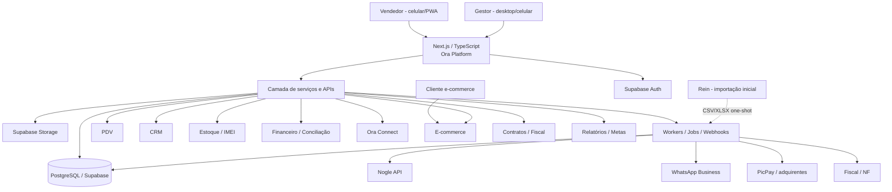
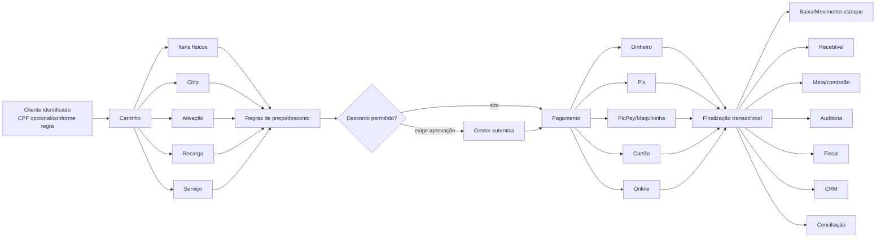

> Relatório extraído integralmente de documento de Pesquisa Aprofundada da Biblioteca. Conteúdo histórico; verificar fatos, preços, normas, integrações e referências antes de implementação.

# Plano mestre de desenvolvimento da plataforma Ora 5G

## Resumo executivo

A plataforma Ora 5G deve ser construída como **um único sistema empresarial modular**, com PostgreSQL/Supabase como fonte central de verdade, uma aplicação web responsiva **mobile-first**, um backend transacional, integrações isoladas por adaptadores e uma trilha de auditoria comum. O objetivo não deve ser criar um “CRM com módulos acoplados depois”, mas um **núcleo operacional único** no qual cliente, vendedor, loja, produto, IMEI, chip, ativação, recarga, serviço, pagamento, desconto, comissão, estoque, financeiro, documento e evento de integração compartilhem os mesmos identificadores e regras.

A decisão mais importante é tratar **cada operação comercial como uma venda ou evento comercial individualmente atribuível**. Isso permitirá que a Ora saiba, para cada vendedor e loja, quantos aparelhos, acessórios, chips, ativações, recargas e serviços foram realizados; quanto foi vendido; quanto foi recebido; por qual meio; quanto houve de desconto; quanto virou comissão; quanto ainda está a receber; quais taxas foram cobradas; e se a operação foi conciliada. Essa estrutura resolve simultaneamente PDV, metas, bonificações, fechamento diário, CRM e gestão financeira.

O Supabase é adequado para o núcleo porque fornece PostgreSQL gerenciado, Auth, Storage e mecanismos de autorização apoiados em Row Level Security. A documentação atual recomenda habilitar RLS e revisar explicitamente grants/policies em todas as tabelas expostas, inclusive testando tanto cenários permitidos quanto negados. citeturn349271search0turn248451search7 Para produção, a recomendação é iniciar no **Supabase Pro**, atualmente a partir de **US$ 25/mês**, com 8 GB de banco incluídos, 100 GB de Storage, 250 GB de egress e backups diários com sete dias de retenção. citeturn248451search2turn248451search4

O sistema deve ser desenvolvido por **Claude Code e Codex como dois engenheiros independentes trabalhando sobre o mesmo repositório**, e não como dois agentes alterando os mesmos arquivos simultaneamente. Claude Code ficará prioritariamente responsável por arquitetura funcional, domínio, banco, segurança e módulos transacionais; Codex por frontend, testes de integração/E2E, automação, observabilidade, revisão independente e implementação de partes delimitadas. Todo PR criado por um deverá, sempre que possível, ser revisado pelo outro. Claude Code suporta execução via CLI e automação em GitHub Actions, enquanto Codex também opera em terminal/IDE/CI e possui integração própria com fluxos de engenharia. citeturn681845search0turn681845search2turn681845search5turn681845search6

A estratégia deve evitar uma promessa tecnicamente irrealista de “nunca mais precisar de migration”. Sistemas em produção evoluem e migrations fazem parte do mecanismo seguro para alterar esquema. O requisito correto é: **modelar o domínio amplamente agora, minimizar alterações destrutivas depois e executar toda mudança futura por migrations versionadas, reversíveis e testadas**. O próprio fluxo recomendado pelo Supabase mantém migrations em código e desaconselha alterações diretas no banco remoto fora do histórico versionado. citeturn349271search1turn349271search5

O resultado do programa de dez meses deve ser uma plataforma que possa substituir gradualmente sistemas isolados e operar as 14 lojas da Ora 5G sem dependência operacional da Rein. A Rein continuará somente como fonte de **importação inicial**, preferencialmente CSV/Excel. A API oficial da Rein existe e expõe produtos, tabelas de preço, pessoas, condições de pagamento, canais, categorias, marcas, unidades e pedidos; sua autenticação utiliza SecretKey, ClientId, Database e token HMAC-SHA256 com validade limitada. Entretanto, esses endpoints não devem entrar no caminho crítico diário da Ora. citeturn248451search0turn248451search1

A documentação pública da Nogle é acessível em `docs.nogle.tech`, mas, nesta pesquisa, o conteúdo de endpoints não foi exposto de forma textual/indexável suficiente para confirmar nomes, métodos, scopes e esquema de autenticação. Portanto, **nenhum endpoint Nogle deve ser inventado**. O primeiro sprint de integração deve transformar a documentação/credenciais disponíveis para a Ora em um contrato técnico versionado antes de qualquer código de produção. citeturn677272view0

## Arquitetura, fluxos e modelo de dados

A recomendação é um **monólito modular** em Next.js/TypeScript, com módulos de domínio explicitamente separados. Isso reduz complexidade operacional no estágio atual, mas mantém fronteiras suficientes para que integrações, jobs ou serviços específicos sejam separados futuramente. PostgreSQL permanece a fonte de verdade e Supabase Auth identifica usuários; Edge Functions ou workers server-side executam integrações que exigem segredo. Segredos de produção não devem ser incluídos no código ou no cliente: o Supabase permite armazenar secrets de Edge Functions separadamente e recomenda arquivos locais fora do Git. citeturn349271search2

O fluxo financeiro deve ser separado conceitualmente em **venda, pagamento, recebimento e conciliação**. Uma venda de R$ 1.000 no cartão não significa necessariamente R$ 1.000 recebidos naquele instante, e uma venda de chip ou recarga pode ter valor, custo, comissão e liquidação distintos. Isso exige um ledger operacional em vez de simplesmente guardar `payment_method` na tabela `sales`.

O esquema deve usar UUIDs, timestamps com timezone, chaves estrangeiras, índices adequados e estados explícitos. Campos financeiros devem usar `numeric`, não ponto flutuante. Dados imutáveis de auditoria, preços de venda e movimentos de estoque não devem ser sobrescritos retroativamente.

| Domínio | Tabelas principais | Campos-chave e relações |
|---|---|---|
| Organização | `companies`, `stores`, `departments` | `store.id`, CNPJ, código, endereço, status |
| Identidade | `profiles`, `roles`, `permissions`, `role_permissions`, `user_store_access` | `profile.auth_user_id → auth.users`, loja, papel, status |
| Cliente | `customers`, `customer_addresses`, `customer_contacts`, `customer_consents` | CPF normalizado/único quando aplicável, nome, telefone, e-mail, consentimentos |
| CRM | `leads`, `opportunities`, `crm_tasks`, `customer_interactions`, `campaigns` | cliente, responsável, etapa, origem, próximo contato |
| Catálogo | `products`, `product_variants`, `categories`, `brands`, `price_lists`, `product_prices`, `price_history` | SKU, EAN, categoria, custo, preço, validade |
| Estoque | `stock_locations`, `stock_balances`, `stock_items`, `serial_numbers`, `stock_movements`, `stock_reservations`, `inventory_counts`, `stock_transfers` | loja, SKU, qty, IMEI/serial, origem/destino, motivo |
| Comercial | `sales`, `sale_items`, `sale_status_history` | loja, vendedor, cliente, total bruto/líquido, canal, status |
| Telecom | `telecom_products`, `sim_cards`, `activations`, `recharges`, `connect_lines`, `connect_operations` | ICCID/MSISDN quando aplicável, operador, vendedor, cliente, status Nogle |
| Desconto | `discount_rules`, `discount_budgets`, `discount_requests`, `discount_approvals` | nível vendedor/produto/loja, piso, limite diário/mensal, aprovador |
| Pagamentos | `payments`, `payment_attempts`, `payment_methods`, `payment_providers` | valor, método, adquirente, NSU/ID externo, status |
| Financeiro | `receivables`, `settlements`, `fees`, `reconciliation_batches`, `reconciliation_items`, `cash_sessions`, `cash_movements` | vencimento, bruto, taxa, líquido, liquidação, divergência |
| Meta | `goals`, `goal_metrics`, `commission_rules`, `commission_events`, `bonus_calculations` | vendedor/loja/período, métrica, alvo, atingimento |
| Documentos | `contracts`, `document_templates`, `documents`, `document_signatures`, `fiscal_documents` | cliente/venda, versão, hash, storage path, status fiscal |
| E-commerce | `carts`, `orders`, `order_items`, `shipping`, `web_sessions` | cliente, canal, estoque reservado, pagamento |
| Integrações | `integration_accounts`, `integration_events`, `sync_jobs`, `webhook_events`, `external_references` | provider, idempotency key, payload hash, retry/status |
| Governança | `audit_logs`, `access_events`, `privacy_requests`, `data_retention_jobs` | usuário, ação, entidade, before/after, IP/contexto |

O ponto especialmente importante para a Ora é `sale_items.type`: ele deve representar, por exemplo, `DEVICE`, `ACCESSORY`, `SIM`, `ACTIVATION`, `RECHARGE`, `CONNECT_PLAN`, `SERVICE` e futuros tipos. Assim, uma mesma venda pode conter smartphone + capa + chip + ativação, mas cada item continua mensurável individualmente para estoque, comissão e relatório.

IMEI não deve ser tratado apenas como texto no item da venda. Ele deve existir como entidade de estoque/serial, com ciclo `received → available → reserved → sold → returned/blocked/transferred`, permitindo saber em que loja está, de qual entrada veio, quando saiu e em qual venda foi utilizado.

O caixa precisa de `cash_sessions`: abertura por operador/loja, valor inicial, entradas, retiradas/sangrias, pagamentos em dinheiro, diferenças e fechamento. Pix e cartões devem guardar provedor, referência/NSU, valor bruto, taxas esperadas e valor líquido. O sistema deve aceitar pagamento dividido entre meios diferentes.

## Funcionalidades e integrações externas

O **PDV é o centro operacional**, não uma tela isolada. No celular, o fluxo alvo é: identificar cliente ou continuar conforme política permitida → localizar produto/serviço → confirmar preço → pagamento → concluir. A venda deve ser criada inicialmente como rascunho e só adquirir estado `COMPLETED` após validações de estoque, regras de desconto e confirmação exigida pelo meio de pagamento. Todas as operações críticas devem ser idempotentes para que um duplo toque, refresh ou webhook repetido não gere duas vendas ou duas baixas.

O vendedor deve visualizar suas próprias metas, vendas, chips, ativações, recargas e comissão projetada. Gestores enxergam loja; regional/diretoria enxergam escopos maiores. O fechamento diário precisa diferenciar **quantidade de operações, faturamento bruto, descontos, cancelamentos, recebimentos, taxas e valor líquido**.

O motor de desconto deve utilizar regras versionadas: desconto máximo por produto, categoria, vendedor e função; preço mínimo; orçamento diário/mensal; limites por transação; campanhas; exceções. Acima do limite, a transação fica aguardando aprovação. A autorização deve exigir uma identidade própria do gestor e produzir `discount_request` + `discount_approval` auditáveis; não deve funcionar digitando a senha do gestor no dispositivo do vendedor sem registro independente.

Para PicPay, é importante separar **maquininha física** e API de e-commerce. A documentação pública encontrada do PicPay confirma uma API pública de e-commerce com credenciais próprias e operações de criação/consulta/cancelamento, mas isso não comprova uma API pública equivalente para a maquininha usada atualmente nas lojas. Portanto, no MVP, “PicPay maquininha” deve ser um método de pagamento registrado e conciliável, com NSU/identificador digitado ou importado; integração automática só entra após obtenção de documentação comercial/SmartPOS/TEF específica. citeturn850553search0turn850553search1turn850553search2

| Integração | Uso na Ora | Endpoint/API confirmado | Autenticação / escopo | Decisão |
|---|---|---|---|---|
| Rein | bootstrap de catálogo/preços | `GET /api/v1/produto`, `GET /api/v1/produto/{id}`, `GET /api/v1/tabela-preco`; API também lista categorias, marcas, variações etc. | Headers Token, Database, Timestamp, ClientId; token HMAC-SHA256 assinado com SecretKey | **Não usar no runtime.** Preferir CSV/XLSX; API apenas como referência/fallback de migração autorizado |
| Nogle | linhas, ativações, recargas/serviços Ora Connect | **não confirmado nesta pesquisa** | **não confirmado nesta pesquisa** | Sprint de discovery obrigatório; documentar OpenAPI/Postman, scopes, rate limit, webhooks e sandbox antes de implementar |
| PicPay e-commerce | pagamento online se contratado | criação, consulta e cancelamento documentados | credenciais do lojista; documentação pública cita tokens específicos | Integrar via adapter somente para produto contratado |
| PicPay maquininha | loja física | **não confirmado** | **não confirmado** | MVP registra transação; automação futura após documentação TEF/SmartPOS |
| WhatsApp | CRM, notificações, atendimento | configurar pela API oficial contratada | token/conta empresarial | Isolar em `WhatsAppProvider`; consentimento e templates conforme política aplicável |
| Fiscal | NFC-e/NF-e/NFS-e conforme operação | depende do provedor contratado | depende do provedor | `FiscalProvider` abstrato; definição com contador/provedor antes de produção |

A Rein documenta token com validade máxima de 15 minutos e exige SecretKey, ClientId, Database e HTTPS; a documentação OpenAPI lista também operações de pessoa, condição de pagamento, canal de venda, variação, categoria, marca, unidade, figura fiscal e pedido. citeturn677272view1turn248451search1 Isso é útil para entender os dados legados, mas não justifica acoplar a nova plataforma à Rein.

A importação Rein deve usar staging tables: `import_batches`, `import_rows`, `import_errors` e `import_mappings`. O arquivo é carregado, lido sem alterar produção, normalizado, validado e exibido em preview. Só então um comando de commit cria/atualiza registros. Cada linha deve guardar origem, hash, resultado e ID criado. O importador deve ser repetível sem duplicar dados.

O e-commerce deve consumir o **mesmo catálogo, preço e estoque** do PDV. Um pedido web cria reserva de estoque e só converte em saída após confirmação do pagamento. Nunca deve existir um segundo estoque “do site”.

Contratos e documentos devem ser versões associadas ao cliente/venda/serviço, com hash, timestamp e origem. Arquivos ficam em buckets privados do Storage e são acessados por autorização, não por URL pública permanente.

Para LGPD, a empresa precisará mapear finalidade, hipótese legal, retenção e acesso aos dados; a ANPD destaca papéis de controlador, operador e encarregado e recomenda que avaliações de impacto descrevam dados tratados, metodologia, riscos e medidas mitigadoras. citeturn850553search3turn850553search5turn850553search6 Portanto, o projeto deve incluir inventário de dados, processo para solicitações do titular, política de retenção e registro de acessos desde o primeiro release.

## Divisão de trabalho entre Claude Code e Codex

A colaboração não deve ser “Claude faz metade e Codex faz metade” de maneira fixa. Ela deve ser organizada por **ownership temporário de uma issue/branch**, com revisão cruzada. Isso evita alterações concorrentes e reduz a chance de ambos introduzirem padrões diferentes.

| Área | Claude Code — responsável primário | Codex — responsável primário | Evidência de conclusão |
|---|---|---|---|
| Arquitetura | ADRs, módulos, entidades, contratos | revisão adversarial da arquitetura | ADR aprovado + testes |
| Banco/Supabase | migrations, constraints, triggers, RLS | testes RLS, revisão SQL, performance | `supabase db reset` + testes |
| Auth/RBAC | políticas e backend | UI e testes negativos | matriz de permissão testada |
| CRM | domínio, services, API | telas e E2E | fluxo lead→cliente |
| Produtos/preços | domínio e importador | UI/admin, testes CSV/XLSX | import replayable |
| Estoque/IMEI | transações, serial tracking | UI inventário/transferências | zero estoque negativo indevido |
| PDV | state machine e checkout backend | interface mobile-first | E2E venda completa |
| Descontos | rule engine/aprovação | telas de solicitação/aprovação | cenários limite |
| Pagamentos | ledger, adapters, idempotência | UX + mocks + reconciliação E2E | retries sem duplicidade |
| Financeiro | receivíveis, liquidação, fees | dashboards e reconciliação | fechamento reproduzível |
| Nogle | contrato/adapters | simuladores, contract tests | sandbox homologado |
| E-commerce | serviços, reserva/estoque | storefront e checkout | pedido ponta a ponta |
| WhatsApp | adapter/webhook | UI CRM e testes | mensagens auditáveis |
| Metas/comissões | motor de cálculo | dashboards | cálculo determinístico |
| Auditoria/LGPD | modelo e políticas | testes de vazamento/permissão | security suite |
| CI/CD | revisão da estratégia | implementação pipelines | pipeline verde |
| Observabilidade | eventos críticos | dashboards/alertas | drill de incidente |

Claude Code pode ser executado interativamente ou programaticamente e suporta controle explícito de ferramentas e modo de permissão; sua documentação também descreve integração com GitHub Actions. citeturn681845search0turn681845search2 Codex está disponível como agente em IDE, CLI e CI/CD e a OpenAI documenta seu uso para escrever, revisar e depurar software. citeturn681845search5turn681845search6

O repositório deverá conter arquivos de governança que ambos os agentes leiam antes de qualquer alteração: `ARCHITECTURE.md`, `DOMAIN.md`, `SECURITY.md`, `DATABASE.md`, `INTEGRATIONS.md`, `TESTING.md`, `AGENTS.md`, `CLAUDE.md`, `DECISIONS/ADR-*`, e a definição de pronto. Nenhum agente pode alterar uma regra estrutural silenciosamente; deve criar ADR.

O fluxo por tarefa será: issue bem definida → branch → implementação → testes locais → PR → revisão pelo segundo agente → correções → CI → aprovação humana para migrations, pagamentos, fiscal, segurança e produção. O objetivo é usar os agentes para aumentar capacidade, não eliminar checkpoints empresariais críticos.

A qualidade mínima deve incluir TypeScript strict, lint, unit tests, integration tests, database tests, contract tests para integrações e Playwright para jornadas essenciais. Cada bug crítico precisa gerar um teste de regressão antes do fechamento.

## Infraestrutura, segurança, CI/CD e continuidade

A estrutura inicial recomendada é `app.ora5g.com.br` para ERP/CRM/PDV, `loja.ora5g.com.br` para e-commerce, `api.ora5g.com.br` somente se houver necessidade de endpoint público separado e `connect.ora5g.com.br` se a experiência Ora Connect justificar um frontend independente. O banco nunca deve receber acesso público irrestrito apenas porque o frontend é web.

Para a fase de desenvolvimento, Supabase Free é suficiente; antes do primeiro piloto real, migrar para Pro. Atualmente o Pro parte de US$ 25/mês, inclui 8 GB de banco e backups diários por sete dias. PITR é um adicional separado; a página de preços mostra US$ 100/mês por sete dias de retenção e a documentação exige pelo menos compute Small quando PITR está ativo. citeturn248451search4turn248451search5 Para uma operação financeira com 14 lojas, minha recomendação é ativar PITR quando o PDV se tornar produção crítica, além de backup lógico periódico externo.

Para hospedar Next.js e workers em VPS, um ponto de partida prudente é **2 vCPU/4 GB RAM** para piloto e **2–4 vCPU/8 GB RAM** quando as 14 lojas estiverem ativas, medindo CPU, RAM, latência e filas antes de escalar. Como referência atual, o Lightsail publica instâncias Linux de 4 GB/2 vCPU por US$ 24/mês e 8 GB/2 vCPU por US$ 44/mês, e desde junho de 2026 o serviço está disponível na região São Paulo. citeturn469120search2turn469120search6 Esses valores são referência de mercado, não obrigação de usar AWS.

O pipeline deverá ser:

Supabase permite ambientes de branch isolados e preview branches; por padrão eles não recebem dados de produção, reduzindo a exposição de dados sensíveis durante testes. citeturn349271search3 Para mudanças de banco, todas as migrations devem executar primeiro em ambiente local descartável, depois staging e somente depois produção. A documentação oficial recomenda manter schema e migrations no repositório e aplicar mudanças remotas através desse histórico. citeturn349271search1turn349271search4

A matriz de segurança deve implementar MFA para gestores/administradores, RLS por loja/função, least privilege, `service_role` somente server-side, rotação de credenciais, CSP/headers seguros, rate limiting em endpoints sensíveis, validação de payload, anti-CSRF quando aplicável, proteção de webhooks por assinatura, idempotency keys, log de mudanças críticas, criptografia em trânsito, buckets privados e sessões curtas para funções privilegiadas. O Supabase destaca que `service_role` ignora RLS e deve permanecer no servidor. citeturn349271search0

Segredos como Nogle, PicPay, WhatsApp, SMTP ou fiscal nunca entram em `NEXT_PUBLIC_*`, Git, prompts ou screenshots. O Supabase fornece gerenciamento específico de secrets para Edge Functions e orienta que arquivos `.env` locais fiquem fora do versionamento. citeturn349271search2

O plano de contingência exige deploy versionado, feature flags para integrações arriscadas, backup pré-migration para mudanças de alto impacto, migrations forward-compatible e rollback de aplicação independente do banco. Mudanças destrutivas devem seguir expand/contract: criar campo/tabela nova → aplicação passa a preencher ambos → backfill → leitura muda → somente release posterior remove legado.

Para incidentes de loja, o sistema mobile pode preservar carrinhos/rascunhos localmente, mas **não deve marcar pagamento, baixar estoque ou emitir documento fiscal offline sem uma estratégia fiscal e financeira formalmente homologada**. Em falha de internet, o objetivo é manter dados não financeiros temporários e retomar a operação quando reconectado.

## Roadmap de dez meses e entregáveis

O cronograma abaixo assume sprints de duas semanas, aproximadamente vinte sprints. O MVP operacional não deve esperar dez meses: a meta é ter um piloto interno entre o quarto e quinto mês e transformar isso progressivamente em produção robusta.

| Período | Sprints | Entregáveis principais | Marco |
|---|---:|---|---|
| Mês 1 | 1–2 | monorepo/app, Supabase local, CI, Auth, RBAC, lojas, ADRs, schema base, catálogo de integrações Nogle/Rein | fundação congelada v1 |
| Mês 2 | 3–4 | clientes/CRM, produtos, categorias, preços, import CSV/XLSX, staging/import audit | dados mestres funcionais |
| Mês 3 | 5–6 | estoque por loja, IMEI/serial, entrada, transferência, inventário, reservas | estoque confiável |
| Mês 4 | 7–8 | PDV mobile/desktop, carrinho, venda, dinheiro/Pix/maquininha/cartão registrados, caixa | MVP PDV |
| Mês 5 | 9–10 | desconto/aprovação, receivíveis, taxas, reconciliação, metas/comissões básicas, fiscal adapter | piloto em uma loja |
| Mês 6 | 11–12 | Nogle homologada, chips, linhas, ativações, recargas, Ora Connect, contract tests | telecom integrado |
| Mês 7 | 13–14 | e-commerce, reservas, pagamentos online, contratos/docs, fiscal completo conforme provedor | omnichannel |
| Mês 8 | 15–16 | WhatsApp/CRM automações, dashboards, comissão avançada, relatórios financeiros | gestão consolidada |
| Mês 9 | 17–18 | hardening, LGPD, performance, backups/PITR, disaster drill, observabilidade, pentest/review | release candidate |
| Mês 10 | 19–20 | rollout 3→7→14 lojas, treinamento, suporte, tuning, documentação, handover | produção integral |

O **MVP obrigatório** termina somente quando cadastro de cliente, catálogo, preço, estoque, IMEI, venda, vendedor, loja, métodos de pagamento, desconto, caixa, auditoria e relatório diário estiverem ligados ao mesmo modelo transacional. Não faz sentido chamar uma tela de checkout de MVP se ela ainda depender de planilhas para fechamento diário.

Cada sprint deve sair com software utilizável. Nenhum sprint termina apenas com “código escrito”; exige migration, testes, documentação, observabilidade relevante e critérios de aceitação.

| Marco | Critério de aceite |
|---|---|
| Fundação | usuário de loja A não consegue ler/escrever dados restritos da loja B |
| Catálogo/import | mesmo arquivo importado duas vezes não duplica produtos |
| Estoque | todo movimento possui origem, destino/motivo e ator; IMEI único |
| PDV | venda completa no celular sem necessidade de desktop |
| Pagamento | retry/webhook duplicado não duplica recebimento |
| Desconto | vendedor não consegue ultrapassar limite sem aprovação registrada |
| Financeiro | valor bruto = descontos + recebíveis/recebimentos conforme regra contábil operacional |
| Telecom | ativação/recarga vinculada a venda, loja, vendedor e resposta externa |
| Comissão | reprocessamento do mesmo período gera o mesmo resultado |
| E-commerce | pedido pago reserva/baixa o mesmo estoque usado pelo PDV |
| Auditoria | alterações críticas mostram ator, data e mudança |
| Backup | restore é executado em ambiente de teste e comprovado |
| Rollout | piloto fecha caixa e estoque por período acordado sem divergência crítica |

## Custos, KPIs, riscos e definição de “projeto completo”

Os preços de ferramentas de IA mudam, portanto precisam ser tratados como custo operacional revisável. Atualmente Anthropic publica Claude Pro a US$ 20/mês e Max a partir de US$ 100/mês; a OpenAI publica Codex incluído em planos compatíveis, com Plus a US$ 20/mês e Pro a US$ 100/mês na página atual do produto. citeturn469120search0turn469120search1turn681845search3 Para desenvolvimento intensivo, os planos básicos podem atingir limites rapidamente; portanto, deve haver orçamento para tiers maiores ou uso medido.

A tabela abaixo é uma **estimativa de planejamento**, não uma cotação. Para facilitar orçamento interno, valores em reais usam um câmbio de planejamento arredondado de **R$ 5,50/US$**, e não uma taxa cambial atual.

| Item | Desenvolvimento/piloto | Produção 14 lojas |
|---|---:|---:|
| Supabase | Free → Pro US$ 25 | US$ 25+ |
| PITR | dispensável antes de produção | + US$ 100/mês + compute compatível, se adotado |
| VPS 4 GB referência | ~US$ 24/mês | — |
| VPS 8 GB referência | — | ~US$ 44/mês |
| Claude Code | US$ 20–200/mês conforme uso | uso de engenharia |
| Codex | US$ 20–100+ conforme plano | uso de engenharia |
| Domínio | já existente | já existente |
| Monitoramento | free/baixo custo inicialmente | R$ 0–500+ |
| E-mail/SMS/WhatsApp | variável | conforme volume/provider |
| Fiscal | variável | conforme provedor/documentos |
| PicPay/adquirência | taxas comerciais | taxas comerciais |
| Auditoria especializada | R$ 3 mil–10 mil por etapa | conforme necessidade |
| Revisão fiscal/LGPD/security | R$ 5 mil–25 mil ao longo do projeto | manutenção periódica |

Com AI realizando grande parte da implementação e o proprietário coordenando o produto, uma reserva realista para **serviços especializados externos** ao longo dos dez meses seria R$ 20 mil–60 mil para revisão de segurança, fiscal, UX crítica, infraestrutura e validação. Um modelo híbrido com engenheiros/consultores assumindo partes do desenvolvimento tende a ficar na faixa de R$ 80 mil–200 mil. Esses valores são estimativas de projeto, não preços de mercado garantidos.

Os KPIs de engenharia e operação devem ser definidos antes do piloto. Sugestão de metas internas: disponibilidade do PDV ≥99,9% durante horário comercial após estabilização; zero venda duplicada por retry; zero IMEI vendido duas vezes; 100% dos descontos fora de regra com aprovação registrada; 100% dos pagamentos conciliáveis por lote; divergência de estoque mensurada diariamente; p95 das interações comuns do PDV abaixo de dois segundos em condições normais; fechamento diário reproduzível; 100% dos acessos privilegiados auditáveis; restore de backup testado mensalmente; e taxa de testes E2E de sucesso acima de 99% no pipeline de release.

Os KPIs comerciais devem incluir faturamento e quantidade por vendedor/loja/categoria; ticket médio; aparelhos; acessórios; chips; ativações; recargas; serviços; margem; desconto médio; conversão; comissão; atingimento de meta; recebíveis; taxa de conciliação; divergências; estoque parado; giro; cancelamentos; chargebacks e retorno de clientes. Como tudo deriva dos mesmos eventos comerciais, o painel do gestor não precisará reconciliar manualmente números vindos de sistemas diferentes.

O maior risco técnico é tratar integrações externas como se fossem estáveis e conhecidas antes da homologação. A Nogle deve ser protegida por adapter, fila, idempotência, retry com backoff e registro de request/response sanitizado. Rein não deve ter papel operacional. PicPay maquininha não deve ser confundida com a API pública de e-commerce. Fiscal deve ser desacoplado do checkout por uma interface, embora a venda só avance para estados definidos pela política fiscal da Ora.

O maior risco de gestão é permitir que Claude Code e Codex “desenvolvam livremente” sem backlog, arquitetura e revisão. Agentes conseguem escrever e revisar código, mas o controle de domínio, acesso a produção, migrations, segredos e critérios de aceite precisa permanecer disciplinado. As capacidades atuais de ambos suportam workflows reais de engenharia, inclusive terminal, IDE e CI, mas isso não elimina a necessidade de testes e governança. citeturn681845search0turn681845search5turn681845search6

**“Projeto completo” deverá significar:** todas as jornadas de negócio definidas possuem implementação, teste, autorização, auditoria, documentação, monitoramento, backup e procedimento de recuperação; nenhuma operação principal depende de planilha ou da Rein; todos os módulos usam o mesmo cadastro de cliente, produto, loja e vendedor; todo dinheiro vendido pode ser rastreado até pagamento/recebível/conciliação; todo item físico pode ser rastreado até estoque e venda; toda ativação, chip ou recarga pode ser atribuída a vendedor e loja; e cada release pode ser reconstruído a partir do Git e das migrations.

Esse critério é mais importante do que tentar congelar o banco hoje. A arquitetura deve ser desenhada agora para evitar reescritas, mas **migrations futuras serão parte normal e controlada da vida da plataforma**. Supabase oferece exatamente esse fluxo de migrations versionadas e ambientes isolados para testar mudanças antes de produção. citeturn349271search1turn349271search3

A decisão recomendada ao término deste planejamento é começar pelo **Sprint de Fundação**, mas com uma regra: antes de Claude Code ou Codex criarem dezenas de telas, eles devem produzir e versionar o modelo de domínio, ADRs, migrations-base, matriz RBAC, estados das entidades, contratos das integrações e suíte inicial de testes. Isso reduz drasticamente o risco de chegar ao sexto mês com um CRM bonito, porém incapaz de sustentar estoque, financeiro, telecom e PDV de forma coerente.
