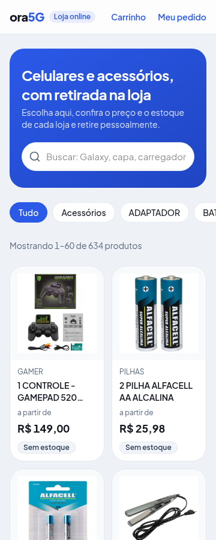
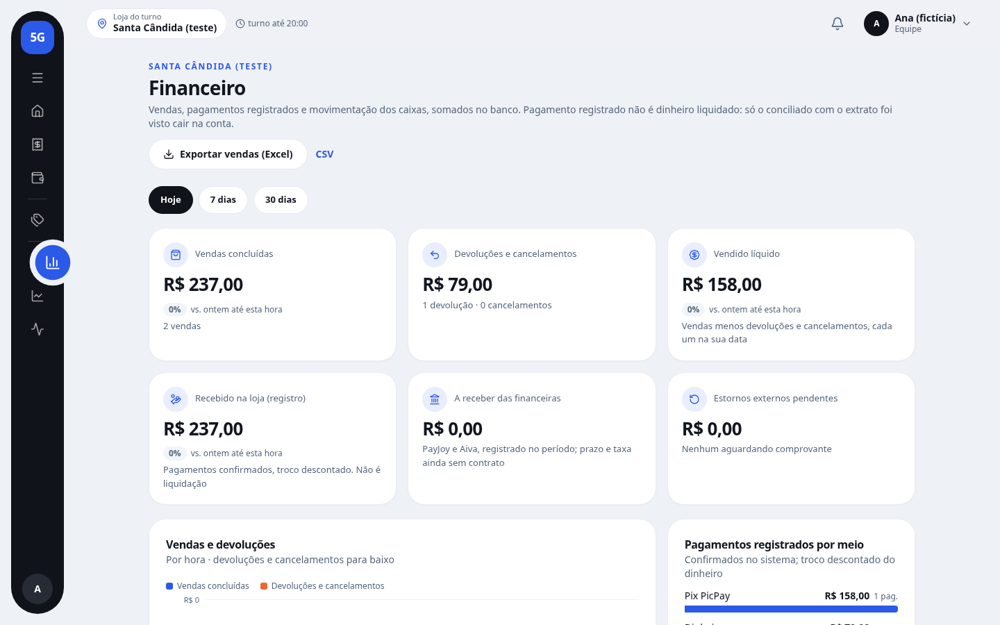
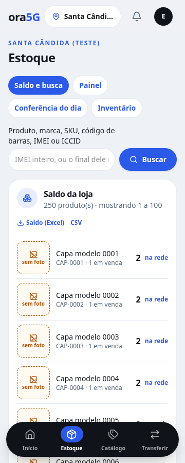

# Composição visual e navegação

## O que preservar

A identidade azul, o cabeçalho com loja/turno, os componentes compartilhados, os cartões e as mensagens de erro já formam uma base coerente. Os gráficos existem no código real (`componentes/graficos.tsx`, `paineis-de-vendas.tsx`, Financeiro, Resultado e Previsão); o objetivo é torná-los encontráveis e sustentados por dados, não criar outro conjunto de gráficos fictícios.

A inspeção local de seis telas em 360 e 1.440 px não encontrou extravasamento horizontal do documento. A inspeção pública também não registrou erros JavaScript nas rotas examinadas. Isso não certifica todos os estados responsivos, teclado, leitor de tela ou sessão privada.

## Hierarquia proposta

1. Cabeçalho persistente: loja de operação, turno, pesquisa quando apropriada, alertas e conta. Distinguir filtro de consulta de troca efetiva da loja do turno.
2. Menu com nomes legíveis e agrupamento por tarefa. O menu atual oferece 31 entradas ao dono, 25 ao gerente e 14 ao vendedor nas fixtures de permissão. O menu móvel do dono deixa 27 entradas em “Mais”; Financeiro não está entre seus quatro atalhos iniciais.
3. Título curto + filtros + uma ação principal. Ações destrutivas e ajustes ficam nos detalhes com confirmação específica.
4. Resumo de até quatro indicadores prioritários; gráficos e listas abaixo. Detalhes técnicos de cálculo em “Como calculamos”.
5. Página ampla para listas/dashboards; formulários com largura controlada. Hoje estoque, produtos e PDV usam aproximadamente 768 px no desktop de 1.440 px, enquanto Financeiro usa 1.152 px.
6. Estados consistentes: carregando, vazio, sem permissão, falha, sucesso e resultado desconhecido. Falha de banco não vira zero.

## Telas que podem compartilhar uma área

| Área | Rotas atuais representativas | Apresentação proposta | Regra preservada |
|---|---|---|---|
| Vendas | `/vender`, `/vendas`, `/vendas/[id]`, `/reservas-do-site`, `/caixa` | Nova venda, vendas, pedidos do site; caixa acessível no PDV | Pedido reservado ≠ venda concluída; recebido ≠ liquidado |
| Produtos e estoque | `/catalogo`, `/produtos`, `/produtos/precos`, `/catalogo/lote`, `/estoque`, `/transferencias` | Pesquisa única; detalhe com Dados, Fotos, Preço, Por loja e Movimentos; abas de transferências/inventário/entradas | Custo e edição por permissão; DEFEITOS não vende; IMEI individual |
| Financeiro | `/financeiro`, `/resultado`, `/previsao`, `/contas-a-pagar`, `/pagamentos/recebiveis`, `/pagamentos/financeiras`, `/pagamentos/conciliacao`, `/pagamentos/extratos`, `/pagamentos/depositos` | Visão geral, A receber, A pagar, Conciliação, Resultado, Previsão; filtros de período/loja compartilhados | Liquidação, taxas, repasse e estorno são eventos distintos |
| Clientes | `/clientes`, detalhes/cadastro, `/crm`, `/crm/agenda` | Lista e ficha únicas; abas Histórico, Oportunidades e Agenda | WhatsApp e nome no cadastro rápido; e-mail opcional; dados fiscais quando necessários |
| Pendências | `/aprovacoes`, `/operacao`, alertas fiscais/transferências/caixa | Caixa de trabalho com tipo, idade, loja, responsável e ação que abre a tela correta | Cada ação mantém sua autorização e sua transação |
| Canais | Loja online, reservas, marketplaces e anúncios acessíveis nas telas atuais | Resumo por canal com pedidos, importações, repasses e situação da conexão | Importação de arquivo não é API; Meta Ads não é catálogo de comércio |
| Administração | `/lojas`, `/equipe`, `/pagamentos/maquininhas`, contas bancárias, auditoria e entregas | Configurações agrupadas; documentação fora da rotina do vendedor | Configurar não concede permissão operacional |

Ora Connect, Assistência e Metas permanecem áreas reconhecíveis. Não transformar telecom em uma aba genérica de pagamento, nem misturar o fornecedor oficial Nogle com o Pix de varejo Asaas. Links antigos continuam funcionando; primeiro alterar agrupamento e links, depois considerar redirecionamentos.

## Prioridades visuais por jornada

**Estoque:** produto com foto, nome completo e código; filtro de loja explícito; números Físico, Reservado, Disponível e Em trânsito. Clicar no produto mostra as 11 lojas e DEFEITOS em bloco separado. O teste com 100 linhas produziu cerca de 8.810 px no celular: usar busca visível, filtros e paginação confortável, antes de adicionar virtualização. O link “na rede” mede cerca de 16 px de altura: ampliar a área clicável e testar o foco, sem afirmar violação WCAG só pela altura, pois há exceções por espaçamento.

**Transferência:** pendentes antes de concluídas, busca por número, origem/destino, quantidade e próximo passo. Mostrar quando a disponibilidade diminui e quando o físico sai. Divergência e DEFEITOS têm justificativa/auditoria. A prioridade funcional é F24-01.

**PDV:** sequência Produto → Cliente → Pagamento → Conclusão; carrinho e total visíveis no celular, sem encobrir teclado ou botões. Reutilizar a venda em andamento, não introduzir cópia local concorrente do estado. Caixa e descontos permanecem próximos da operação.

**Financeiro:** levar Financeiro ao acesso principal do dono; visão inicial com vendido líquido, recebido registrado, liquidado e a receber, com nomenclatura consistente. Gráficos de vendas/recebimentos e despesas por período, comparação e detalhamento com o mesmo filtro. Não chamar faturamento de saldo bancário, nem previsão de dinheiro disponível. Na captura móvel o resumo ocupa grande parte da rolagem; reduzir texto repetido e permitir abrir a explicação de cada indicador.

**Produtos:** separar formulário de produto das configurações de marcas/categorias, manter vínculo numa área única. Não exigir que o vendedor conheça a distinção técnica entre cadastro de produto, catálogo e variação para localizar disponibilidade.

**Loja pública:** a vitrine atual já mostra produtos/fotos, carrinho e paginação. Priorizar nomes e categorias compreensíveis ao público, detalhes suficientes para distinguir modelos, estado comercial honesto e pedido recuperável. Conservar o caminho único de carrinho do ONLINE-e. Conferir categoria/variação da foto antes de declarar cobertura integral.

**Menu móvel:** sugestão inicial para teste: vendedor Início/Vender/Produtos/Vendas/Mais; gerente Início/Vender/Pendências/Estoque/Mais; dono Início/Financeiro/Pendências/Vendas/Mais. A seleção exata é proposta de usabilidade, não decisão já aprovada. No desktop, rótulos fixos para a gestão e modo compacto opcional.

## Aceite visual objetivo

- Em 360, 390, 768 e 1.440 px: sem corte de ação principal ou rolagem horizontal da página; tabelas podem ter contêiner próprio identificado.
- Navegação por teclado com foco visível e retorno correto ao fechar diálogo; nome acessível em ícones e avisos anunciados.
- Todas as operações principais com texto de ação compatível com o efeito real e feedback de envio/resultado.
- A mesma busca/filtro permanece ao abrir detalhe e voltar.
- Contraste verificado por ferramenta, não deduzido só de captura; gráficos com legenda textual/tabela alternativa e distinção que não dependa apenas de cor.
- Capturas antes/depois com o mesmo perfil, loja, período e dados de teste. Medir passos e tempo nas três tarefas: encontrar produto em outra loja, receber transferência, conferir caixa.

Nos cinco dias, executar primeiro agrupamentos de menu e correções de contexto. A fusão de todas as telas num componente novo é uma expansão desnecessária do risco.

## Capturas de referência

Vitrine pública observada em 24/11, corte `003421d`, 360 px:

Financeiro: componente real no corte `947a391`, renderização local com dados fictícios; não é captura autenticada do domínio:

Estoque: componente real com fixture de lista longa, corte `947a391`, renderização local:

